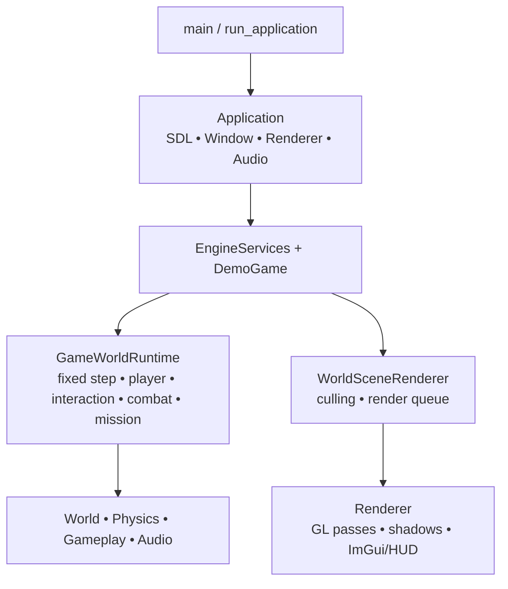

# Технический аудит RelayCore

Дата аудита: 2026-07-26  
Объект: `RelayCore-dev.zip`  
SHA-256 архива: `b621c696e955068020b801cc5916a2fc1f34b8942161bc95e9c46f438f1ba521`  
Комментарий ZIP: `5cb990d972ec486493863538769cbc1b33a71618`

## Аудиторская база и ограничения

Архив прочитан целиком и успешно проверен командой `unzip -t`: ошибок сжатых данных нет. Изучены все исходники, заголовки, CMake-файлы и presets, CI, тесты, TOML-контент, GLSL, скрипты, README, `AGENTS.MD` и vendored glad. Исходники проекта не изменялись, diff не создавался.

В архиве нет `.git`, поэтому история коммитов, авторство отдельных изменений и фактическая дата последней разработки недоступны. Все 209 файлов получили одну и ту же отметку времени экспорта `2026-07-26 13:55:52`; это не доказательство времени их разработки. Комментарий ZIP содержит SHA коммита, но без истории по нему нельзя установить, когда и почему снимок стал неполным. Указанный владельцем перерыв около трёх месяцев принят как контекст, но архивом независимо не подтверждается.

Полноценная сборка в доступной среде не состоялась:

| Проверка | Результат |
|---|---|
| `cmake --version` | Не запущено: `cmake: command not found` |
| `cmake --list-presets=all` | Не запущено: CMake отсутствует |
| `cmake --preset msvc-debug` | Не запущено: CMake отсутствует |
| Windows 11 / MSVC / vcpkg | В среде отсутствуют |
| Ninja, CTest, clang-tidy, cppcheck, Doxygen, PowerShell | В среде отсутствуют |
| Доступный компилятор | GCC 13.3, но без SDL3, GLM и остальных зависимостей |

Это ограничивает динамическую проверку, но не меняет основной вывод о сборке: статически доказано, что предоставленный снимок не может сконфигурироваться и скомпилироваться даже в ожидаемой Windows-среде, потому что в нём отсутствуют девять требуемых файлов.

## Инвентаризация

| Метрика | Фактическое значение |
|---|---:|
| Файлы | 209 |
| Каталоги, включая корень | 32 |
| Распакованный объём | 2 506 994 байта |
| `.cpp` | 83 |
| `.h` | 70 |
| `.c` | 1 |
| GLSL/vertex/fragment shader-файлы | 19 |
| TOML | 5 |
| WAV | 5 |
| BMP | 1 |
| C++-строки в `.cpp` | 26 554 |
| Строки в `.h` | 9 809 |
| Строки vendored C | 1 620 |
| Обнаруженные `TEST_CASE` | 160 |
| Вхождения doctest assertion-макросов | 1 214 |

Распределение основного кода:

| Область | Файлы | Строки релевантного кода/данных | Назначение |
|---|---:|---:|---|
| `src/relaycore/app` | 11 | 897 | Bootstrap, frame timer, services, app delegate |
| `src/relaycore/audio` | 3 | 458 | miniaudio engine, loop/fade/one-shot |
| `src/relaycore/core` | 10 | 1 195 | Config, paths, logging, profiling, spatial index |
| `src/relaycore/debug` | 16 | 2 586 | ImGui, inspector, source navigation |
| `src/relaycore/gameplay` | 14 | 4 167 | Doors, triggers, interactions, mission, combat, snapshots |
| `src/relaycore/physics` | 4 | 727 | AABB collision and player motion |
| `src/relaycore/platform` | 4 | 386 | SDL lifetime, window, GL context |
| `src/relaycore/render` | 27 | 5 894 | Renderer, shaders, meshes, atlas, camera, HUD |
| `src/relaycore/world` | 15 | 2 467 | TOML blockout loader and validation |
| `src/relaygame` | 28 | 6 360 | Demo integration, runtime, player, scene rendering |
| `tests` | 21 | 7 278 | Unit and shipped-content validation |
| `assets` | 30 | 2 081 текстовая строка | Config, three levels, shaders, texture, audio |

Главные цели CMake:

| Target | Тип | Назначение |
|---|---|---|
| `relaycore_engine` | Static library | Engine/runtime |
| `relaycore_demo` (`RelayCore.exe`) | Executable | Текущий FPS slice |
| `relaycore_tests` | Executable | 151 unit/integration test cases по исходникам |
| `relaycore_content_validation` | Executable | 9 shipped-content/acceptance cases |
| `relaycore_demo_assets` | Custom `ALL` target | Копирование `assets` |

Зависимости:

| Зависимость | Источник/фиксация в архиве | Фактическое использование |
|---|---|---|
| SDL3 | vcpkg baseline `a9f0cd…` | Window, events, filesystem, BMP surface, clipboard |
| OpenGL 4.6 Core | Системный API | Renderer |
| glad 2.0.8 | Vendored source/header | Загрузка OpenGL |
| GLM | vcpkg | Math, transforms, geometry |
| spdlog | vcpkg | Console/file logging |
| Dear ImGui | vcpkg, SDL3/OpenGL3 bindings | Diagnostics and game HUD |
| toml++ | vcpkg headers | Engine/render/level authoring |
| miniaudio | vcpkg header | Реальная audio subsystem |
| doctest | vcpkg headers | Unit/content tests |
| Tracy | vcpkg | Conditional CPU/GPU instrumentation |

Точные версии vcpkg-портов не записаны непосредственно в снимке; сохранён baseline реестра, по которому они должны разрешаться. Точная версия доказана только для vendored glad из его generated header.

# 1. Краткий вердикт

RelayCore в предоставленном виде — содержательный, но структурно незавершённый снимок проекта. Это не пустой набор с убедительными именами: в коде есть реальные подсистемы, явное владение, fixed-step simulation, контентная валидация, runtime snapshots, collision, gameplay и большой набор осмысленных тестов. Одновременно архив оборван посередине разбиения исходников: отсутствуют девять файлов, включая реализацию центрального `GameWorldRuntime::update`, шаблонную часть level loader и acceptance harness.

Прямые ответы:

- Сборка: **нет, снимок гарантированно не собирается**. Реальную команду CMake выполнить в текущей среде нельзя, но CMake и `#include` ссылаются на отсутствующие файлы.
- Запуск: **не выполнен и для этого снимка невозможен до P0-восстановления**.
- Поддерживаемость сохранившейся части: **средняя**. Локальные подсистемы часто читаемы и протестированы; интеграционный слой и debug/iteration tooling чрезмерно широки.
- Риск продолжить без очистки: **высокий**. Любая новая функция сейчас будет строиться поверх неизвестного базового состояния, сломанной упаковки ресурсов и непроверенного runtime.
- Смысл возобновления: **не как основного движка в текущем масштабе**. Смысл есть как в источнике отдельных учебных подсистем и как в ограниченном упражнении по восстановлению.
- Итоговое решение: **C — заморозить, но использовать отдельные подсистемы для изучения**. Условно допустим короткий P0-эксперимент по восстановлению исходного коммита; он не равен возобновлению feature-разработки.

Critical-дефектов, связанных с безопасностью данных или удалённой эксплуатацией, не найдено. Найдены два High build/correctness blocker, тринадцать Medium и семь Low/Note замечаний.

# 2. Паспорт проекта

| Параметр | Фактическое состояние |
|---|---|
| Язык и стандарт | C++20; vendored glad на C11 |
| Заявленная платформа | Windows 11, Visual Studio 2022/MSVC |
| Реальная платформенная матрица | Только Windows preset/CI; `vcpkg.json` содержит `supports: windows`; Linux не заявлен и не проверен |
| Система сборки | CMake, Ninja presets, vcpkg manifest |
| Версия проекта | `0.1.0` |
| Зависимости | SDL3, OpenGL 4.6, glad, GLM, spdlog, ImGui, toml++, miniaudio, doctest, Tracy |
| Основные подсистемы | App/platform, renderer, world authoring, physics, interaction, combat, mission, audio, debug UI |
| Тесты | 160 test cases и 1 214 assertion-макросов в исходниках; фактически не запущены |
| CI | Windows 2022: format-check и один MSVC Debug workflow |
| Sanitizers | MSVC/generic ASan presets есть; в CI не запускаются |
| Статический анализ | `.clang-tidy` и `/analyze` option есть; автоматического запуска нет |
| Документация | README, 630-строчный `AGENTS.MD`, Doxyfile; generated docs отсутствуют |
| Последняя активность | По архиву не устанавливается; есть только ZIP SHA и единое время экспорта |
| Статус сборки | Невозможна из снимка: девять файлов отсутствуют |
| Статус запуска | Не запускался; до восстановления сборки недостижим |
| Packaging/install | Install/CPack target отсутствует; копирование DLL и assets только в build tree |
| Лицензирование | Manifest заявляет MIT; корневого `LICENSE` и набора third-party notices нет |

Фактический поток выполнения:

Владение в нормальном пути в основном явно:

| Владелец | Что держит | Оценка |
|---|---|---|
| `Application` | `AppDelegate`, SDL guard, config, window/context, renderer, audio | Порядок разрушения корректен: audio → renderer → window → SDL |
| `Renderer` | Shader/mesh/texture RAII, ImGui, diagnostics; raw shadow FBO/textures | Почти корректно, но shadow handles выбиваются из модели |
| `DemoGame` | `GameWorldRuntime`, `WorldSceneRenderer`, iteration state | Явное владение значениями |
| `GameWorldRuntime` | Level/runtime vectors, player, registries, mission/combat/audio state | Нет глобального service locator, но слишком широкая ответственность |
| `EngineServices` | Невладеющие ссылки на config/window/renderer/audio/running flag | Нормальный узкий facade, lifetime задаёт `Application` |

# 3. Оценка по категориям

Оценки относятся к предоставленному снимку, а не к предполагаемой более полной версии проекта.

| Категория | Оценка | Обоснование |
|---|---:|---|
| Корректность | 4/10 | Центр runtime отсутствует; есть подтверждённые trigger/path/lifetime дефекты, динамическая проверка невозможна |
| Архитектура | 6/10 | Engine/game split и ownership понятны, но `GameWorldRuntime` и iteration tooling стали центрами высокой связанности |
| Качество C++ | 7/10 | Хорошее применение RAII, move-only и `span`; есть raw GL lifetime, ошибочный `noexcept` и лишняя абстракция |
| Управление ресурсами | 6/10 | Большинство объектов корректно освобождаются; shadow objects и shader failure path нарушают общую модель |
| Рендеринг | 6/10 | Реальные passes, culling, lighting, shadows и diagnostics; нет запуска, sRGB и полной exception safety |
| Производительность | 6/10 | Есть culling, spatial indices, reserve и Tracy; есть вероятные frame allocations/over-instrumentation, измерений нет |
| Тестируемость | 7/10 | 160 содержательных cases, включая acceptance; монолитная линковка и отсутствующие файлы блокируют весь набор |
| Воспроизводимость сборки | 3/10 | Baseline vcpkg полезен, но snapshot неполон, docs/presets расходятся, assets/log paths привязаны к source tree |
| Документация | 4/10 | README и Doxyfile есть, но команды частично неверны, controls/state/recovery map отсутствуют |
| Возвращение после перерыва | 3/10 | Нельзя начать с green build; нет checkpoint/status; центральные файлы отсутствуют |
| Учебный проект | 7/10 | Fixed loop, collision, RAII, level validation и tests пригодны для отдельного разбора |
| Основа дальнейшего движка | 4/10 | Возможна только после восстановления и сокращения scope; сейчас продолжать feature work нельзя |

## Архитектура и цикл

Хорошая базовая граница проходит между `relaycore_engine` и `relaygame`. `Application` управляет lifetime, `AppDelegate` изолирует игру, `EngineServices` не владеет ресурсами. `FrameTimer` ограничивает frame delta до 100 мс. `FixedSimulationLoop` работает с шагом 1/120 с и максимум восемью шагами за frame; backlog ограничивается бюджетом, поэтому spiral of death предотвращён ценой осознанного отбрасывания лишнего времени.

Главная архитектурная проблема — не количество классов, а концентрация поведения в `GameWorldRuntime`: в одном состоянии соединены player motion, triggers, usables, doors, mission, combat, runtime registry, snapshots, audio feedback, HUD/inspector diagnostics и iteration commands. Разбиение реализации по `.cpp` уменьшает размер файлов, но не зависимость подсистем друг от друга. Отсутствующий `game_world_runtime_update.cpp` делает эту концентрацию ещё опаснее: это был orchestration seam, без которого невозможно проверить порядок frame/fixed-step операций.

## OpenGL, математика и камера

Подтверждённые корректные решения:

- Vertex layout locations 0–3 совпадают с GLSL.
- `view_projection = projection * view`.
- Normal transform использует inverse-transpose model matrix.
- Frustum planes извлекаются из view-projection, AABB culling применяется до постановки chunk в очередь.
- Transparent blockout chunks сортируются far-to-near.
- Render state явно переключается для opaque/overlay/transparent.
- Две shadow cascades имеют отдельные FBO/depth maps и возвращают framebuffer/viewport/state после нормального прохода.
- GL debug context и callback включаются в Debug.

Ограничения: нет runtime-подтверждения shader compilation, driver compatibility и визуальной корректности. `inverse(u_model)` вычисляется в vertex shader для каждой вершины, хотя normal matrix постоянна для draw; это место для профиля, а не доказанный bottleneck. Цветовой pipeline работает через `GL_RGBA8` без framebuffer sRGB.

## Gameplay и физика

Сохранившаяся логика не фиктивна: doors имеют toggle/open-only policy и защиту от закрытия через игрока; interaction использует spatial index; combat учитывает static geometry/doors, turrets и hazards; mission шагает по typed objectives; runtime snapshot восстанавливается транзакционно через staged copies и registry signature.

Horizontal motion дробится на подшаги и тестирует thin-wall tunneling. Vertical axis остаётся одним дискретным перемещением. Trigger semantics для `once=false` неполны: такой trigger применяется каждый fixed tick внутри объёма, что для toggle-door означает смену направления до 120 раз в секунду.

## Ресурсы, config, logging, debug и audio

Runtime сначала ищет `assets` рядом с executable, затем молча откатывается к абсолютному source path, вшитому CMake. Это удобно только на исходной dev-машине и маскирует ошибку копирования assets. Logger ещё сильнее связан с source tree: относительный `logs` разрешается через build-time `RELAYCORE_ASSET_DIR`.

Render authoring config и blockout data валидируются подробно. Engine config, напротив, молча игнорирует значения неверного TOML-типа и не проверяет диапазоны. ImGui и Tracy реально интегрированы, но инструментирование слишком плотное: найдено 442 использования profiling macros, включая trivial getters.

AudioSystem — реальная RAII-обёртка с one-shot, loop, crossfade и shutdown. Ошибки отдельных файлов логируются, но отсутствие audio device делает весь запуск fatal. На Windows для miniaudio используется `filesystem::path::string()`, поэтому Unicode-путь остаётся непроверенным риском.

## Статический performance-аудит

| Наблюдение | Класс | Вывод |
|---|---|---|
| `transparent_chunks` и `sorted_lights` создаются локально каждый render frame | Подтверждённая frame allocation | Устранение имеет смысл только после профиля, но reuse прост |
| Пять diagnostics structs со множеством строк строятся и копируются каждый frame | Подтверждённая работа/аллокации | Вероятный hotspot при больших inspector/runtime данных |
| Render queue сканируется отдельно для каждого pass | Подтверждённая линейная работа | Для текущего малого slice, вероятно, приемлемо |
| Две shadow cascades повторяют opaque draw list | Подтверждённая стоимость функции | Ожидаемая цена текущего shadow design |
| Far cascade делает до 25 PCF samples на fragment | Вероятный GPU hotspot | Измерить GPU Tracy zone и frame time |
| `inverse(u_model)` находится в vertex shader | Вероятный GPU hotspot | Передать normal matrix uniform только после измерения |
| 442 CPU zones, включая getters | Возможное искажение профиля | Сравнить Tracy build с macro density reduction |
| Frustum culling, spatial indices, retained capacities | Подтверждённые полезные меры | Сохранять |

Минимальный профиль: `msvc-relwithdebinfo`, `stress_room_02`, фиксированная камера и 60 секунд записи; сравнить overlay F2/F6 off/on, shadows on/off и Tracy on/off. Смотреть CPU `Application::run_frame`, `GameWorldRuntime::simulate_fixed_step`, diagnostics builders, `WorldSceneRenderer::render`, `Renderer::draw_render_queue`; GPU — shadow и три scene passes. Одновременно записать draw calls, triangles, visible/culled chunks и число fixed steps. До такого измерения нельзя называть проект медленным.

## Тестовое покрытие

| Подсистема | Покрыта тестами | Качество | Главные пробелы |
|---|---|---|---|
| Blockout loader/validation | Да, 38 cases | Высокая: valid/invalid data, templates, provenance, shipped levels | Missing template implementation блокирует сборку |
| Mesh/atlas/render authoring | Да, 16 cases | Хорошая CPU-side проверка | Нет OpenGL context, GPU upload и shader compile tests |
| Camera/math | Да, 4 cases | Базовая | Нет degenerate target/up и invalid projection |
| Fixed loop | Да, 1 case | Проверяет budget/backlog/tick | Нет последовательностей jitter/pause и interpolation |
| Player motion/collision | Да, 11 cases | Хорошая horizontal/step проверка | Нет vertical thin-floor/ceiling tunneling |
| Player controller | Да, 1 case | Узкая spatial-query проверка | Нет event/focus-loss/ImGui capture |
| Interaction/doors/triggers | Да, 50 cases | Самая сильная часть набора | Нет runtime semantics `once=false` |
| Combat | Да, 4 cases | Реальные turret/hazard/door сценарии | Нет long-run timing и numeric boundary cases |
| Mission | Да, 6 cases | Typed progression и shipped flow | Нет corrupt snapshot/property fuzzing |
| Runtime model/snapshot | Да, 2 cases | Проверяет registry и transactional restore | Малое число malformed snapshot cases |
| Inspector/source references | Да, 11 cases | Полезная provenance проверка | Windows launcher не проверяется end-to-end |
| Audio zones | Да, 2 cases | Покрывает selection | Сам AudioSystem/device/thread/shutdown не тестируется |
| Logging | Да, 1 case | Реальные файлы и pruning | Нет unwritable/relocated path |
| Shipped content/runtime | Да, 9 cases | Задуман сильный acceptance слой | Target не компилируется: отсутствуют harness и update source |
| Packaging/paths | Нет | — | Нет clean-machine/moved-binary test |

Процент покрытия не измерялся и не оценивается.

# 4. Критические проблемы: Critical и High

Critical замечаний не найдено.

## RC-001 — Снимок потерял девять обязательных файлов

- Severity: High
- Category: Build
- Confidence: High
- Location: `src/relaycore/CMakeLists.txt:47,101`; `src/relaygame/CMakeLists.txt:4,7,9,10,14,27`; `tests/CMakeLists.txt:40`; `blockout_loader_pipeline.cpp:5`; `demo_game_debug_commands.cpp:2`; `shipped_content_validation_tests.cpp:21`
- Evidence: отсутствуют `blockout_loader_templates.cpp/.h`, `demo_game_debug_command_helpers.cpp`, `demo_game_render_debug_commands.cpp`, `demo_game_snapshot_commands.cpp`, `demo_game_source_debug_commands.cpp`, `game_world_runtime_update.cpp`, `demo_game_debug_commands_internal.h`, `tests/acceptance_slice_harness.h`. CMake или `#include` требуют каждый из них. У `GameWorldRuntime::update` и восьми private update helpers есть объявления, но в сохранившихся `.cpp` нет определений.
- Current behavior: CMake generation должен остановиться на отсутствующих listed sources; даже после удаления записей компиляция остановится на missing headers, а затем на undefined update methods.
- Impact: engine, demo, unit tests и content validation нельзя получить из архива.
- Trigger: любая чистая configure/build попытка.
- Recommendation: сначала восстановить именно эти файлы из исходного commit SHA, ветки, IDE local history или backup. Не реконструировать их по названиям до проверки оригинала. Если файл сознательно удалён, удалить CMake/include/declaration только после доказательства новой реализации и тестового контракта.
- Verification: чистый checkout; `cmake --workflow --preset debug-discipline-workflow`; затем ASan и RelWithDebInfo workflows; список source/include references не содержит отсутствующих путей.
- Scope: несколько подсистем — build, loader, demo debug commands, runtime update, acceptance tests.
- Regression risk: High

## RC-002 — Runtime привязан к source tree, а logger может упасть до top-level catch

- Severity: High
- Category: Correctness
- Confidence: High
- Location: `src/relaycore/CMakeLists.txt:129-134`; `core/paths.cpp:19-47`; `core/log.cpp:59-81,199-301`; `app/run_application.cpp:55-61`
- Evidence: CMake вшивает абсолютный `${PROJECT_SOURCE_DIR}/assets`. При отсутствии `<exe>/assets` `asset_root_path()` возвращает этот путь. Относительный `logs` всегда разрешается через parent build-time asset path. `LogLifetime` создаётся до блока `try`, поэтому исключение из `log::init()` не попадает в обработчик `run_application`.
- Current behavior: на dev-машине source fallback скрывает отсутствующие assets; перенесённый executable пытается читать/писать по пути машины сборки. Невалидный или недоступный logs path может выпустить исключение из `main` до штатного сообщения и shutdown.
- Impact: бинарник не переносим, clean-machine test ложно заменяется доступом к исходникам, первичная ошибка может завершить процесс без контролируемого отчёта.
- Trigger: запуск после переноса build tree, удаление/переименование source tree, другая машина/диск, read-only source path или отказ создания logs directory.
- Recommendation: runtime assets разрешать только рядом с executable/явным dev override; logs — через SDL pref path либо каталог пользователя/executable с console-only fallback. Инициализацию logger включить в внешний error boundary, способный писать в `stderr`.
- Verification: собрать на машине A; скопировать только executable, DLL и assets на машину/каталог B; переименовать source tree; запустить из read-only working directory и проверить assets, logs, осмысленный error path.
- Scope: build definitions, paths, bootstrap, logging, packaging.
- Regression risk: Medium

# 5. Проблемы средней важности

## RC-003 — Asset target не является зависимостью demo target

- Severity: Medium
- Category: Build
- Confidence: High
- Location: `src/relaygame/CMakeLists.txt:73-107`; `CMakePresets.json:93-117`
- Evidence: `relaycore_demo_assets` объявлен отдельным `ALL` target, но `add_dependencies(relaycore_demo relaycore_demo_assets)` или `POST_BUILD` asset copy отсутствуют. Build presets запрашивают только target `relaycore_demo`.
- Current behavior: explicit target build не обязан выполнять unrelated `ALL` target; executable может появиться без соседнего `assets`.
- Impact: documented build может дать бинарник, который работает только из-за RC-002 source fallback.
- Trigger: `cmake --build --preset demo-*` или `--target relaycore_demo` в чистом build tree.
- Recommendation: сделать asset stamp прямой зависимостью executable либо синхронизировать assets его `POST_BUILD`; добавить moved-binary smoke test.
- Verification: удалить build output, собрать только `relaycore_demo`, убедиться, что полный `assets` существует рядом с executable без сборки default `all`.
- Scope: локальный CMake плюс packaging test.
- Regression risk: Low

## RC-004 — Три feature switch не соответствуют коду

- Severity: Medium
- Category: Build
- Confidence: High
- Location: `cmake/RelayCoreOptions.cmake:67-69`; `src/relaycore/CMakeLists.txt:136-165`; весь `debug/`, `renderer.cpp`, `game_hud.cpp`, `audio_system.cpp`, `engine_config.cpp`
- Evidence: при OFF определяются три compile definitions, но product source нигде их не читает. ImGui headers/calls остаются unconditional; miniaudio/toml++ всё равно находятся и исходники компилируются.
- Current behavior: Audio/config OFF ничего функционально не выключают; ImGui OFF, вероятно, ломает compile/link, потому что пакет не находится/не линкуется, а код его требует.
- Impact: misleading build matrix, ложная возможность headless/minimal build, дополнительная сложность.
- Trigger: configure с любым из трёх options OFF.
- Recommendation: либо реализовать compile-time границы целиком, либо удалить ложные options и оставить runtime `enabled` для audio/ImGui. Для текущего масштаба удаление config/audio compile switches проще.
- Verification: отдельный CI configure/build для каждого поддерживаемого switch combination или отсутствие неподдерживаемых switches.
- Scope: CMake и несколько подсистем.
- Regression risk: Medium

## RC-005 — Документированный toolchain contract сам себе противоречит

- Severity: Medium
- Category: Build
- Confidence: High
- Location: `README.md:49-79`; `CMakePresets.json:1-8,155-227`; `CMakeLists.txt:1`
- Evidence: README требует CMake 3.28+, но presets явно требуют CMake 4.0 и schema ссылается на 4.3. README предлагает `ctest --preset tests-debug`, тогда как test preset называется `test-debug`; `tests-debug` — build preset.
- Current behavior: пользователь следует README и упирается в version/preset error до проекта.
- Impact: чистое окружение нельзя воспроизвести по основной документации; особенно плохо после перерыва.
- Trigger: setup по README.
- Recommendation: выбрать один minimum contract, закрепить его в README, preset и CI; документировать точные configure/build/test/workflow команды и `VCPKG_ROOT`.
- Verification: выполнить README буквально в чистой Windows VM.
- Scope: локальная документация/build metadata.
- Regression risk: Low

## RC-006 — Engine config молча принимает неверные типы и опасные диапазоны

- Severity: Medium
- Category: Correctness
- Confidence: High
- Location: `core/engine_config.cpp:30-66,69-221`; `render/camera.cpp:25-29,58-65,140-175`; `platform/window.cpp:45-68`
- Evidence: `assign_if_present` игнорирует wrong-type value без warning; после parse нет semantic validation. Width/height, FOV, near/far, volume, shadow size, directions и input tuning передаются дальше. Camera нормализует `world_up` и `target-position` без zero-vector guard.
- Current behavior: часть повреждённого config тихо заменяется defaults, другая часть достигает SDL/GL/GLM и может дать startup failure, NaN matrix или непредсказуемый visual state.
- Impact: конфигурационные ошибки трудно диагностировать по первопричине.
- Trigger: typo типа `width = "2560"`, невалидные размеры, `near >= far`, нулевые camera vectors, отрицательные/нечисловые tuning values.
- Recommendation: после parse провести единый strict validation pass; wrong type считать ошибкой с key/source; clamp применять только там, где это документированный policy.
- Verification: table-driven tests на wrong types, boundaries и cross-field invariants; сообщения содержат путь и ключ.
- Scope: engine config, window, renderer/camera, audio/input.
- Regression risk: Medium

## RC-007 — Отсутствие аудиоустройства фатально для всего приложения

- Severity: Medium
- Category: Correctness
- Confidence: High
- Location: `audio/audio_system.cpp:99-115`; `app/application.cpp:51-71`
- Evidence: `ma_engine_init` failure бросает `runtime_error`; default config включает audio; `Application` не умеет перейти в silent mode.
- Current behavior: машина без доступного device/backend не запускает graphics/gameplay, хотя audio не является необходимым для диагностики или content validation.
- Impact: headless/remote/VM и часть пользовательских систем теряют весь runtime из-за необязательной подсистемы.
- Trigger: нет device, backend initialization failure, policy/driver denial.
- Recommendation: различить required и optional audio policy; по умолчанию логировать warning и продолжать с disabled AudioSystem, сохранив explicit strict mode для audio testing.
- Verification: smoke test с принудительно недоступным backend: приложение запускается, diagnostics показывает audio disabled, shutdown чистый.
- Scope: audio/bootstrap/config.
- Regression risk: Low

## RC-008 — Shadow resources не имеют полного RAII и reload transaction

- Severity: Medium
- Category: Rendering
- Confidence: High
- Location: `render/renderer.h:28-179`; `renderer.cpp:376-396,571-647`
- Evidence: `Renderer` не объявляет destructor, хотя владеет raw FBO/texture IDs. `initialize_shadow_resources()` при incomplete framebuffer бросает до cleanup и до `glBindFramebuffer(..., 0)`. `commit_live_content_reload()` сначала заменяет live shaders/texture/config и удаляет старые shadows, затем пытается создать новые.
- Current behavior: normal shutdown оставляет shadow objects до уничтожения context/process; failure может оставить partially allocated objects и bound FBO. Hot reload, заявленный staged, после shadow failure уже изменил live content и не может откатиться.
- Impact: GPU leaks и повреждённое GL/live состояние на failure path.
- Trigger: normal shutdown; framebuffer incompleteness/out-of-resource; изменение shadow config при live reload.
- Recommendation: завернуть texture/FBO pair в move-only RAII; создавать все shadow resources в staging object с state guard; commit делать только после полного успеха.
- Verification: GL test hook, искусственно проваливающий вторую cascade; проверить отсутствие live-state changes, нулевые leaked IDs и восстановленные framebuffer/viewport/state.
- Scope: renderer resource model и reload.
- Regression risk: Medium

## RC-009 — `once=false` trigger срабатывает каждый fixed tick

- Severity: Medium
- Category: Correctness
- Confidence: High
- Location: `gameplay/interaction_runtime_queries.cpp:102-167`; `interaction_runtime_doors.cpp:19-31,174-187`; `interaction_runtime.h:40-48`
- Evidence: пропуск делается только при `trigger.once && trigger.fired`. Для `once=false` overlap каждый вызов снова применяет action. Runtime вызывает функцию каждый 1/120-секундный step. Toggle-door меняет Opening на Closing и обратно.
- Current behavior: непрерывное нахождение внутри reusable trigger может дёргать toggle target до 120 раз/с и завышать `fired_triggers`.
- Impact: нестабильная door/mission логика для явно поддержанного authoring value `once=false`.
- Trigger: reusable trigger, игрок остаётся внутри bounds больше одного fixed step.
- Recommendation: определить контракт reusable trigger как edge-on-enter/после выхода или как cooldown; хранить overlap state отдельно от permanent `fired`; добавить тест до реализации.
- Verification: enter → несколько ticks inside → exit → re-enter; action ровно один раз на допустимый вход, без toggle oscillation.
- Scope: trigger runtime, snapshot state при необходимости, tests.
- Regression risk: Medium

## RC-010 — Vertical collision допускает tunneling через тонкую геометрию

- Severity: Medium
- Category: Correctness
- Confidence: Medium
- Location: `physics/collision.cpp:31-72,255-313`; `tests/player_motion_tests.cpp`
- Evidence: horizontal delta дробится по travel distance; vertical delta один раз передаётся в overlap-at-final-position `move_axis`. Если конечный AABB уже целиком по другую сторону тонкого floor/ceiling, overlap отсутствует.
- Current behavior: высокая вертикальная скорость потенциально пересекает тонкую плиту без hit. Fixed step 120 Hz снижает вероятность, но gravity увеличивает скорость длинного падения.
- Impact: fall-through или прохождение потолка на нетипичных высотах/velocity/config.
- Trigger: `abs(velocity.y * dt)` больше толщины препятствия плюс размер пересечения.
- Recommendation: применить bounded vertical substeps либо swept AABB; определить maximum supported velocity/solid thickness.
- Verification: regression cases для thin floor и ceiling на максимальной достижимой скорости, включая ASan build.
- Scope: локальная collision implementation и tests.
- Regression risk: Medium

## RC-011 — Ошибки инициализации ImGui backend игнорируются

- Severity: Medium
- Category: Correctness
- Confidence: High
- Location: `debug/imgui_overlay.cpp:34-61`
- Evidence: return values `ImGui_ImplSDL3_InitForOpenGL` и `ImGui_ImplOpenGL3_Init` не проверяются; `initialized_` устанавливается безусловно.
- Current behavior: после backend failure overlay считает себя готовым и вызывает NewFrame/Render/Shutdown.
- Impact: поздняя ошибка, потеря первичной причины или некорректный shutdown partial initialization.
- Trigger: backend/context incompatibility, allocation failure, invalid handles.
- Recommendation: проверять каждый result, откатывать уже созданные stages в обратном порядке, выдавать contextual exception либо отключать optional overlay.
- Verification: fault injection для каждого init stage; context и backend освобождены, состояние disabled/exception предсказуемо.
- Scope: локальный ImGui wrapper.
- Regression risk: Low

## RC-012 — Debug UI и gameplay одновременно потребляют один input

- Severity: Medium
- Category: Correctness
- Confidence: High
- Location: `app/application.cpp:128-182`; `player_controller.cpp:92-243`; `imgui_overlay.cpp:92-111`
- Evidence: событие сначала передаётся ImGui, затем почти всегда game delegate; `WantCaptureKeyboard/WantCaptureMouse` не учитываются. Movement опрашивается через глобальный `SDL_GetKeyboardState`. Focus-lost/minimize policy отсутствует.
- Current behavior: навигация/кнопки diagnostics может одновременно двигать, стрелять или активировать gameplay; held keys продолжают влиять согласно глобальному состоянию.
- Impact: ложные игровые действия во время debug operations и непредсказуемое управление после focus changes.
- Trigger: открытый интерактивный overlay, отключённый mouse capture, keyboard navigation или смена focus.
- Recommendation: сформулировать input ownership policy; блокировать gameplay actions по ImGui capture flags, очищать edge state на focus loss, отдельно оставить global engine shortcuts.
- Verification: UI interaction не изменяет player/weapon/usable state; focus loss/reacquire не создаёт stuck action.
- Scope: application event routing, ImGui facade, player controller.
- Regression risk: Medium

## RC-013 — Verification tooling настроен формально, но не закреплён

- Severity: Medium
- Category: Testing
- Confidence: High
- Location: `.github/workflows/ci.yml`; `.clang-tidy`; `.clangd`; `cmake/RelayCoreOptions.cmake:149-181`; `CMakePresets.json`
- Evidence: CI запускает только MSVC Debug discipline и format. RelWithDebInfo, Release и ASan workflows существуют, но CI их не вызывает. `.clang-tidy` не привязан к CMake/CI; `/analyze` option default OFF; UBSan/TSan/coverage отсутствуют.
- Current behavior: optimized-only, sanitizer и analyzer regressions могут попасть в main при зелёном Debug CI.
- Impact: lifetime/UB и build-configuration defects выявляются поздно или не выявляются.
- Trigger: изменение ownership, GL/audio shutdown, code path под optimization, platform/toolchain warning.
- Recommendation: после P0 добавить минимальную матрицу: Debug tests+validation, MSVC ASan tests, RelWithDebInfo build; отдельный targeted clang-tidy job для handwritten source. Не добавлять инструменты, которые команда не будет запускать.
- Verification: каждый job выполняется на чистом runner и имеет intentional-failure check.
- Scope: CI/CMake/tooling.
- Regression risk: Low

## RC-014 — В архиве нет полноценного license grant и third-party notices

- Severity: Medium
- Category: Other
- Confidence: High
- Location: корень проекта; `vcpkg.json:6`; `extern/glad/include/glad/gl.h:1-4`
- Evidence: manifest содержит строку `"license": "MIT"`, но корневого `LICENSE` нет. Для runtime dependencies нет notices/license bundle. Vendored glad имеет SPDX header, но соответствующие license texts также не собраны.
- Current behavior: metadata заявляет MIT без текста лицензии; потенциальная binary distribution копирует DLL, но не notices.
- Impact: правовой статус собственного кода и соблюдение notice obligations при распространении не оформлены.
- Trigger: публикация source archive или бинарной сборки.
- Recommendation: добавить выбранный project LICENSE с holder/year; на зафиксированных vcpkg versions собрать third-party attribution и включить его в packaging. Не угадывать лицензии по названиям библиотек.
- Verification: license scan конкретного resolved dependency tree; clean package содержит project license и требуемые notices.
- Scope: repository metadata и будущий packaging.
- Regression risk: Low

## RC-015 — README не описывает фактическое состояние и путь возврата

- Severity: Medium
- Category: Documentation
- Confidence: High
- Location: `README.md`; отсутствующий status/checkpoint document; generated Doxygen output
- Evidence: README перечисляет функции как доступные, но не фиксирует broken snapshot; не содержит управления, startup/data flow, ownership map, golden path, current blocker или места продолжения. Doxyfile есть, но docs в архиве нет. `AGENTS.MD` на 630 строк задаёт процесс агенту, а не краткую human recovery map.
- Current behavior: вернувшийся разработчик вынужден читать тысячи строк и только затем обнаруживает отсутствующий orchestration code.
- Impact: высокий re-entry cost и риск продолжить не с того слоя.
- Trigger: возвращение после паузы или новый участник.
- Recommendation: после green P0 создать короткие `STATUS.md`/architecture notes: verified commit, exact commands, controls, runtime flow, ownership, known issues, next safe task.
- Verification: человек, не читавший код, за час получает green build, запускает golden path и показывает владельцев ключевых ресурсов.
- Scope: документация.
- Regression risk: Low

# 6. Низкоприоритетные замечания

## RC-016 — Failed fragment compilation оставляет vertex shader

- Severity: Low
- Category: C++
- Confidence: High
- Location: `render/shader_program.cpp:88-139,216-249`
- Evidence: vertex shader создаётся первым; если fragment `compile_shader` бросает, локальный raw vertex ID не удаляется.
- Current behavior: каждая такая неудачная загрузка теряет один shader object до уничтожения GL context.
- Impact: накопительный GPU leak при серии ошибочных hot reload.
- Trigger: valid vertex shader и invalid fragment shader.
- Recommendation: локальный RAII shader handle или scope guard для обоих stages.
- Verification: повторить сотни failed reload и проверить object count/debug instrumentation.
- Scope: локальный shader loader.
- Regression risk: Low

## RC-017 — Quit/minimize/zero-size window обрабатываются грубо

- Severity: Low
- Category: Correctness
- Confidence: High
- Location: `app/application.cpp:84-123,138-182`; `renderer.cpp:404-413`
- Evidence: после `SDL_EVENT_QUIT` текущая итерация всё равно делает update/render/swap; zero pixel size передаётся в `glViewport`; pause/minimize/focus throttling нет.
- Current behavior: выполняется лишний финальный frame; minimized app продолжает simulation/render loop, viewport может стать 0×0.
- Impact: небольшой лишний side effect/CPU usage, сложнее reasoning о shutdown.
- Trigger: quit или minimize/resize-to-zero.
- Recommendation: после event phase сразу проверять running; пропускать render при zero extent; определить pause/throttle policy.
- Verification: instrumented quit вызывает no subsequent update/render; minimized loop не нагружает CPU.
- Scope: локальный main loop/window policy.
- Regression risk: Low

## RC-018 — Diagnostics path аллоцирует каждый frame и обещает ложный `noexcept`

- Severity: Low
- Category: Performance
- Confidence: High
- Location: `demo_game.cpp:79`; `game_world_runtime.cpp:164-188`; `game_world_runtime_diagnostics.cpp`; `renderer.cpp:950-1003`; `render_diagnostics.h`
- Evidence: каждый frame строятся структуры с десятками `std::string`, затем копируются в Renderer. Setters объявлены `noexcept`, хотя copy assignment string/vector может бросить. Iteration diagnostics содержит три vectors сложных объектов.
- Current behavior: есть регулярные allocations/copies; allocation failure в setter вызывает `std::terminate`.
- Impact: вероятный debug/performance overhead; неправильный exception contract на редком OOM path.
- Trigger: каждый frame, особенно большой registry/inspector data; allocation failure.
- Recommendation: обновлять heavy diagnostics только когда panel видим/данные изменились, использовать move/snapshot cadence; убрать `noexcept` с allocating copy либо сделать truly non-allocating update.
- Verification: allocation profile с F2/F6 off/on; compile-time/runtime fault injection подтверждает contract.
- Scope: diagnostics production and renderer storage.
- Regression risk: Medium

## RC-019 — Тесты используют общие фиксированные temp paths

- Severity: Low
- Category: Testing
- Confidence: High
- Location: `tests/log_tests.cpp`; `shader_source_loader_tests.cpp`; около 50 config/loader tests с `relaycore_test_logs`
- Evidence: test cases создают/удаляют одинаковые каталоги и имена в system temp. `doctest_discover_tests` делает отдельные CTest invocations, которые могут идти параллельно.
- Current behavior: последовательный CI обычно стабилен; `ctest -j` может получить взаимное удаление файлов/log directories.
- Impact: flaky parallel tests и ложные failures.
- Trigger: параллельный CTest или два одновременных test runs.
- Recommendation: уникальный per-process/per-test temp directory с RAII cleanup.
- Verification: многократный `ctest -j` без flakes и без остаточных файлов.
- Scope: test utilities.
- Regression risk: Low

## RC-020 — В build остаются неиспользуемые и no-op элементы

- Severity: Low
- Category: Architecture
- Confidence: High
- Location: `app/fly_camera_controller.*`; `assets/shaders/basic.vert/.frag`; `src/relaycore/CMakeLists.txt:133`; `RelayCoreOptions.cmake:191-193`
- Evidence: `FlyCameraController` компилируется, но нигде не создаётся; его config type переиспользует Grounded controller. Basic shaders нигде не загружаются. `RELAYCORE_PROJECT_ROOT` нигде не читается. Release presets включают PCH, но `RELAYCORE_PCH_HEADERS` всегда пуст.
- Current behavior: build и mental model содержат остатки прежних вертикальных срезов и options без эффекта.
- Impact: небольшой build/documentation noise и ложные точки расширения.
- Trigger: попытка понять current camera/input/shader/PCH design.
- Recommendation: после green tests удалить действительно мёртвое либо явно пометить/подключить поддерживаемое; не сохранять классы «на будущее».
- Verification: reference search, clean build/tests, identical runtime behavior.
- Scope: несколько локальных cleanup changes.
- Regression risk: Low

## RC-021 — Camera API не защищён от вырожденных входов

- Severity: Low
- Category: Correctness
- Confidence: High
- Location: `render/camera.cpp:25-29,58-65,140-175`; `camera_tests.cpp`
- Evidence: нулевые `world_up` или `target-position`, параллельные forward/up, invalid near/far/FOV не проверяются перед normalize/perspective.
- Current behavior: public API может создать NaN basis/projection.
- Impact: исчезнувшая сцена и трудно читаемые последующие GL симптомы.
- Trigger: invalid direct API call или RC-006 config.
- Recommendation: validate config and use deterministic fallback/error for degenerate basis.
- Verification: explicit degenerate tests; matrices остаются finite либо выбрасывается contextual error.
- Scope: camera/config.
- Regression risk: Low

## RC-022 — Цветовой pipeline не использует sRGB

- Severity: Note
- Category: Rendering
- Confidence: High
- Location: `render/texture2d.cpp:45-53`; renderer initialization; shaders
- Evidence: atlas загружается как `GL_RGBA8`; `GL_FRAMEBUFFER_SRGB` и sRGB internal formats отсутствуют.
- Current behavior: texture/color values и lighting смешиваются в одном gamma-encoded pipeline.
- Impact: физически некорректные brightness/blending; текущий stylized look мог быть настроен под это поведение.
- Trigger: ожидание linear-light authoring, импорт новых textures или visual comparison.
- Recommendation: сначала зафиксировать reference screenshots; только затем отдельно решить, нужен ли linear/sRGB migration.
- Verification: controlled gray-ramp/reference scene и screenshot comparison.
- Scope: texture/framebuffer/shader authoring.
- Regression risk: High

# 7. Что сделано хорошо

Только подтверждённые сильные стороны:

- `Application` задаёт правильный normal-path lifetime: GL-owning members уничтожаются до window/context, SDL — последним.
- `SdlSystem`, `Window`, `ShaderProgram`, `StaticColorMesh`, `Texture2D`, `ImGuiOverlay`, `AudioSystem` используют RAII и запрещают опасное копирование.
- `AppShutdownGuard` гарантирует `on_shutdown()` после начала delegate lifecycle; interface callback объявлен `noexcept`.
- `EngineServices` — невладеющий facade со ссылками, а не глобальный mutable service locator.
- Frame delta clamped, fixed-step имеет budget и отдельные tests.
- Horizontal collision дробит движение, поддерживает slide/step-up и имеет thin-wall regression.
- Door logic учитывает actor overlap при закрытии; этот сценарий явно протестирован.
- Blockout loader добавляет source provenance и выполняет обширную cross-reference validation.
- Render authoring contract проверяет материалы и light ranges до shader injection.
- Runtime snapshot restore использует staged copies и registry signature, поэтому отказ до commit не меняет live gameplay state.
- World renderer делает frustum culling, разносит passes и сортирует transparent blockout chunks.
- GL state и uniform locations заданы явно; debug context/callback присутствуют.
- Тесты не являются mock-пустышками: они проверяют shipped maps, mission flow, doors, combat, snapshot restore и invalid authoring.
- В product source нет найденных `TODO/FIXME/HACK`, закомментированных реализаций, `abort`, raw `new/delete` или обнаруженных секретов.
- Все заявленные runtime dependencies действительно используются; miniaudio/Tracy/ImGui не просто числятся в manifest.

# 8. Мёртвый и незавершённый код

| Элемент | Статус | Доказательство | Действие после P0 |
|---|---|---|---|
| Девять отсутствующих файлов | Незавершённый snapshot, не «dead code» | CMake/include/declarations требуют их | Восстановить оригиналы прежде любых feature changes |
| `GameWorldRuntime::update` и update helpers | Объявлены, определений нет | Header declarations, ни одного definition в сохранившихся `.cpp` | Должны прийти из missing update source |
| Demo debug command split | Незавершён | CMake требует четыре helper `.cpp` и internal header | Восстановить или доказанно свернуть split |
| Blockout templates implementation | Незавершён | Loader вызывает `build_*templates` через missing header | Восстановить; 38 loader tests задают contract |
| Acceptance harness | Незавершён | Shipped validation включает отсутствующий header | Восстановить, не заменять пустой заглушкой |
| `FlyCameraController` | Вероятно dead | Компилируется, но не инстанцируется; current game использует Grounded controller | Удалить либо выделить как отдельный реально используемый mode |
| `basic.vert/basic.frag` | Dead assets | Ни один runtime path их не загружает | Удалить после screenshot/build check |
| `RELAYCORE_PROJECT_ROOT` | Dead build definition | Определяется, reference отсутствует | Удалить |
| `RELAYCORE_PCH_HEADERS` | No-op plumbing | Presets включают PCH, список всегда пуст | Удалить option либо задать и измерить |
| AUDIO/CONFIG/IMGUI disabled macros | Незавершённые switches | Определяются, product code не читает | См. RC-004 |
| Doxygen output | Не создан, не dead code | Doxyfile есть, `docs/doxygen` в архиве нет | Генерировать в CI/artifact только если реально используется |

Не найдено недоступных switch branches, больших закомментированных реализаций или TODO, которые можно честно назвать отдельным незавершённым feature. Отсутствие маркеров не означает завершённость: сломанный file split — более сильное доказательство обратного.

# 9. Карта технического долга

| Область | Текущая проблема | Последствие | Сложность | Приоритет |
|---|---|---|---:|---:|
| Source snapshot | Девять файлов отсутствуют | Ничего нельзя собрать | S, если история доступна; L/XL, если потеряна | P0 |
| Paths/logging | Build-time source path участвует в runtime | Непереносимый executable, ранний crash | M | P0 |
| Assets | Copy target не связан с demo | Сборка без runtime data | XS/S | P0 |
| Toolchain docs | CMake/preset команды расходятся | Setup не воспроизводится | XS | P0 |
| Optional subsystems | CMake switches ложные | Broken build combinations | S/M | P0 |
| Config | Нет strict validation | Late/opaque failures | M | P1 |
| Renderer resources | Shadow raw handles и partial commit | Leak/corrupt failure state | M | P1 |
| Gameplay triggers | Нет enter/exit semantics | Toggle oscillation | S/M | P1 |
| Physics | Vertical discrete collision | Редкий tunneling | M | P1 |
| Input/UI | Нет capture/focus boundary | Одновременные UI/game actions | S/M | P1 |
| Runtime orchestration | `GameWorldRuntime` слишком широк | Высокая цена изменений | M/L, только инкрементально | P2 |
| Diagnostics | Frame string copies и zone density | Overhead/noise | S/M после профиля | P2 |
| Dead code | Fly camera/basic shaders/no-op flags | Лишний mental/build surface | S | P2 |
| Tests | Shared temp paths, нет GL/audio/path tests | Flakes и blind spots | M | P3 |
| CI | Только Debug | Не ловит ASan/optimized defects | S/M | P3 |
| Docs/licenses | Нет recovery map и notices | Re-entry/legal cost | S/M | P3 |
| Новые функции | Нет green baseline | Увеличение неизвестности | Не начинать | P4 |

## Что, скорее всего, уже забыто

1. Точный порядок bootstrap и разрушения SDL → Window/GL → Renderer → Audio → delegate.
2. Разница между frame update и fixed simulation 1/120 с, включая dropped backlog.
3. Как `engine.toml`, `render_authoring.toml` и level TOML проходят разные validation pipelines.
4. Как anchors/templates/module instances создают geometry и source provenance.
5. Как runtime registry связывает authored entities с doors/triggers/usables и snapshot signature.
6. Как player собирает static collision candidates, добавляет moving-door blockers и делает step-up.
7. Как use/fire/trigger events двигают inventory, mission, doors, combat и HUD.
8. Как `WorldSceneRenderer` строит queue, а `Renderer` выполняет shadow/opaque/overlay/transparent passes.
9. Как live reload должен stage-ить renderer, level session, pinned inspector и runtime state.
10. Какие клавиши управляют capture, diagnostics, noclip, inspector, reload и snapshots.

## Наблюдаемые признаки Codex-управляемого роста

Нельзя доказать, что конкретный дефект вызван ИИ. Ниже только наблюдаемые признаки и практический риск.

| Наблюдение | Где найдено | Возможное происхождение | Практический риск |
|---|---|---|---|
| Очень подробные docblocks у простых getters/wrappers | Public headers, 213 `@brief` | Автоматическая генерация документации | Объём текста маскирует важные invariants |
| 442 profiling macros, включая trivial accessors | Почти все подсистемы | Механическое применение правила «профилировать всё» | Tracy noise и overhead |
| Debug/iteration tooling выросло до отдельной большой подсистемы | `debug` 2 586 LOC, runtime registry/source/snapshot tools | Локальное расширение без повторной проверки главной цели | Работа смещается от малого FPS slice к meta-tooling |
| Убедительные options без реализации | AUDIO/CONFIG/IMGUI switches, PCH | Генерация инфраструктуры «на будущее» | Ложная build matrix |
| File split оборван между declarations/CMake и archive | Девять missing files | Незавершённый рефакторинг или неполный export | Полный build blocker |
| Несколько abstraction levels для простой door activation | Virtual strategy classes в одном `.cpp` для двух stateless policies | Обобщение раньше необходимости | Лишний cognitive surface, хотя runtime cost мал |
| Governance значительно больше human status docs | `AGENTS.MD` 630 строк против короткого README без checkpoint | Оптимизация под дальнейшие agent turns | Агент знает правила, владелец не знает текущую точку |
| Сильная локальная аккуратность при слабом end-to-end состоянии | RAII/tests рядом с broken snapshot/packaging | Последовательные локальные задачи без финальной clean-check | «Зелёные куски» создают ложное чувство готовности |

# 10. План восстановления проекта

План не содержит реализации. До завершения P0 не добавлять gameplay/render features.

## P0 — проект стабильно собирается и запускается

| Задача | Затронуто | Ожидаемый результат | Риск | Проверка | Объём |
|---|---|---|---|---|---:|
| Найти оригинальный commit/export и восстановить девять файлов | Loader, demo commands, runtime update, validation harness | Snapshot снова структурно цел | Подмена оригинала реконструкцией | File/reference audit, clean configure | S при наличии истории; L/XL без неё |
| Зафиксировать один CMake/MSVC/vcpkg contract и исправить команды README | README, presets, CI | Setup повторяется буквально | Низкий | Clean Windows VM | XS |
| Выполнить Debug discipline без локальных исключений | Весь проект | Unit, validation и demo build green | Найдутся новые compile/runtime defects | CI workflow | S–M |
| Связать assets с demo и убрать обязательный source fallback | Game CMake, paths | Executable самодостаточен | Сломать dev workflow | Moved-binary smoke test | M |
| Перенести logs в runtime/user location и защитить logger startup | Logging/bootstrap | Ошибка логов не обрушает error boundary | Изменение местоположения логов | Read-only/invalid-path tests | S–M |
| Решить судьбу ложных feature switches | CMake/subsystems | Только поддерживаемая build matrix | Низкий | Switch matrix или удаление options | S |
| Запустить golden path вручную | `test_room` | Spawn → outer door → keycard → inner door → turret → terminal | Runtime может открыть новые blockers | Checklist + log | S |

Stop condition P0: чистая машина получает executable, tests и validation только по документированным командам; executable запускается без source tree.

## P1 — correctness и lifetime

| Задача | Затронуто | Ожидаемый результат | Риск | Проверка | Объём |
|---|---|---|---|---|---:|
| Сделать shadow resources RAII и transactional | Renderer | Failure не меняет live GL state | Средний visual risk | Fault injection + screenshots | M |
| Закрыть shader stage leak | ShaderProgram | Failed reload не течёт | Низкий | Repeated-failure test | XS/S |
| Ввести strict engine config validation | Config/window/camera/audio | Ошибка указывает key и source | Средний compatibility risk | Boundary table tests | M |
| Определить reusable-trigger semantics | Interaction/runtime/snapshot | Нет tick oscillation | Средний gameplay risk | Enter/stay/exit/re-enter tests | S/M |
| Закрыть vertical tunneling | Collision | Thin floors/ceilings надёжны | Средний movement feel risk | High-velocity tests | M |
| Проверять ImGui init и отделить UI input | App/debug/player | Predictable partial init и input | Средний controls risk | Fault/focus/UI tests | S/M |
| Перевести audio init в optional policy | Audio/bootstrap | Silent mode вместо fatal | Низкий | No-device smoke test | S |

## P2 — упрощение архитектуры и удаление мёртвого

| Задача | Затронуто | Ожидаемый результат | Риск | Проверка | Объём |
|---|---|---|---|---|---:|
| Удалить/подключить FlyCamera, basic shaders, dead definitions, no-op PCH | App/render/CMake | Меньше ложных сущностей | Низкий | References + full tests | S |
| Выделить из `GameWorldRuntime` только стабильные seams | Runtime update/diagnostics/audio feedback | Orchestrator остаётся читаемым | Высокий при broad refactor | Малые commits, acceptance после каждого | M/L |
| Сократить diagnostics cadence/copies | Runtime/renderer/debug | Меньше frame allocations | Потеря свежести UI | Tracy A/B | S/M |
| Сократить zone density по данным профиля | Весь код | Читаемый Tracy capture | Потеря нужных probes | A/B capture | S |

## P3 — tests, docs и диагностика

| Задача | Затронуто | Ожидаемый результат | Риск | Проверка | Объём |
|---|---|---|---|---|---:|
| Добавить ASan и RelWithDebInfo в CI | CI/presets | Lifetime и optimized build проверяются | Время CI | Intentional failure | S |
| Запускать targeted clang-tidy | CI/tooling | Реальные analyzer findings | Initial noise | Baseline без blanket suppressions | S/M |
| Уникализировать temp fixtures | Tests | Надёжный `ctest -j` | Низкий | Repeated parallel runs | S |
| Добавить paths/packaging/audio/GL smoke tests | Tests/CI | Закрыты главные blind spots | Runner/driver complexity | Clean package job | M |
| Создать STATUS/architecture/controls/recovery docs | Docs | Возврат за часы, не дни | Устаревание | Quarterly clean-follow test | S |
| Оформить LICENSE/notices | Root/packaging | Понятный legal status | Требует version audit | License scan package | S/M |

## P4 — новые функции

Новые renderer/gameplay/editor features допустимы только когда P0–P1 закрыты, CI зелёный, а владелец может объяснить текущий frame/runtime/data flow. Первый feature должен быть одним вертикальным изменением с заранее написанным acceptance criterion, а не новой универсальной подсистемой.

# 11. Маршрут возвращения на один день

## Первые 15 минут

1. Прочитать разделы 1, 4 и список missing files.
2. Не открывать feature backlog.
3. Найти оригинальный checkout/remote/local history для SHA `5cb990d…`.
4. Зафиксировать: доступен ли каждый из девяти файлов без реконструкции.

## Первый час

1. Открыть `CMakePresets.json`, root CMake и три target CMakeLists.
2. Открыть `application.cpp`, `demo_game.cpp`, `game_world_runtime.h`.
3. На бумаге объяснить ownership и frame order.
4. Восстановить snapshot в отдельной ветке/копии.
5. Выполнить только `debug-discipline-workflow`.

Если оригинальные файлы не найдены, остановиться: это уже не build repair, а реконструкция L/XL. Не отдавать её Codex одной большой задачей.

## Следующие 2–3 часа

1. Разобрать первый compile/link failure, не пачку косметических warnings.
2. Добиться unit tests, затем content validation, затем demo build.
3. Запустить `test_room` и пройти golden path.
4. Проверить F1/F2/F3/F4/F5/F6/F7/F8/F9/F10, V и Escape.
5. Сохранить фактические команды и первый known-good log.

## Первая маленькая правка

После green baseline связать `relaycore_demo_assets` с `relaycore_demo` и доказать это moved-binary smoke test. Это небольшой change, но он требует понять CMake target graph, runtime paths и упаковку. Не менять renderer/gameplay одновременно.

## Критерий восстановленной ориентации

Можно считать, что ориентация вернулась, если без подсказки можно:

- предсказать порядок одного frame и нескольких fixed steps;
- назвать владельца SDL, GL context, GPU objects, audio и gameplay state;
- проследить один panel use до door/mission/HUD;
- объяснить, откуда берутся assets на чистой машине;
- запустить tests, validation и golden path;
- сделать одну локальную правку с заранее выбранной проверкой и откатить её без помощи агента.

# 12. Решение о судьбе проекта

## Выбор: C — заморозить, но использовать отдельные подсистемы для изучения

Аргументы за:

- Сохранившиеся fixed loop, collision, level validation, runtime snapshots и tests дают хороший материал для самостоятельного разбора.
- Архитектура достаточно реальна, чтобы изучать ownership, data flow и regression testing.
- Короткий P0 recovery experiment научит больше, чем немедленное добавление новой функции.

Аргументы против:

- Кодовая база уже велика для проекта, который владелец не писал вручную целиком.
- Центральный orchestration snapshot неполон.
- Meta-tooling и диагностика стали непропорциональны маленькому FPS slice.
- Возобновление как «основного движка» легко снова превратится в принятие больших Codex-патчей без собственной модели.

Стоимость восстановления:

- Если девять файлов доступны в исходной истории: **M**, ориентировочно 1–3 сфокусированных дня опытной работы плюс отдельное время на понимание владельцем.
- Если файлы потеряны: **L/XL**. Восстановление update/reload/acceptance semantics по declarations и тестам — это новый development, а не repair.

Учебная польза: высокая при работе по одной подсистеме и с самостоятельными тестами; низкая при продолжении feature prompts на уровне всего движка.

Практический режим:

1. Сохранить архив и SHA как неизменяемую точку.
2. Разрешить только P0 recovery experiment с жёстким timebox.
3. Для обучения выбрать одну подсистему: fixed loop, collision или level validation.
4. Объяснить её invariants, написать собственный маленький test и только затем менять.
5. Не превращать восстановленный RelayCore обратно в бесконечный engine roadmap.

Риск повторного ухода в Codex-управляемую разработку: **высокий**, если задача формулируется как «продолжи движок»; **управляемый**, если каждый шаг ограничен одним invariant, одним failing test и собственным объяснением до генерации кода.

# 13. Отдельная оценка навыков

По этому архиву нельзя определить уровень C++ владельца: объём и сложность полностью Codex-сгенерированного кода не доказывают ни понимание, ни его отсутствие.

Части, которые нужно уметь объяснить, чтобы считать их освоенными:

- C++ object lifetime и reverse member destruction в `Application`;
- move-only RAII на примере mesh/shader/texture/audio;
- accumulator fixed-step и причина step budget;
- AABB overlap, axis separation, substeps и tunneling;
- authored data → validation → runtime objects → render queue;
- staged transaction на примере snapshot restore и его отличие от renderer reload;
- event input против polled state и граница ImGui/gameplay;
- CMake target graph, runtime DLL/assets и clean-machine reproducibility.

Небольшие проверочные задания без готового решения:

1. Нарисовать порядок конструирования и разрушения `Application`, затем объяснить, какой перестановкой двух members можно уничтожить GL context слишком рано.
2. Для последовательности frame delta `4, 10, 90, 200` мс вручную вычислить число fixed steps, tick index и discarded backlog при текущих 1/120 с и budget 8.
3. Проследить по конкретным функциям путь `E` на внешней панели `test_room`: event → action → door → mission → HUD/audio. Записать все mutable states.
4. Сформулировать контракт `once=false` trigger и написать только regression scenarios: enter, stay, exit, re-enter, snapshot restore.
5. Составить clean-package test matrix для assets/logs: исходники рядом/нет, working directory другой, каталог read-only, audio device отсутствует.
6. Перечислить все OpenGL handles, их владельцев и cleanup paths; отдельно разобрать failure второй shadow cascade.
7. Сравнить vertical substeps и swept AABB: определить invariants, maximum velocity, thin-floor cases и regression risks без написания реализации.

Как отличить понимание от способности запускать Codex:

- До запуска можно предсказать конкретное поведение и назвать строки, которые его задают.
- Можно написать минимальный failing test раньше изменения.
- Можно объяснить lifetime, preconditions и failure path без пересказа названий классов.
- Можно отклонить правдоподобный, но слишком широкий patch и сузить его до одного invariant.
- После изменения можно назвать, что проверено, что не проверено и какой regression остаётся возможным.
- Можно вручную восстановить небольшой алгоритм или test, не прося агента «сделать всё».

## Итог аудита

RelayCore не является бесполезным кодом, но предоставленный snapshot не является рабочим репозиторием. Первое действие — не исправление runtime и не новая функция, а поиск оригинальных девяти файлов и получение green clean build. Если оригинал не находится быстро, рационально сохранить проект как материал для разбора отдельных подсистем, а не реконструировать большой Codex-сгенерированный движок.
