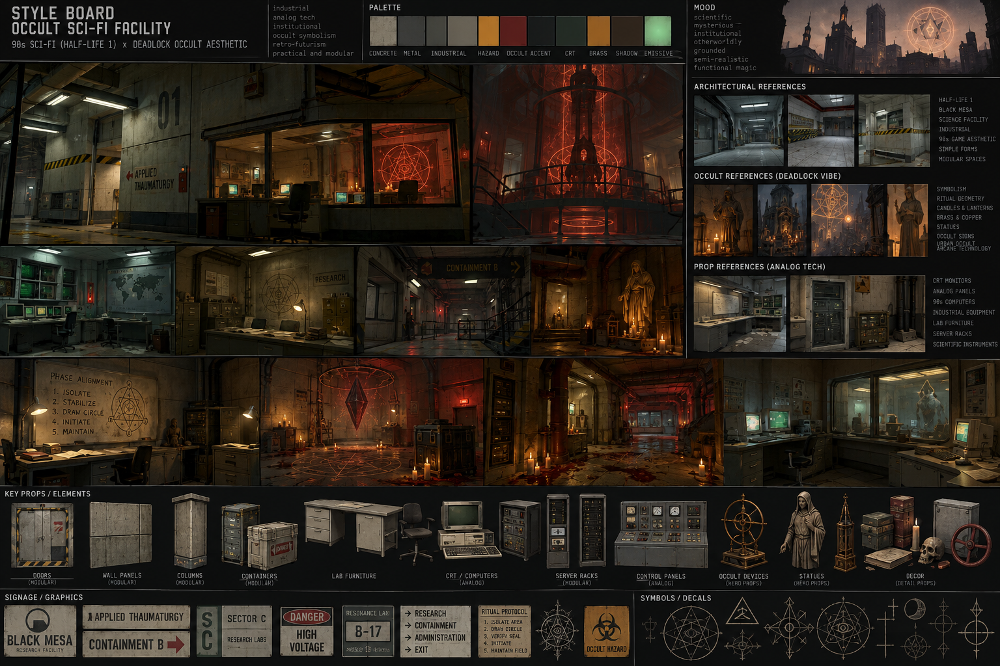

# RelayCore — Art Direction

This is the project's visual direction reference. It guides requested art work; it does not authorize new content, gameplay, renderer features, dependencies, or pipeline changes. The active development queue remains `docs/PLAYABLE_SLICE_ROADMAP.md`.

## Visual Reference Board

Use the supplied board for material relationships, analog technology, atmosphere, and functional occult integration. Its rendered lighting is a scene reference, not lighting to bake into textures. Black Mesa branding, named-game assets, and recognizable symbols are references, not RelayCore deliverables; create original project-specific signage and motifs.

Gameplay readability, routes, sightlines, cover, and interaction cues take priority over decorative atmosphere. Match current asset formats, scale, shader capabilities, and export conventions; this document does not establish new technical requirements.

## 1. Core Visual Direction

**Primary direction:**  
**1990s scientific / industrial sci-fi facility + urban occult aesthetics.**

The visual foundation should feel like a believable late-1980s to 1990s research complex: functional, institutional, industrial, slightly outdated, and built for engineers and scientists rather than for visual spectacle.

The occult layer is not a separate fantasy world placed on top of the facility. It is treated as a real, studied, engineered phenomenon that has become part of the laboratory's infrastructure.

The intended shorthand is:

> **90s scientific / industrial facility first, Deadlock-like occult layer second.**

The environment should never read as modern clean sci-fi, cyberpunk, medieval fantasy, or generic demonic horror.

## 2. High-Level References

### Primary references

#### Half-Life 1 / Black Mesa
Use as the main reference for:
- research-facility architecture;
- industrial corridors;
- laboratories;
- maintenance areas;
- concrete and painted-metal surfaces;
- CRT terminals;
- analog control panels;
- server racks;
- pipes, vents, cable trays and machinery;
- institutional signage;
- hazard markings;
- functional room layouts;
- utilitarian proportions.

#### Deadlock
Use as the main reference for the occult layer:
- sigils;
- ritual geometry;
- mystical diagrams;
- brass and copper occult devices;
- candles and lantern-like lighting;
- statues and symbolic objects;
- arcane machinery;
- occult iconography integrated into ordinary life;
- supernatural technology treated as normal infrastructure;
- occult-noir atmosphere.

### Secondary references

#### Dishonored
Useful for coexistence of machinery and supernatural forces, industrial technology with occult undertones, brass/copper/dark wood accents, readable silhouettes.

#### BioShock
Useful for environmental graphic design, signage, industrial decorative elements, retro scientific equipment, and coherent visual identity.

#### SIGNALIS
Useful for retro-tech discipline, CRT-based interfaces, limited material vocabulary, institutional signage, analog controls.

#### Control
Useful in moderation for containment spaces, institutional architecture, bureaucratic presentation of supernatural phenomena, monumental concrete spaces.

## 3. Setting Logic

The world assumes that occult phenomena are real and measurable.

Scientists and engineers do not treat occult practices as superstition. They study, instrument, contain, reproduce and exploit them.

Examples:
- resonance chambers;
- ritual containment fields;
- spectral measurement devices;
- rune-encoded control panels;
- spirit storage vessels;
- occult signal amplifiers;
- thaumaturgic test rigs;
- ritual geometry embedded into machinery;
- analog instruments calibrated for non-physical phenomena.

A device can simultaneously contain electrical wiring, coils, vacuum tubes, CRT readouts, brass contacts, engraved sigils, geometric ritual layouts and warning labels.

## 4. Architectural Language

Architecture must remain practical and institutional.

Preferred:
- rectangular concrete rooms;
- thick structural columns;
- service corridors;
- tiled laboratories;
- maintenance tunnels;
- observation rooms;
- reinforced doors;
- industrial staircases;
- metal walkways;
- exposed utilities;
- large research halls;
- containment chambers.

Avoid arbitrary curved walls, modern showroom-style spaces and excessively futuristic silhouettes.

## 5. Materials

Core:
- aged concrete;
- painted industrial steel;
- galvanized metal;
- ceramic laboratory tile;
- dirty glass;
- rubber;
- aged plastic;
- black cable insulation;
- brushed or oxidized aluminum.

Occult accents:
- aged brass;
- oxidized copper;
- dark wood;
- blackened steel;
- wax;
- parchment / paper;
- etched glass;
- engraved metal;
- unusual emissive materials.

## 6. Color Direction

Base:
- concrete gray;
- desaturated green;
- dirty white;
- industrial beige;
- dark steel;
- faded blue-gray;
- muted brown.

Utility accents:
- hazard yellow;
- safety orange;
- red warning paint;
- white stenciling;
- black-and-yellow stripes.

Occult accents:
- aged brass;
- copper;
- deep red;
- amber;
- muted spectral green;
- occasional dark violet.

## 7. Lighting

Normal facility:
- fluorescent ceiling fixtures;
- cool-white work lights;
- practical wall lights;
- emergency lamps;
- industrial fixtures.

Occult areas:
- warm amber practical light;
- candles where justified;
- dim red emergency illumination;
- spectral green emissive light;
- localized supernatural glow.

Avoid flooding entire scenes with saturated colored light.

## 8. Prop Language

Common props:
- metal desks;
- laboratory benches;
- filing cabinets;
- storage lockers;
- CRT monitors;
- keyboards;
- analog instruments;
- server racks;
- electrical cabinets;
- oscilloscopes;
- industrial carts;
- toolboxes;
- crates;
- cable reels;
- pipes;
- ventilation units;
- fire extinguishers;
- warning signs;
- intercoms;
- phones;
- paper documents.

Occult hero props:
- ritual apparatus;
- occult measuring devices;
- containment circles;
- engraved brass instruments;
- spirit vessels;
- spectral detectors;
- statues;
- ritual frames;
- sigil projectors;
- anomalous specimens;
- ceremonial technical equipment.

## 9. Occult Integration Rules

Good:
- containment circle made from copper conductors embedded into the floor;
- ritual diagram connected to an electrical cabinet;
- brass sigil array mounted around a vacuum chamber;
- CRT displaying spectral waveform data;
- shrine-like device built from ordinary laboratory hardware;
- rune plates used as interchangeable machine components;
- occult diagrams printed as official technical schematics.

Bad:
- random pentagrams everywhere;
- skull piles with no functional reason;
- medieval altars inside ordinary laboratories;
- generic demonic flesh;
- gothic cathedral architecture in scientific spaces.

The occult layer must look systematic, researched and repeatable.

## 10. Signage and Graphic Design

Use:
- room numbers;
- department names;
- laboratory classifications;
- warning labels;
- directional arrows;
- equipment IDs;
- technical diagrams;
- ritual procedure charts;
- containment instructions;
- exposure limits;
- maintenance tags;
- handwritten annotations.

Example department names:
- Applied Thaumaturgy
- Spectral Materials Division
- Resonance Research
- Containment Engineering
- Ritual Systems Laboratory
- Anomalous Energy Research
- Esoteric Signal Analysis

Example warnings:
- SPECTRAL EXPOSURE LIMIT
- DO NOT BREAK CONTAINMENT GEOMETRY
- RESONANCE FIELD ACTIVE
- RITUAL SEQUENCE IN PROGRESS
- HIGH VOLTAGE
- THAUMATURGIC HAZARD
- DO NOT CROSS INNER CIRCLE
- VERIFY SIGIL CONTINUITY BEFORE ENERGIZING

Avoid decorative fantasy fonts.

## 11. Technology Level

Preferred:
- CRTs;
- physical buttons;
- toggle switches;
- rotary knobs;
- analog meters;
- monochrome or limited-color displays;
- rack-mounted electronics;
- thick cables;
- wired intercoms;
- large industrial connectors;
- simple computers;
- printed documents;
- physical access panels.

Avoid:
- modern flat touchscreens;
- holographic UI;
- thin consumer electronics;
- RGB-style lighting;
- futuristic smartphones;
- glossy white clean-room sci-fi;
- modern LED strips unless justified.

## 12. Modeling Direction

Prefer:
- simple large forms;
- believable construction;
- moderate bevels;
- clean silhouettes;
- modular dimensions;
- reusable pieces;
- visually meaningful detail.

Do not add geometry purely to make an asset look more sci-fi.

Prefer decals, labels, dirt, scratches, panel seams, bolts, warning graphics and surface wear for secondary detail.

## 13. Texture Direction

Preferred:
- low-to-moderate roughness variation;
- restrained dirt;
- edge wear where mechanically plausible;
- faded paint;
- localized rust;
- oil and grime around machinery;
- imperfect concrete;
- readable decals.

Avoid extreme procedural grunge, uniformly dirty materials, exaggerated edge wear and random scratches.

## 14. Environment Composition

Priorities:
1. clear room function;
2. strong large shapes;
3. readable navigation;
4. practical lighting;
5. repeated industrial elements;
6. occult focal point;
7. secondary environmental storytelling.

Most spaces should be ordinary infrastructure with one or two strong supernatural focal elements.

## 15. Atmosphere

Desired mood:
- scientific;
- institutional;
- mysterious;
- industrial;
- grounded;
- slightly oppressive;
- old but functional;
- occult without becoming gothic fantasy.

## 16. What This Style Is NOT

Do not drift toward:
- modern clean sci-fi;
- generic spaceship interiors;
- cyberpunk;
- neon city aesthetics;
- glossy futuristic panels;
- excessive greebling;
- Doom-like demonic flesh;
- medieval occult fantasy;
- gothic cathedral environments;
- generic abandoned asylum horror;
- steampunk;
- full Art Deco;
- generic SCP concrete corridors without identity;
- random horror clutter.

## 17. AI / Blender Agent Rules

Before creating or modifying any visual asset, the agent must check:
1. Could this plausibly exist in a late-1980s / 1990s research facility?
2. Is the base form functional before occult details are added?
3. Are occult elements integrated into function rather than decoration?
4. Does the asset reuse the established material vocabulary?
5. Does it avoid modern clean sci-fi conventions?
6. Is the silhouette readable?
7. Can an existing modular asset be reused?
8. Is the amount of detail justified by viewing distance and gameplay importance?
9. Does it belong to the same world as the Half-Life-style industrial base and Deadlock-inspired occult layer?

If several answers are no, redesign before continuing.

## 18. Agent Prompt Shorthand

> Create the asset for a grounded late-1980s/1990s scientific-industrial research facility.
> Base visual language: Half-Life 1 / Black Mesa-style laboratories and infrastructure.
> Occult layer: Deadlock-inspired occult technology, ritual geometry, brass/copper devices, sigils and practical supernatural machinery.
> The facility must look functional and believable first.
> Avoid modern clean sci-fi, cyberpunk, excessive greebling, medieval fantasy and generic demonic horror.
> Use simple modular geometry, practical construction, restrained materials and strong readable silhouettes.

## 19. First Environment Target

This is a proposed art validation target, not an approved roadmap ticket. Build it only when explicitly requested or included in an authorized milestone.

### Occult Research Laboratory — B-17

Purpose:
- validate architectural language;
- validate materials;
- validate lighting;
- validate signage;
- validate ordinary props;
- validate occult hero props;
- validate the AI-assisted Blender workflow.

Minimum contents:
- one corridor entrance;
- one observation window;
- laboratory workstations;
- CRT terminals;
- electrical cabinets;
- ventilation;
- utility pipes;
- containment area;
- one central ritual/scientific apparatus;
- floor containment geometry;
- warning signage;
- normal fluorescent lighting;
- localized occult emissive lighting.

## 20. Final Style Rule

When uncertain, prioritize:
1. believable 1990s research facility;
2. functional industrial design;
3. strong modularity;
4. Deadlock-like occult integration;
5. atmosphere;
6. decorative detail.

If an element looks visually impressive but violates the first four priorities, it does not belong in the project.
