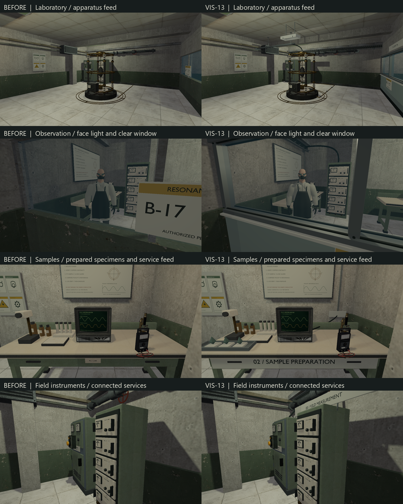

# VIS-13 — B-17 laboratory finish

Authorized scope: finish the existing B-17 room using its apparatus, scientist,
instruments and furniture. The phenomenon stays the focal point; observation,
sample preparation and field measurement explain its use. Preserve physical
solids, colliders, entry points, interactions and mission data.

The fitted `b17_services` assembly adds a sealed observation-window frame,
supported signal tray, rack and apparatus feeds, bonded conductor terminations,
workstation labels, a prepared-specimen tray and a shielded observer lamp.
Late-1980s/1990s sage enamel, galvanized steel, ivory labels, rubber insulation
and copper follow `ART_DIRECTION.md`. No low-poly style was requested; bevels,
smooth cable sweeps and readable connections target gameplay distances of 1–8 m.
The assembly uses the existing world origin and opaque native material contract;
its expected budget is below 30,000 triangles with six materials.

References inspected: the project's facility/anomaly board and fresh B-17 views.
The board's grouped analog stations, metal glazing rails, practical lamps and
localized containment focus guide the pass. The actual kit determines dimensions:
2.4 × 0.9 × 0.92 m benches, a 4 m observation window and the existing apparatus
envelope. No downloaded asset or new rendering capability is required.

Review questions: do services visibly reach their consumers; do labels mount on
real surfaces; can the samples and scientist be distinguished; does the apparatus
remain dominant; are the passage, reverse view and quiet walls preserved?

Baseline: `build/vis13/before/occult_lab_b17.toml` and runtime HDR captures under
`build/vis13/before/power-captures/hdr/shadows`, taken before edits. Working
evidence and logs are local and ignored by Git.

Completed 2026-10-08: the original apparatus remains the room's focal point;
01 / OBSERVATION, 02 / SAMPLE PREPARATION and 03 / FIELD MEASUREMENT identify
the working groups. The window has a sill, gaskets, mullion covers and a clear
view of the scientist and apparatus. The existing containment sign now mounts
on the opaque lower panel. Three prepared specimens supplement the existing
vials, microscope, meter and CRT. A shielded observer lamp lights the scientist's
front; a reused fluorescent fixture lights the apparatus. The side walls and
circulation space retain their quieter composition.

Runtime review corrected confirmed fit defects: apron labels initially stood
away from the benches; the tray needed clearance from the notebook; conduit
crossed the procedure boards; pipe returns missed the native module's 0.20 m
local height offset. A close view then caught the electrode lead stopping short
and an observer-lamp backplate standing away from the partition. The retained
source closes those contacts and adds conduit saddles and sign backing.



Source chain: `scripts/export-b17-services-glb.py` →
`content/models/b17_services.blend` / `b17_services.glb` →
`cmake/RelayCoreModelAssets.cmake` → generated `models/b17_services.rcmodel`
and receipt → staged `src/relaygame/assets/models/b17_services.rcmodel`.
The single fitted assembly is specific to this room; it is not a general room
generator. The model has 25,725 triangles and six materials. Authored and fresh
GLB inspections pass with zero invalid vertices, degenerate faces, zero-length
edges or missing-material faces. All six neutral views were opened and reviewed;
metrics and images are in `build/vis13/final-*-metrics.json` and
`build/vis13/final-multiview`.

The existing optimized baker produced 18 probes from 280,452 triangles and eight
lights, signature `17306281129061297601`. Baking used isolated native inputs;
the final optimized build independently confirmed matching inputs and reused
that product. No receipt or fingerprint was hand-edited.

Five selected RelWithDebInfo checks passed without skips: B-17 native content
and traversable inspection routes, all shipped map content, native model tooling,
B-17 HDR and B-17 SDR. After the last contact repair, the three affected B-17
checks passed again. Each graphics run captures 12 views, including the window,
reverse route, services, scientist and the same-camera isolator before/after;
the test requires the control image to change. RelWithDebInfo disables Vulkan
validation; these executed gates validate rendering and content, without
claiming validation-layer coverage. Both final contact sheets and relevant
full-resolution views were inspected on the RTX 4060 Ti.
An isolated copy of the previously built Debug capture harness then rendered
the retained native model, map and probe with `--art-review`: exit 0,
`validation=true`, no Vulkan validation warnings/errors or shutdown failures.
Its eight B-17 views check the final assets through the validation-enabled
renderer; the new capture-mode/state assertions are covered by the current
optimized binary above. The isolated log is
`build/vis13/debug-validation/runtime.log`.

Check Map reports `valid: true`, no warnings, six prop colliders, one usable and
two mission steps. All 43 optimized model receipts/products/staged hashes pass
`scripts/check-model-assets.ps1`; the final Debug receipts also pass for all 43
models. B-17's staged map, native model and probe have identical Debug/optimized
SHA256 hashes. The preservation comparison against the saved
baseline confirms that all 45 original solids, prop colliders, entries, scientist,
apparatus, interactions and mission data remain unchanged. The only moved
existing props are the sign and sampling accessories (90 mm back).

```text
cmake --build --preset demo-relwithdebinfo --target relaycore_power_restoration_graphics relaycore_content_validation relaycore_level_check -j 2
ctest --test-dir build/msvc-relwithdebinfo -R '^(graphics\.b17(_sdr)?|validation\.B17.*|validation\.all shipped.*|relaycore\.tooling\.model_assets)$' --output-on-failure --no-tests=error
ctest --test-dir build/msvc-relwithdebinfo -R '^graphics\.b17(_sdr)?$|^validation\.B17' --output-on-failure --no-tests=error
```

Logs, JUnit, preservation evidence and final HDR/SDR contact sheets are under
`build/vis13`. `clang-format --dry-run --Werror tests/power_restoration_graphics.cpp`
and `git diff --check` pass. The initial Debug attempt encountered C1083 on a
generated object while another chat was building the same tree. Its bake was
left running; after that build exited, `cmake --build --preset demo-debug
--target relaycore_demo_assets -j 2` completed and staging was reconciled as
described above. The automated B-17 gates ran in RelWithDebInfo. A continuous player
walkthrough remains open; these captures do not close the external playtest or
other-GPU gates.

## Author feedback — 2026-10-08

The author accepted the B-17 revamp visually: «ревамп b-17 выглядит круто».
The same feedback reports overexposed SDR lighting, with highlight detail retained
when the game's HDR option is enabled, while monitor HDR is disabled. The two
supplied screenshots show clipped floor/wall highlights in SDR and retained detail
in the internal HDR mode. This rendering issue remains open; passing capture tests
does not establish acceptable SDR highlight handling.

Source inspection confirms the distinction documented in `docs/DEVELOPMENT.md`:
the HDR option enables a floating-point scene buffer and Reinhard tone mapping,
while display output remains SDR. The non-HDR branch in
`assets/shaders/vulkan/mesh.slang` saturates lighting plus emissive before postfx;
`assets/shaders/vulkan/tone_mapping.slang` compresses HDR scene values instead.
Monitor HDR is therefore not required for this option. No renderer behavior or
B-17 lighting was changed in response to this feedback.
