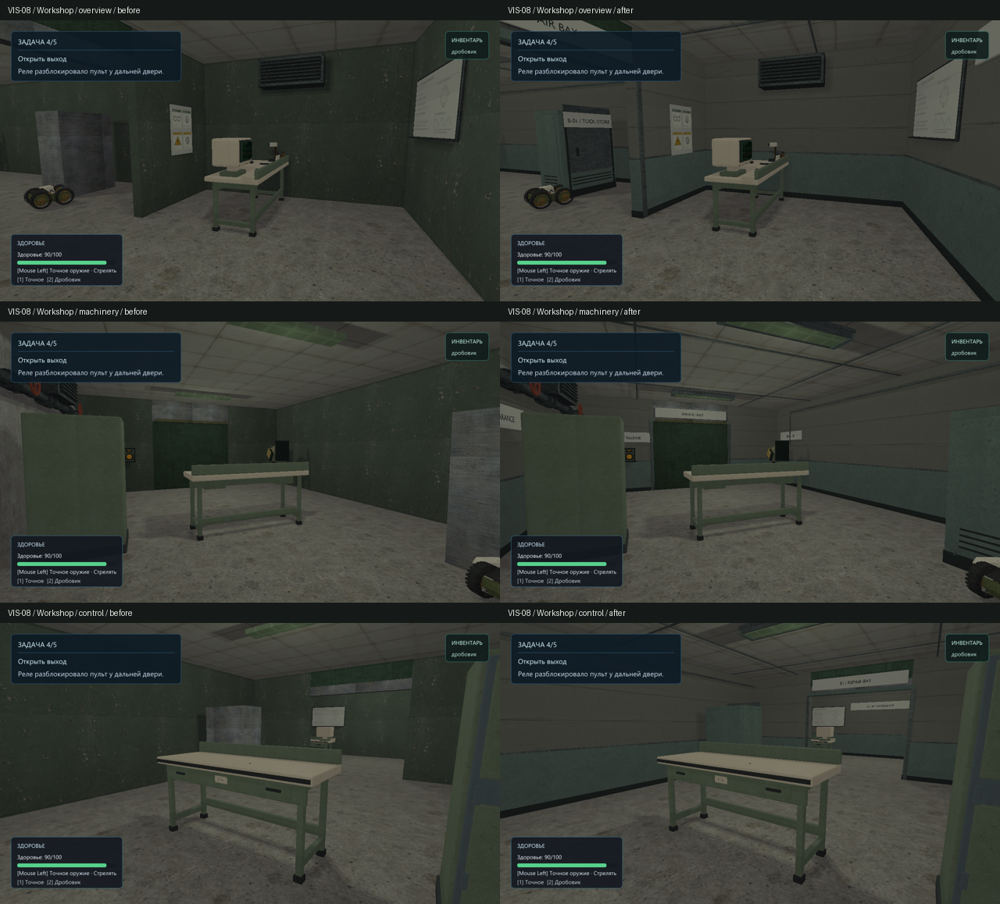
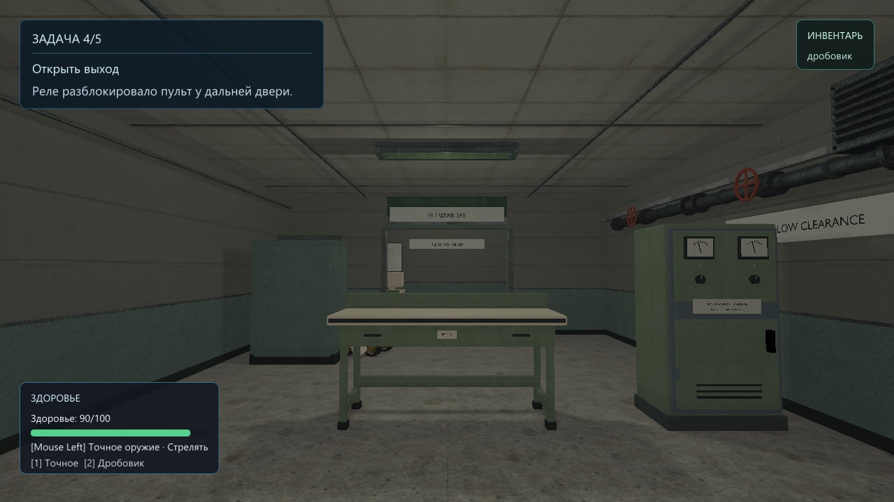
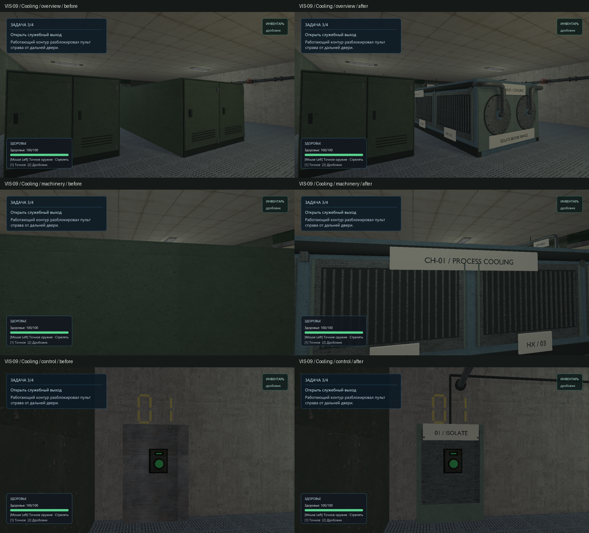
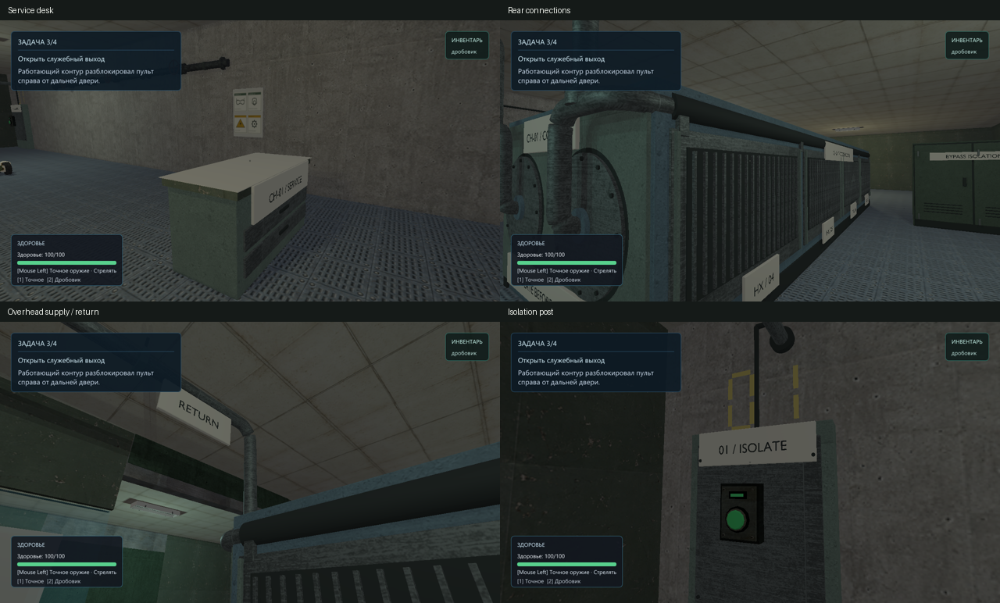
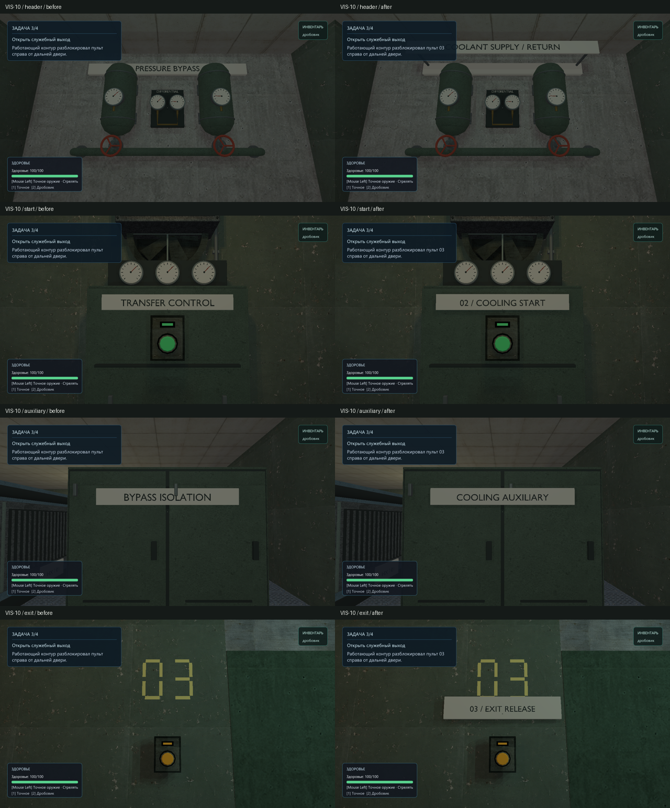
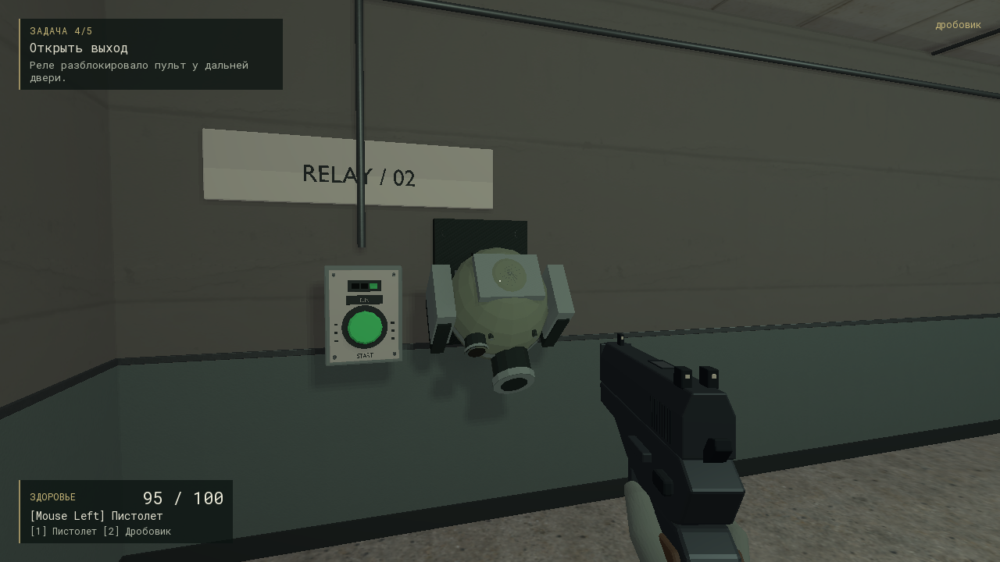

# VIS-08–09 — workshop and cooling bank, 2026-10-08

Authorized scope: finish `bench_relay` walls/ceiling, door frames, cabinet cover,
signage and light housings; replace the three stretched central cabinet skins in
`cooling_loop` with one legible cooling assembly, finish its ends, service desk
and isolation post. Existing physical solids, native bench collision, enemies,
interactions, mission, lights and effects own gameplay and remain unchanged.
Cooling room architecture and the broader graphics/signage pass VIS-10 are outside
this scope.

## Contract and reference notes

The workshop should read as a maintained institutional repair bay: sealed plaster,
sage enamel dado, galvanized portal frames and protected fluorescent fittings.
The existing open `lab_bench` remains the playable bench; neither drawers nor a
closed casing are added to its rover/low-shot opening. The tall entrance cover
receives a tool-cabinet skin. Existing tiled ceiling and floor remain visible.

The cooling bank retains the original 3.2 × 2.2 × 10m solid as its dimensional
constraint. One continuous skid, four removable fin cassettes per side, insulated
headers and bolted tube-sheet covers explain heat exchange and servicing. Supply
and return connect to wall sleeves above the aisles. This is a static schematic
facility assembly, not a refrigeration simulation or a vendor reconstruction.
Viewing distance is 1–12m; smooth round fittings, thin folded metal and restrained
material variation take priority over decorative detail. Review questions: does
the bank read as one machine; are both ends resolved; do the open bench, controls,
approaches and reverse views remain readable?

The inspected [project style board](occult-facility-style-board.png) supplies broad
plaster planes, dark wall protection, substantial portal returns and quiet
instrument labels. Existing power cabinet/fixture construction and the native
pressure manifold provide local form references. An external
[packaged chiller reference](https://www.taichillers.com/products/air_cooled_screw_chillers/air_cooled_screw_water_chillers.html)
was located for the skid/long exchanger/control relationship, but the image
retrieval did not provide an inspectable image payload. It is not claimed as a
visually inspected reference. Hidden circulation is an explicit original design
assumption. No external mesh or texture was downloaded.

## Production

`scripts/export-bench-cooling-glb.py` reproducibly builds three world-origin
families, reusing the established power/transfer geometry, labels, UV and export
functions. The new `content/models/{bench_workshop,cooling_exchanger,cooling_service}`
`.blend`/`.glb` pairs are registered in `cmake/RelayCoreModelAssets.cmake` with the
existing metallic/roughness opt-in. Texture derivatives use the already present
source atlas/concrete under `content/graphics/bench_cooling`; no pipeline contract
or dependency changes are introduced.

Stages: existing-envelope and reference review; fitted primary shells; frame,
fin, header and end-cover construction; native-compatible materials; fresh GLB
inspection and neutral views; fixed-camera runtime comparison and local repair.
Working evidence, saved original maps, logs and metrics live under
`build/visual-revamp/bench-cooling`. The existing graphics runner's `--visual-slice`
option now also selects four fixed inspection views on these two maps;
`--mounting-views` adds service desk, rear connections, overhead feeds and isolator
views for cooling. Default route/state behavior is retained.

## Reviewed evidence

The comparisons use identical cameras at 1280×720, hardware-sRGB/HDR rendering,
with the original authored lights. Left is the starting working tree, right is
the completed pass. The first reverse camera was blocked by the closed exit
door; that uninformative pair is excluded. The final workshop reverse is taken
from inside the room and shown separately.

The runtime review replaced visibly capped pipe intersections with continuous
round elbows, narrowed the end identification plate to clear the risers, and
fitted the desk finish to its original top height. No duplicate start label is
added above the existing control console. Its inherited `TRANSFER CONTROL`
graphic remains for the separately scoped VIS-10 replacement.

Six neutral fresh-GLB views of the final bank are retained in
`build/visual-revamp/bench-cooling/exchanger-multiview-final/contact_sheet.png`.
The functional geometry is static; no new animation or cooling simulation is
claimed. Original leak, isolation, ventilation and exit-light behavior is retained.

## Verification

All six authored/fresh-import inspections pass with no reported issues: finite
geometry/transforms, assigned materials, UVs, no degenerate faces, isolated
vertices or zero-length edges. Authored and GLB triangle counts match:

| Family | Authored | Fresh GLB |
| --- | ---: | ---: |
| Workshop | 14,936 | 14,936 |
| Cooling exchanger | 41,578 | 41,578 |
| Cooling service | 5,661 | 5,661 |

These are asset totals, not a performance measurement. Debug/optimized native
products are byte-identical; all 38 receipts/products/staged model paths pass
`scripts/check-model-assets.ps1` in both configurations. Both staged maps match
source. Final hashes and inspection metrics are retained in `final-products.json`
under the working evidence directory. The workshop's 30 irradiance probes were
rebaked; subsequent native baker checks reuse signature `2015853073655644368`.
Other probe volumes were reused with their matching current fingerprints.

Parsed baseline/current maps compare equal after excluding only the new
render-only placements and the three removed render-only cabinet instances:
18 workshop and 21 cooling solids, all collision declarations, original gameplay
entities, mission, lights and effects remain unchanged.

Commands and actual results:

- Blender 5.2.2 LTS: `--background --factory-startup --disable-autoexec --threads 2 --python-exit-code 1 --python scripts/export-bench-cooling-glb.py`; optional `-- --model=<family>` selects one family. Fresh `.blend`/GLB inspection uses `.agents/skills/blender-asset-validation/scripts/inspect_asset.py`.
- `cmake --build --preset demo-debug --target relaycore_bench_relay_run relaycore_content_validation relaycore_level_check -j 1`: passed. An accidentally overlapping retry encountered an output-file lock; the subsequent sequential build passed. No cache cleanup was used.
- `cmake --build --preset demo-relwithdebinfo --target relaycore_demo_assets -j 1`: passed; the existing optimized runtime receives the final models/maps.
- `ctest --preset test-debug -R 'validation\.(bench relay|cooling loop)|relaycore.tooling.model_assets' --output-on-failure --no-tests=error`: 10/10 passed. Includes native opening/low ray/rover clearance, both combat tactics, gates, disk continue, death/retry, powered states and editor round trip.
- `ctest --preset graphics-debug -R '^graphics\.(bench_relay|cooling_loop)$' --output-on-failure --no-tests=error`: 2/2 passed with Vulkan validation and zero skips. Cooling is repeated after the last local label removal. No frozen graphics samples or tolerances are changed.
- Final `relaycore_bench_relay_run.exe --visual-slice`, `--cooling-loop --visual-slice` and `--cooling-loop --mounting-views`, using the complete staged Debug asset root: passed. These also execute the existing scripted route before rendering the fixed views.
- `relaycore_level_check.exe <absolute staged map path>` on both maps: valid with no warnings.
- Scoped clang-format, Python AST/TOML/invariant inspection and `git diff --check`: passed. Pre-existing formatting outside the affected runner lines is not reformatted.

The selected technical acceptance is complete. Continuous human playthrough and
subjective visual acceptance remain open; other GPU, external playtest and
performance gates retain their previous statuses. VIS-10 and later visual tickets
are not closed by this pass. No package or archive was created.

## VIS-10 — cooling signage, 2026-10-08

Completed by a separate author request after VIS-08/09. The existing
`cooling_service` render skin now covers the shared props' old lettering with
thin opaque plates: `PRESSURE BYPASS` → `COOLANT SUPPLY / RETURN`,
`TRANSFER CONTROL` → `02 / COOLING START`, and `BYPASS ISOLATION` →
`COOLING AUXILIARY`. The original `01 / ISOLATE` remains; `03 / EXIT RELEASE`
identifies the exit reader. Three authored interaction/HUD strings now explicitly
refer to control 03. The existing numbers, targets, locks and mission sequence
are retained.

The first runtime review found receiver tops masking the header lettering.
The final label sits ahead of them on two stand-off brackets; its former plate
is covered. The other replacement plates sit just ahead of the original faces
and clear all buttons and meters. This reuses the original cabinet/manifold
geometry without changing the shared GLBs consumed by `pressure_transfer`.
`DIFFERENTIAL` and the analog meters remain appropriate coolant instrumentation.

Reproducible source: `scripts/export-bench-cooling-glb.py --model=cooling_service`
inside Blender using the command above. Only `cooling_service.blend/.glb` is
regenerated. The current family has 9,220 triangles in both authored source and
fresh GLB, with no inspection issues. Debug/optimized native products match SHA256
`f1d9696628ad88293f1f1be694618334477ea8b312d0b25565ae464ad30e7ba0`.
All 38 model receipts/staged paths pass in both configurations; staged map hashes
match source. The three shared pressure/casing GLBs match their pre-task hashes.
Parsed maps compare equal after restoring only the three edited text fields.

Verification on the completed change:

- The same targeted Debug build and optimized asset staging commands documented above passed; unchanged probe volumes were reused by their verified fingerprints.
- `ctest --preset test-debug -R '^validation.cooling loop' --output-on-failure --no-tests=error`: 4/4 passed, including both routes, gating, continue/retry, state transitions and editor round trip.
- `ctest --preset graphics-debug -R '^graphics.cooling_loop$' --output-on-failure --no-tests=error`: 1/1 passed with Vulkan validation; JUnit has zero failures/skips.
- `relaycore_bench_relay_run.exe --cooling-loop --atmosphere`: passed on final staged assets; this cooling-specific inspection selection captures header/start/auxiliary/exit after the existing scripted route. Default graphics behavior is unchanged.
- Check Map: valid with no warnings. Fresh `.blend`/GLB inspection, scoped clang-format, Python AST/TOML/invariant checks and `git diff --check`: passed.

Raw before/after captures, logs, metrics and comparison/check scripts are under
`build/visual-revamp/vis-10`. No frozen baselines, renderer, dependencies, gameplay
geometry or packaging changed. Continuous human acceptance and the existing
external/GPU/performance gates remain open.

## Workshop turret mounting correction — 2026-10-09

Author screenshot showed `bay_turret` floating beside the relay control. Its
origin was x=-2.8 and yaw=0, placing the rear plate away from the x=-4 wall and
parallel to it. `bench_relay.toml` now uses x=-3.515 and yaw=90. The plate rear
lands at x=-3.8894, slightly inside the plaster face at x=-3.887; intact and
destroyed OBJ models share the fixed mounting geometry. Height, size, health,
damage and timing are unchanged. The position change alters the level fingerprint;
old saves require a fresh scenario rather than a forced compatibility bypass.

Debug/optimized `relaycore_demo_assets` builds passed and staged map hashes match
source. The existing Debug capture runner was rebuilt; its second workshop
`--mounting-views` camera now inspects this attachment. `--visual-slice` and
`--mounting-views` both passed; the mounting image above was inspected. Check Map:
valid, zero warnings. Five `validation.bench relay` cases passed, covering both
tactics, cover, native opening, editor/continue and retry. Two save cases required
an outside-sandbox retry after temporary-file rename access failures; the capture
runner build similarly required a retry after sandbox MSVC C1902. No validation
errors appeared in the two render logs. `git diff --check` passed. Raw captures
and logs: `build/bench-turret-fix`. Continuous author playtest remains open.
