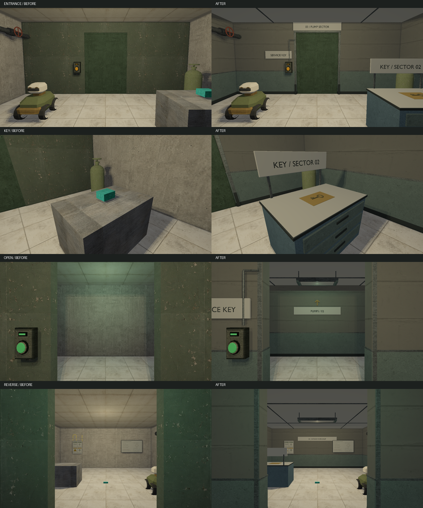
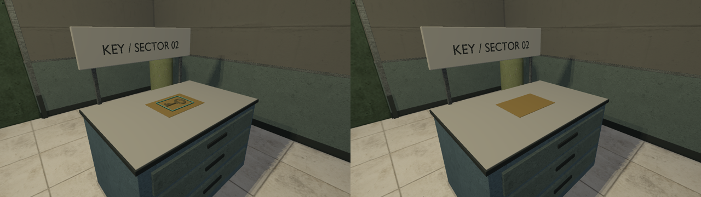
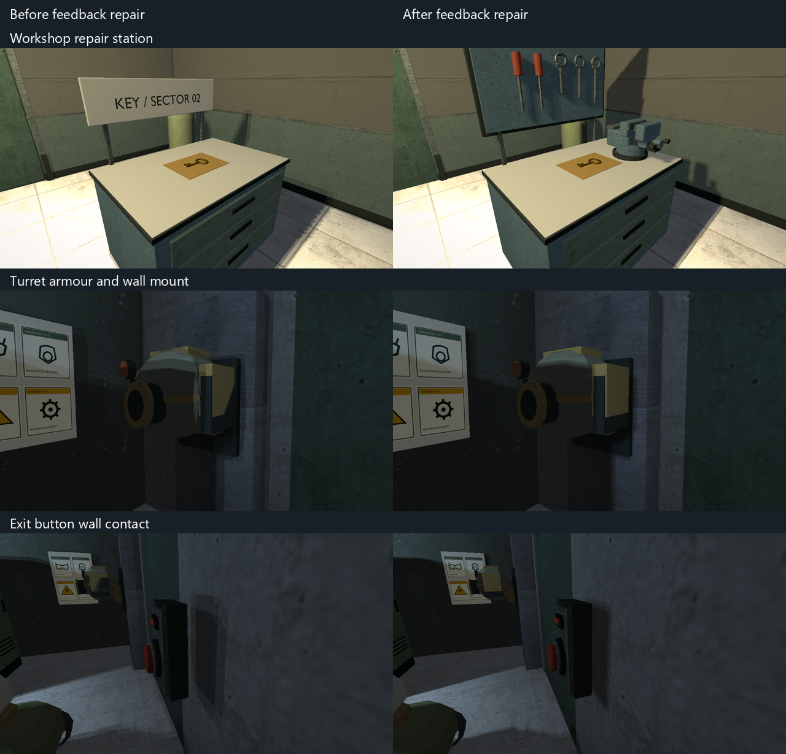
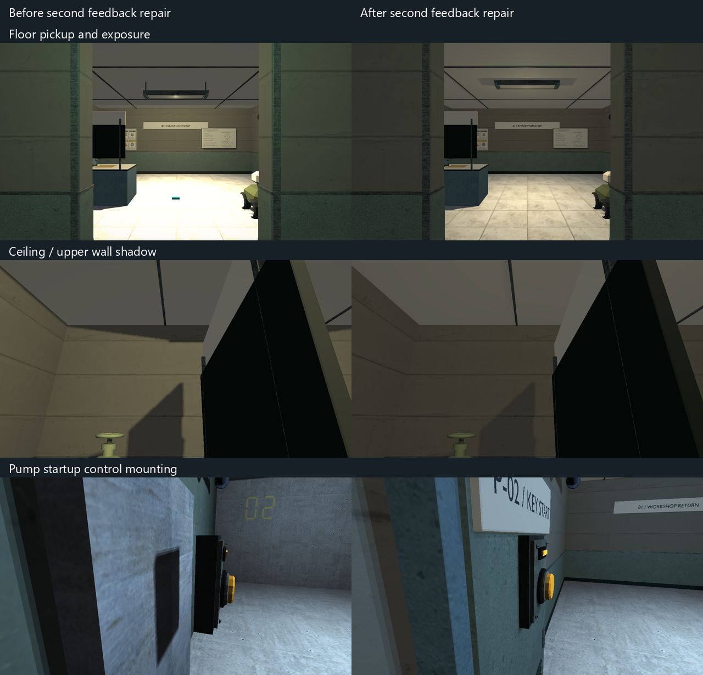

# VIS-11 — foundation intake workshop, 2026-10-08

Scope: the existing 8 × 10 m intake workshop, its key issue station, sector-02
pump approach and practical light fittings. Preserve all ten physical solids,
pickup bounds, door travel, rover, entry/exit, mission and interaction data.
`foundation_pump` and the broader door redesign remain separate tickets.

The inspected project style board supplies quiet plaster above sage wall
protection, folded galvanized portal returns, institutional sector plates and
suspended fluorescent trays. The inspected starting runtime views show a bare
solid table, generic cyan pickup, undifferentiated partition and no light bodies.
Reuse the established power/bench material and construction vocabulary; no new
external assets are needed. The key needs an actual bow, shaft and teeth rather
than a permanent static prop that survives collection.

Contract: fitted world-origin room shell and closed tool cabinet over the
existing table solid; issue tray beneath the pickup; recognizable service key
using the existing pickup lifecycle; two ceiling-supported light bodies at the
authored lights; double-sided sector identification and pump route sign.
Viewing distance is 1–8 m. Use smooth manufactured edges and restrained material
variation, not a deliberately faceted style. Keep the room assembly below 60k
triangles and key below 5k; these are budgets, not performance claims.

Stages: baseline/reference review; original-envelope layout; finished cabinet,
portal and fixture construction; existing native materials/UVs; export and fresh
import; fixed entrance/key/collected/open/reverse runtime review in HDR and SDR.
Review questions: is the key station the clear work area; can sector 02 be found
without HUD; do signs and supports survive reverse views; do collection and door
travel remain visually coherent? No user approval gates or packaging requested.

Working captures, original map, logs and metrics: `build/visual-revamp/vis-11`.

## Delivered and reviewed

`scripts/export-foundation-intake-glb.py` builds the room assembly and normalized
pickup key. Editable `.blend` and exported `.glb` pairs live in
`content/models/{foundation_intake,service_key}`; native declarations are in
`cmake/RelayCoreModelAssets.cmake`. Texture derivatives reuse the existing project
atlas and concrete source under `content/graphics/foundation_intake`. There are
no new downloads, dependencies, formats or renderer capabilities.

The room adds quiet plaster and protective enamel, ceiling tees, folded portal
returns, a drawer cabinet around the existing table solid, key issue tray and
reader conduit. Sector plates identify the workshop and pump destination on both
sides of the passage. The two suspended opal-diffuser housings align with the
original light positions; light color/intensity/radius remain unchanged. Native
diffusers are opaque surfaces, not newly supported GLB emissive materials.

The service key has a pierced bow, shoulder, shaft and two cut teeth. Its native
mesh follows the existing pickup bounds and lifecycle, including collection,
inventory and save/continue. Its focus cue is a thin pulsing frame around the
key; the previous filled cyan box hid the recognizable silhouette. Other pickup
presentation is unchanged. This is the key work needed by VIS-11, not completion
of the remaining visual audit tickets.

Fixed 1280×720 views cover entrance, key, focused key, collected key, open
passage and reverse route. The comparison uses the same cameras and HDR profile,
with starting working-tree content on the left and final content on the right.



Runtime review caught and repaired support shadows crossing the station lettering
and portal plates meeting the ceiling. Final HDR and SDR captures were inspected;
the key remains visible under focus and the tray is empty after collection.
Six neutral fresh-import views of the key at runtime proportions are retained in
`build/visual-revamp/vis-11/key-multiview/contact_sheet.png`.



## Verification

- Installed Blender 5.2.2 LTS, deterministic script export and fresh `.blend`/GLB
  inspection: passed. Room 11,530 triangles / seven materials; key 1,604 triangles
  / one material. No invalid vertices, degenerate faces, zero-length edges or
  missing material faces. Native compilation accepted both opaque models.
- `cmake --build --preset demo-debug --target relaycore_demo relaycore_content_validation relaycore_power_restoration_graphics relaycore_level_check relaycore_vulkan_mesh_tests relaycore_game_lifecycle`
  and `cmake --build --preset demo-relwithdebinfo`: passed. Final asset edits were
  staged with each preset's `relaycore_demo_assets` target; the focus repair was
  rebuilt in both runtimes. An existing C4100 warning in
  `demo_game_source_debug_commands.cpp:335` remains unrelated.
- `ctest --test-dir build/msvc-debug -R '^validation\.(two sectors|pump shelter|all shipped)|^relaycore.tooling.model_assets$' --output-on-failure --no-tests=error`:
  4/4 passed, including key carry, pump start, transition, continue and retry.
- `ctest --test-dir build/msvc-debug -R '^graphics\.(foundation_intake|resource_preparation$|game_lifecycle$)' --output-on-failure --no-tests=error`:
  4/4 passed with Vulkan validation, zero skips. Repeated after the final focus
  repair. The two new intake selections also assert visible focus and collection
  changes at the same camera.
- Check Map: valid, no warnings with both staged asset roots. All 40 model
  receipts and staged paths checked in Debug and optimized; the two new native
  products match between configurations.
- Parsed-map comparison against `before-map.toml`: removing the one new
  `prop_static` placement restores the entire original map, including all ten
  solids, light properties, enemies, interactions, missions and entry/exit.
  Python/TOML checks, scoped clang-format, diff review and `git diff --check` pass.

The first sandboxed MSVC build stalled and was stopped; the installed Blender
also required execution outside the sandbox. The reported successful builds,
exports and graphics checks used that working execution path.

Technical delivery is complete. VIS-11 remains `awaiting_playtest` for continuous
human visual acceptance. VIS-12, independent gameplay acceptance, another GPU,
audio and performance gates remain open. No archives, release, commit or push.

## Author playtest and repair — 2026-10-08

The author played the two-sector route and supplied three screenshots. Explicit
acceptance: the key is recognizable, the focus frame looks good and disappears
after pickup; light, wall and opening presentation looks normal. Rejected: sector
01 reads as a laboratory rather than a workshop. Sector 02 reads as a boiler or
plant room, which fits its intended pump-sector role; it was incorrectly called
a second workshop in the earlier observer brief. The pump room feels cramped
with few movement/interaction choices. That observation remains open for level
design; this repair does not claim independent combat or route acceptance.

The intake cabinet now carries a bolted swivel vise with separate jaws, sliding
guide, lead screw, handle and anvil. Ring spanners and screwdrivers hang on a
supported tool board; the key tray stays clear. The existing room palette,
light properties, key model and focus implementation are preserved. The
[Bravex vise product photographs](https://bravextools.com/products/bench-vise-4-5inch-tools-vice-table-vice-clamping-woodworkers-vise)
were inspected for the jaw gap, cast body, swivel base and screw/handle
construction. The model is original, with no downloaded geometry or textures.
Six neutral fresh-import bench views are retained under
`build/visual-revamp/vis-11-feedback/bench-multiview`.

Confirmed defects and corrections:

- Turret side armour and dark brackets shared their outer X planes at ±0.46 m,
  producing the visible striped depth fight. The armour now stands 12 mm proud
  in both live and destroyed OBJ models. The mount plate's rear also coincided
  with the pump support face; moving that support 10 mm forward embeds the plate.
  The existing shelter test now requires 5 mm of embedding instead of accepting
  near-coplanar contact.
- The first placement attempt moved both door-button origins 60 mm towards
  their walls. The claimed housing overlap and the claim that pump startup was
  already mounted were incorrect: that calculation omitted the descriptor's
  offset from the mounting anchor. The second repair below supersedes it.
- Local point shadows used 256² depth faces and four comparison taps, giving
  coarse outlines and visible coverage bands. Faces are now 512² with a 3×3
  comparison filter. The shader derives its footprint from the actual texture
  dimensions. Bias and geometric receiver-plane correction are preserved.
  This affects local shadows throughout the game; it reduces stepping, without
  claiming perfectly smooth shadows or measured frame-time improvement. The
  fixed 48-face D24 allocation grows from 12 to 48 MiB and comparisons from four
  to nine per evaluated local shadow.



The turret is active on arrival. Destroying it before pump startup is currently
an allowed combat choice; the pump mission and locked exit still require the
key and startup interaction. No new invulnerability or activation gate was added.

Debug and optimized playable builds were updated. The selected ten content and
graphics checks passed with zero skips: route/continue/retry, shelter/rover,
shipped content, mesh pipeline, resource preparation, point-shadow receiver,
intake HDR/SDR and pump HDR/SDR. Fixed pump views include live and destroyed
turrets plus both controls from the side, with Vulkan validation enabled.
The final intake camera selection was repeated after adding the right-wall pipe
view; `graphics.hdr_pipeline` and `graphics.point_shadow_receiver` also passed
with the restored final shader. Commands:

```text
cmake --build --preset demo-debug --target relaycore_demo relaycore_content_validation relaycore_power_restoration_graphics relaycore_vulkan_mesh_tests
cmake --build --preset demo-relwithdebinfo --target relaycore_demo
ctest --test-dir build/msvc-debug -R '^graphics\.(foundation_|point_shadow_receiver$|mesh_pipeline$|resource_preparation$)|^validation\.(two sectors|pump shelter|all shipped)' --output-on-failure --no-tests=error
ctest --test-dir build/msvc-debug -R '^graphics\.(hdr_pipeline|point_shadow_receiver)$' --output-on-failure --no-tests=error
```

Broader verification is not fully green. `graphics.vulkan_mesh` passes mesh/pass
and the four power comparisons, then fails at `pressure_transfer-0`
(`mask_diff=0.0880556`, `color_diff=0.979167`). This other map's baseline mismatch
was already recorded under D5 in `docs/PROJECT_PLAN.md`; this repair does not
change its map/model inputs or its samples. The manual existing
`relaycore_vulkan_mesh_tests --shadows-only` selection stops at the historical
directional sample `shadows-legacy_gamma-0-baseline` (`color_diff=0.0352778`,
mean RGB delta 1.63922). Replaying the original point filter reproduces exactly
the same directional capture, SHA256
`47f67591cdd5face747446541e1fc8e631a26f39a2ab4625a7caffa92fd8303c`.
No local lights are evaluated in that case. The final compiled shader was
restored and checked afterwards. No baseline files or tolerances were changed;
these failures remain explicit limits on the wider graphics gate.

Fresh `.blend` and GLB inspection passes: room 15,986 triangles / eight materials,
zero invalid vertices, degenerate faces, zero-length edges or missing materials.
Working before/after views, source snapshots, metrics and JUnit reports are in
`build/visual-revamp/vis-11-feedback`. The earlier preservation comparison above
describes the first delivery; this follow-up intentionally changes only the two
button origins and the pump support origin in addition to the visual assets.

VIS-11 stays `awaiting_playtest`: the revised workshop identity still needs the
author's visual acceptance. The cramped pump layout and full VIS-12 treatment
remain separate work.

## Second author feedback and correction — 2026-10-08

The author reports that sector 01 reads better, but rejects the cyan block on
the floor, overexposure, the pump startup control's floating housing and the
upper-wall shadow band. Workshop identity is improved, not yet accepted.

The cyan block was an unintended pickup at world origin. `mission_step` uses
`kind = "pickup"` for its condition; the generic interaction builder interpreted
that metadata as a second world pickup. `LevelSessionBuilder` now supplies an
entity-only interaction copy with mission condition kinds removed. The original
mission definition and authored entity indices remain intact, keeping real
interactions and save bindings stable. The two-sector route test requires exactly
one pickup and two usables, then checks key collection, pump startup, completion,
continue and retry as before.

Panel placement now uses the actual descriptor offset and rendered housing rear
at local Z = -0.075 m. Startup's local width/height/depth was incorrectly authored
as world-axis dimensions; it is now `[0.38,0.5,0.12]`, with its mounting anchor at
X = -2.725. Door-button anchors are Z = 2.875 in intake and 5.885 in pump.
A new content check raycasts behind each rendered housing, requiring the mounting
surface within 10 mm of its rear. The startup housing is also inspected from the
side in HDR and SDR, including the current shared VIS-12 pump-room finish.

Intake light intensities change from 1.5/1.2 to 0.7/0.6. Positions, colors and
radii remain unchanged. The low suspended fixture bodies blocked light towards
the upper walls; the back trays move from Y = 3.02 to 3.30 m with correspondingly
shortened ceiling stems and raised diffusers, end caps and reflectors. This
removes the wide wall shadow band. Ordinary pipe and object shadows remain.
The asset was regenerated and freshly imported for inspection: 15,986 triangles,
eight materials, no invalid vertices, degenerates or zero-length edges. The key
asset and focus frame are unchanged.



In the reverse-view floor ROI (X 340–939, Y 480–719 at 1280×720), pixels with two
channels at or above 254 fall from 47.82% to 0%. The same collected-key view has
84 cyan pixels before and zero afterwards. These measurements support this
specific view, alongside inspection of the entrance, key states, reverse,
ceiling, pipes and both controls in HDR/SDR; they are not a whole-game exposure
claim.

Eight distinct selected checks pass with no skips or Vulkan validation errors:
two-sector progression, panel contact, shelter/rover, all shipped runtime content,
and intake/pump views in HDR/SDR. The final pump checks were repeated after
staging the two already compiled VIS-12 models referenced by the concurrently
updated pump map; their first attempt failed on missing staged files. Source and
product hashes were checked before copying. The selected commands were:

```text
cmake --build --preset demo-debug --target relaycore_demo relaycore_content_validation relaycore_power_restoration_graphics
cmake --build --preset demo-relwithdebinfo --target relaygame_runtime
cmake --build --preset demo-relwithdebinfo --target generated/model-assets/models/foundation_intake.rcmodel
ctest --test-dir build/msvc-debug -R '^graphics\.foundation_|^validation\.(foundation control|two sectors|pump shelter|all shipped)' --output-on-failure --no-tests=error
ctest --test-dir build/msvc-debug -R '^graphics\.foundation_pump' --output-on-failure --no-tests=error
```

Debug and optimized game logic and the relevant staged resources are updated.
A simultaneous VIS-12/VIS-13 build held Debug's Ninja log while baking the other
map; this repair did not interrupt it or remove build data. The updated Debug
native room product was copied separately after its compilation. Optimized was
relinked using its generated Ninja link command; the subsequent DLL copy step
reported sharing errors because another bake was using those DLLs. All affected
DLLs already exactly match their expected hashes, so no replacement is needed.
The room product is identical in both configurations, SHA256
`80a73899d84f0c93f499c36432a2614cc9ecb2d3d3d22d79b3aa882707064d5e`.

Source snapshots, captures, inspection, pixel metrics, build logs and test reports
are retained in `build/visual-revamp/vis-11-feedback-2`. No graphics baseline or
tolerance was changed by this repair. The wider pre-existing graphics limits
above remain outside these checks. VIS-11 remains `awaiting_playtest` for the
author's visual acceptance.
