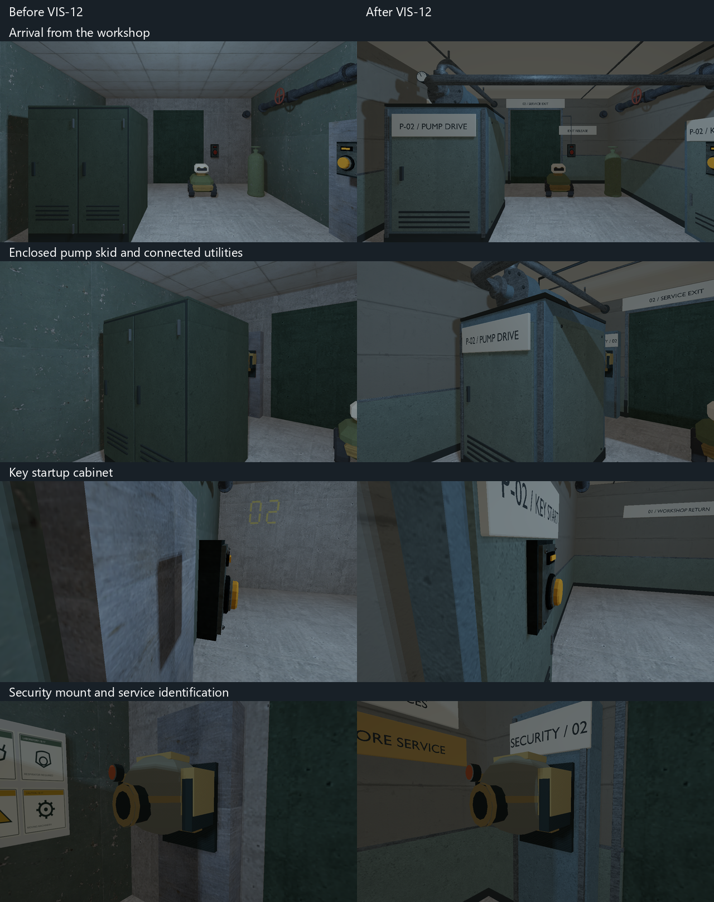
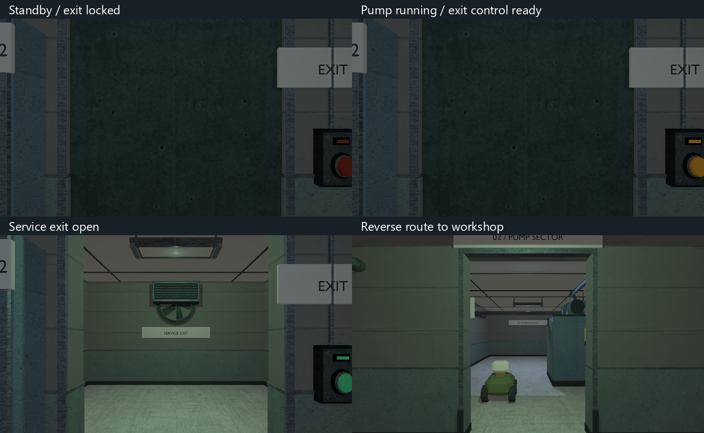

# VIS-12 — foundation pump sector, 2026-10-08

Scope: finish the existing 6 × 14 m pump sector, its startup cabinet, enclosed
pump skid, security support and service exit. Preserve all twelve physical
solids, usable bounds, door travel, player arrival/return, enemies and missions.
The author's observation that the room is cramped remains a level-design issue.

Contract: the full-height drive enclosure retains the existing shelter; a
roof-mounted centrifugal pump, guarded coupling, finned motor and pressure gauge
make its function readable. Suction joins the existing wall utility; discharge
terminates in the exit partition. Folded terminal and turret-support shells,
ceiling-supported fixtures, quiet plaster/sage dado and two-sided sector signage
match the workshop vocabulary. Native materials remain opaque; light positions,
colors and activation conditions are unchanged. Viewing distance is 1–8 m;
smooth manufactured surfaces, with a 60k triangle budget for both families.

References: inspected project style board `occult-facility-style-board.png` and
the existing `power_pump` construction/source. The [KSB Etabloc photograph](https://klema-maschinenhandel.com/products/ksb-blockpumpe-etabloc)
shows a compact coaxial motor/coupling/volute, axial suction and radial discharge,
cooling fins and a foot mounted beneath the motor. The photo informed those
relationships; the enclosure and routing are original adaptations to the map.
Hidden motor internals are not modeled. Reference working copy:
`build/visual-revamp/vis-12/pump-reference.jpg`; no reference imagery is exported.
Textures reuse existing workshop derivatives; no new external models/textures.

Stages: baseline and reference inspection; fixed-envelope enclosure layout;
primary machinery and cabinet construction; supports, joints and surface finish;
existing UV/material palette; export/fresh import; runtime HDR/SDR and route checks.
Review questions: does arrival read as a pump sector; are the key startup and exit
controls clear; are all pipe/support connections plausible; do reverse views and
startup/open states remain coherent? No approval gates or packaging requested.

Source: `scripts/export-foundation-pump-glb.py`; editable `.blend` and GLB pairs
under `content/models/foundation_pump_{machine,room}`. Room origin is world zero;
machine origin is `[1.6,0,2.6]`. Existing map solids own all collision. Working
baseline map, fixed runtime views, metrics and logs: `build/visual-revamp/vis-12`.

## Delivered and reviewed

The two original Blender/native families replace the stretched shared casing and
fit the existing terminal/security supports. The exposed pump has mounting feet,
motor end bells and cooling fins, a junction box, guarded coupling, bolted casing,
flanged suction/discharge and an instrument takeoff. The drive enclosure keeps the
original full-height shelter; the roof machinery and overhead connections add
visual detail without adding colliders. Existing floors and room dimensions stay
unchanged. The generic B-17 laboratory notice is replaced with pump-service and
isolation plates. No new renderer, physics, interaction or audio behavior.

The same HDR cameras compare the starting working tree with the final pass.
Separate fixed views cover the live/destroyed turret, both controls from the side,
arrival, the machine, locked/ready/open exit and reverse route. Visual review
repaired an exit plate hidden behind the fan and seated the portal/reader plates
and conduit against their supports. Final HDR and SDR views were opened.





The test fixture starts the pump using the service key, then activates the exit
control and advances door travel. Same-camera pixel checks require startup and
door opening to visibly change the scene. This supplements the existing route,
inventory, save/continue/retry and turret-shelter tests.

Installed Blender 5.2.2 LTS reproduced both source/export pairs. Authored and
fresh-imported metrics agree: machine 7,653 triangles / six materials; room 15,567
triangles / seven materials. Both have zero invalid vertices, degenerate faces,
zero-length edges and missing material faces. Six neutral fresh-import machine
views were inspected at `build/visual-revamp/vis-12/machine-multiview`; the room's
interior/reverse/support review uses the runtime views rather than exterior
renders of an enclosed shell.

Two control-mounting edits appeared concurrently after the saved baseline:
`pump_button` Z 5.81 → 5.885; `pump_control` X −2.665 → −2.725 and authored size
`[.12,.5,.38]` → `[.38,.5,.12]`. These are preserved, separate mounting repairs;
they are not attributed to VIS-12. The preservation check normalizes only those
explicit deltas and the three visual placement changes. All twelve solids and
remaining gameplay, lighting, enemy, mission and transition data match baseline.

## Verification

Final Debug runtime and both configurations' staged assets are updated:

```text
cmake --build --preset demo-debug --target relaycore_demo relaycore_power_restoration_graphics relaycore_content_validation relaycore_level_check -j 2
cmake --build --preset demo-relwithdebinfo --target relaycore_model_assets relaycore_irradiance_bake -j 2
cmake --build --preset demo-relwithdebinfo --target relaycore_demo_assets -j 2
ctest --test-dir build/msvc-debug -R '^validation\.(two sectors|pump shelter|foundation control|all shipped)|^relaycore.tooling.model_assets$|^graphics.foundation_pump' --output-on-failure --no-tests=error --output-junit E:/Code/C++/RelayCore/build/visual-revamp/vis-12/checks.xml
```

All seven selected checks passed, zero skips: two-sector route/key/startup/
continue/retry, control mounting, turret shelter and rover approach, shipped
content, model tooling, pump HDR and pump SDR. Both graphics selections ran with
Vulkan validation and clean expected validation output. Final captures contain
eleven pump views per color mode, including the upper machinery detail.

`relaycore_level_check assets/levels/foundation_pump.toml` with each staged
`RELAYCORE_ASSET_ROOT`: valid, warnings empty. `scripts/check-model-assets.ps1`
with `-ProjectRoot`, `-BuildRoot` and `-RuntimeAssets` for each configuration:
all 43 model receipts/products/staged hashes verified. The two new native
products are byte-identical between configurations. `check-final.py` verifies
the explicit authored-data preservation above, exported metrics and own model
source/receipt/product/staged hashes. Generator syntax, final diff review and
`git diff --check` pass.

The initial Debug build hit a shared Ninja metadata lock while another build
used the tree, then was retried after that build stopped. The normal asset target
also depended on a fresh B-17 irradiance bake unrelated to this map; the prolonged
Debug bake was cancelled. The existing optimized baker and
`cmake/compile_irradiance_asset.cmake` generated that dependency from each tree's
native inputs in 44 seconds total, then the normal Debug and optimized asset
targets completed. No bake settings, signatures, receipts or dependency rules
were edited. An intermediate optimized receipt check found the concurrently
changing B-17 source stale; final staging and both full receipt checks pass.

VIS-12 is technically delivered and `awaiting_playtest` for continuous human
visual acceptance. The cramped layout observation remains open; no claim of
independent gameplay acceptance, another GPU or measured performance improvement.
No archives, release, commit or push.

## Author visual acceptance — 2026-10-08

The author reviewed VIS-12 and confirmed that the cabinet with a pump on top
reads correctly, the components look attached, no visual conflicts are present,
and the signs are understandable. The key's use is clear because there are no
alternative places to use it and the route is entirely linear. Record this as
a level-design observation, rather than evidence that the environment offers
strong navigation or meaningful choices.

VIS-12 is now `done` on the existing technical evidence and this visual
acceptance. The earlier cramped-room observation and the newly stated linearity
remain separate level-design issues; this feedback does not authorize a layout
redesign or close independent gameplay acceptance. The author also clarified
that earlier VIS-11 feedback predates its latest repairs. Those repairs retain
their separate `awaiting_playtest` status; do not ask the author to repeat the
already answered original workshop/key checklist.
