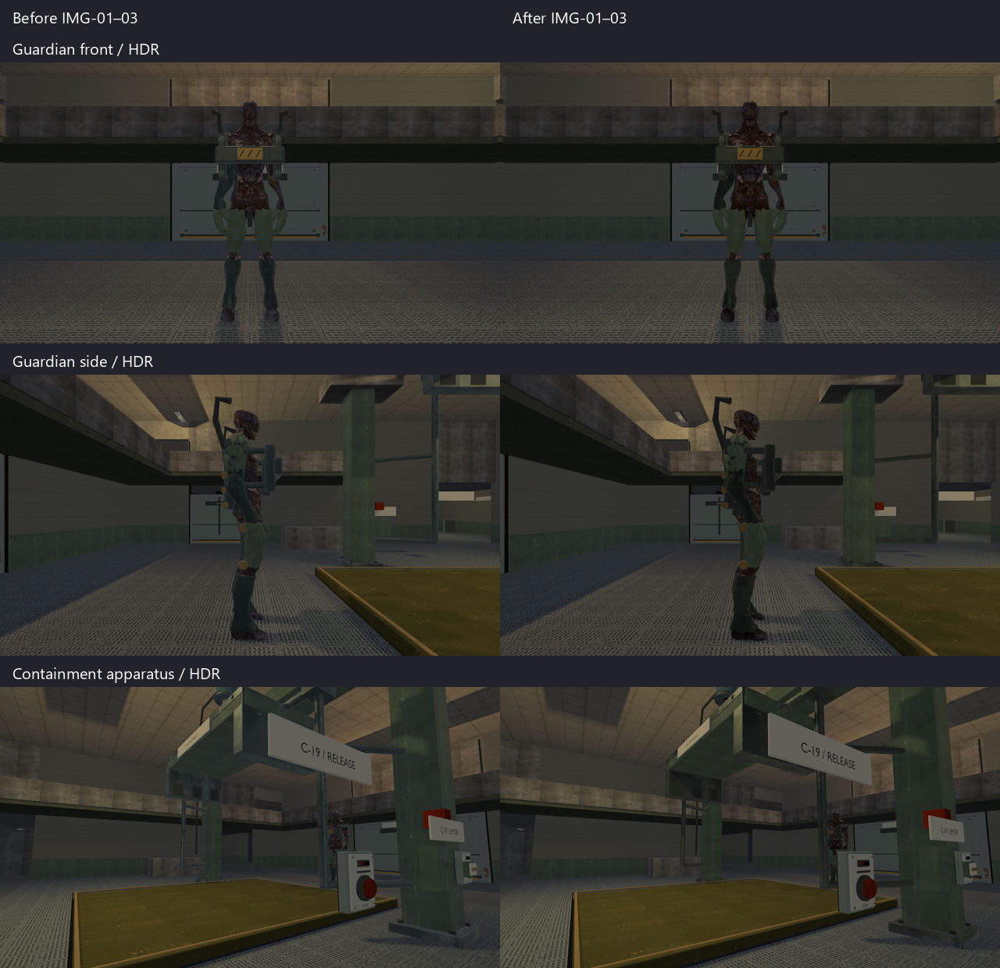
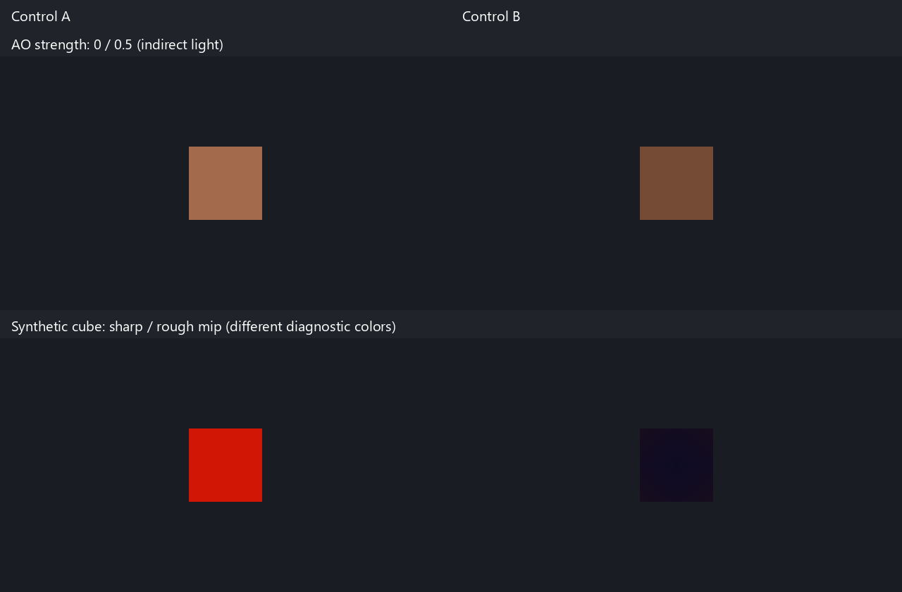

# IMG-01–03 — material maps, reflection probes and AO

Owner request: “img001-003 make”, 2026-10-09. Engine capability is available to all
native models and levels; the first authored consumers are Guardian body/arm,
the containment ram, and one central containment-hall reflection probe.
Human visual acceptance in motion remains open.

## Contracts and scope

- RMDL v4 adds embedded linear MR and AO images plus AO strength. Readers retain
  v1–3 behavior. MR uses G/B multiplied by glTF roughness/metallic factors; AO
  uses R with strength interpolation. UV0, sampler and image checks remain strict.
- AO attenuates indirect diffuse/environment specular, including the existing
  legacy indirect-light path. Direct GGX, local/spot light and shadows remain
  independent. No screen-space AO was added: this pass addresses authored cavities.
- A static reflection cube replaces hemisphere/SH specular inside its authored
  AABB. Box projection accounts for receiver position; outside the volume and for
  overlays/viewmodels, the existing fallback is retained. Transparent legacy glass
  does not acquire a new reflection model in this pass.
- RREF v1 is linear HDR RGBA32F, six Vulkan-order faces, with a complete GGX
  roughness-prefiltered mip chain. Upload preserves those mips. The engine owns
  the cube and material descriptors; replacement waits for GPU use to complete.
- Bake inputs are static opaque prepared geometry, per-material mean linear
  base-color/diffuse reflectance (including mean mapped metallic), unconditional
  local lights, ambient floor, capture origin, bounds, resolution, sample count
  and bake revision. Dynamic actors/doors, conditional lights, transparent geometry,
  directional light, native emission and recursive specular transport are excluded.
  This is a coarse room snapshot; it cannot track power switches or moving actors.
  Runtime rejects stale signatures or mismatched stored settings.

The representative probe captures at `[0, 4.8, 28]`, influences
`[-11.5, .1, 12.3]`–`[11.5, 7.8, 41.5]`, and uses 64px faces/128 prefilter samples.
The CPU bake uses an offline triangle hierarchy to handle the existing room mesh.
No frame-time improvement is claimed.

## Authored sources and reproduction

`scripts/bake-img-materials.py` runs in the installed Blender 5.2.2 LTS with OptiX
on the RTX 4060 Ti, 32 samples and deterministic seed 20261009. Start from the
owning Guardian/containment exporter, then run the material baker for each of
`guardian_body`, `guardian_arm` and `containment_ram`. It updates their editable
`.blend` sources and embedded `.glb` exports in `content/models`.

Guardian retains the supplied artist UVs. Blood/wound color informs a restrained
roughness variation; exposed anatomy uses low metalness. Actual mesh AO is baked
at 512px. This is an authored interpretation, not a recovered source PBR mask.
The ram's repeating UVs could not hold object-specific AO, so the script transfers
its existing base/normal appearance to a unique 1024px atlas without moving geometry;
steel/oxide variation and AO use a 1024px ORM. AO strength is .55 on both assets.
Generated source images live under `content/graphics/img01-03/`.

Native products are generated under `build/<preset>/generated/model-assets/models/`
with normal model receipts. The reflection product is
`lighting/containment_loop.rcreflection` under that generated root. Existing
`relaycore_demo_assets` staging and `runtime-assets.txt` own runtime delivery.
The build target `relaycore_reflection_assets` runs `relaycore_reflection_bake`
through the existing probe compiler wrapper. No archive or release is required.

## Verification and visual evidence

Technical verification passed on 2026-10-09. Debug and normal Play (`msvc-dev`)
builds and runtime staging are updated. Exact logs are retained under
`build/img01-03/`. Builds used the installed Visual Studio developer environment:

```powershell
cmake --build --preset tests-debug --target relaycore_tests relaycore_vulkan_mesh_tests relaycore_containment_loop_graphics relaycore_demo -j 2
cmake --build --preset demo-dev -j 2
ctest --preset test-debug -R '^relaycore\.(GLB|Blender|native|reflection|irradiance|tooling.model_assets)' --no-tests=error --output-on-failure
ctest --preset test-debug -R '^relaycore\.tooling\.irradiance_assets$' --no-tests=error --output-on-failure
ctest --preset graphics-debug -R '^graphics\.(material_maps_reflections|vulkan_upload|containment_loop(_hdr)?|irradiance_probes|hdr_pipeline|vulkan_color_baseline)$' --no-tests=error --output-on-failure
```

- CPU/native/model tooling: **22/22 passed** (`unit-final.log`); irradiance tooling:
  **1/1 passed** (`irradiance-tooling.log`).
- Vulkan: **7/7 passed**, without skips or validation warnings/errors
  (`graphics-final.log`). After the final whitespace correction/recompile,
  the material-map/reflection check also passed (`graphics-shader-final.log`).
- Model receipt/staging checks: **79 models** passed in both Debug and Play
  (`receipts.log`, `play-receipts.log`). Native level checker: `valid=true`,
  `warnings=[]` with each runtime asset root (`level-check.log`, `play-level-check.log`).
- Fresh Blender imports of Guardian body, arm and ram: `hard_gate_pass=true`,
  `issues=[]` (`guardian-import.json`, `arm-import.json`, `ram-import.json`).
- Reflection cube: 64px / 7 mips / 64,104 static triangles;
  signature `5511482587445782643`. Debug, Play generated product and Play staged
  product share SHA-256
  `991D9C82F184CF03F9BDA0178177E07F7172DD14DE180DD6D87ABAAD0FC5D2AE`.
- Scoped diff inspected and `git diff --check` passed. No performance or temporal
  stability claim; human visual acceptance remains `awaiting_playtest`.

The original HDR Guardian/room captures were saved before code and asset changes
under `build/img01-03/before/containment-captures/`. Final SDR/HDR captures are under
`build/msvc-debug/tests/containment-captures/`. Reviewed front, side and apparatus
views retain the existing dark hall composition. Surface/cavity and equipment
highlight changes are restrained; this pass does not resolve IMG-04 light balance.
The sheets preserve exposure/color; only thumbnails and labels were added.





The synthetic reflection control intentionally assigns different colors to its
sharp and rough mips to identify shader LOD selection; it is not a visual example
of physically filtered room radiance. CPU tests separately verify actual GGX
prefiltering and cube seams.

The focused GPU checks exercise independent MR channels/factor multiplication,
AO strength and direct-light isolation, cube face orientation, linear HDR,
roughness mip selection, camera rotation, receiver translation/box projection,
volume fallback and SH double counting.
Upload/readback checks compare every float of every cube face/mip and retirement.
CPU checks cover import/product round trips, malformed data, UV restrictions,
backward compatibility, deterministic bake, filtering, signatures and authoring.
Containment HDR/SDR captures cover the actual map and gameplay states.
