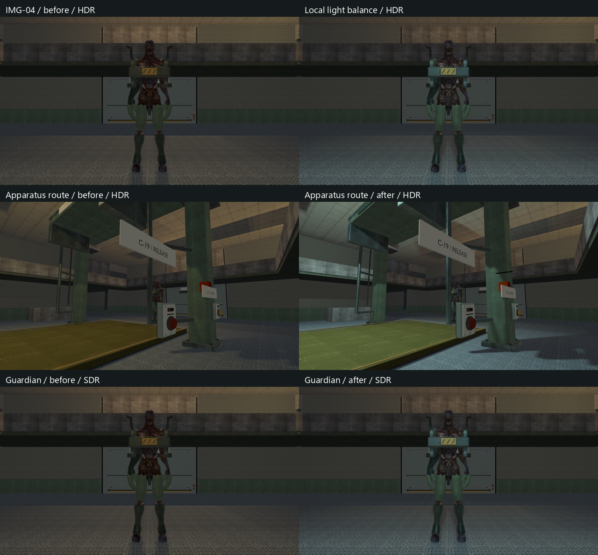
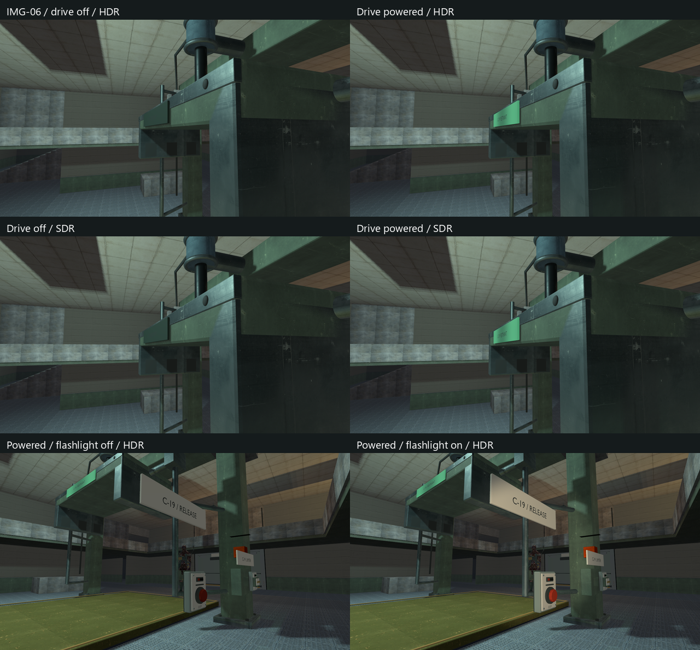
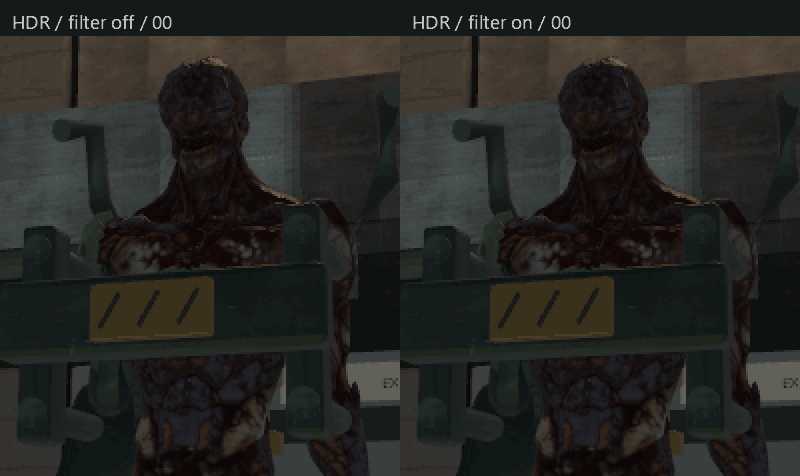
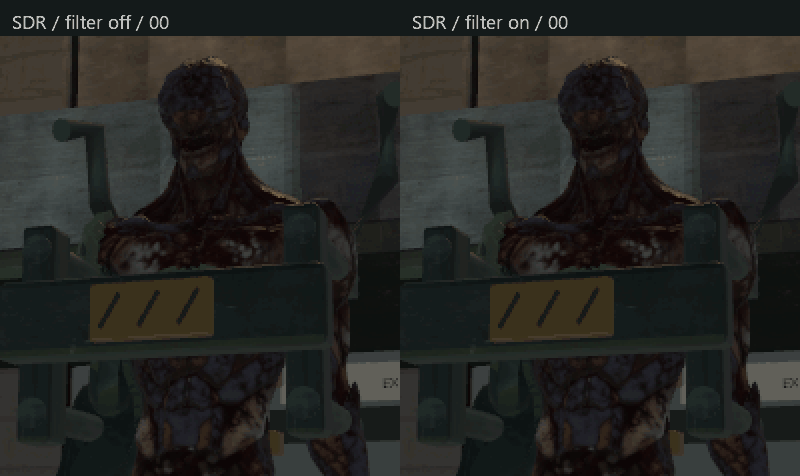

# IMG-04–06 — containment light balance, specular filtering and native emission

Owner request: `img004-006`, 2026-10-09. The engine changes are available to native
models throughout the game; this authored pass is limited to the containment hall
and its travelling crosshead plate. Human visual acceptance remains open.

## Result and contracts

- **IMG-04:** the existing practical at `[0, 7.4, 24]` now uses a muted cool-white
  color, radius 18 and intensity 3.2. The rear warm practical at `[0, 7.4, 38]`
  drops from 1.4 to .85. This separates the Guardian's front and apparatus route
  from the background while retaining the dark hall. The existing control
  indicator receives a small real light at `[-5.5, 2.2, 29]`, radius 6/intensity
  .65, conditional on `grip_ready`. Global exposure and tone mapping are unchanged.
  The static room reflection cube was invalidated and rebaked for the light change.
- **IMG-05:** native normal-mapped PBR surfaces add a bounded screen-space normal
  variance to squared GGX alpha. The maximum addition is .04. Direct specular and
  reflection roughness LOD use the filtered value; flat normals, base-color
  textures, text and UI retain their existing sampling. There is no frame history
  or new AA configuration. This is a conservative first pass informed by
  [geometric specular antialiasing research](https://www.jp.square-enix.com/tech/library/pdf/ImprovedGeometricSpecularAA.pdf),
  rather than a claim that every source of flicker is resolved.
- **IMG-06:** RMDL v5 adds an optional embedded emissive RGBA8 image and independent
  linear RGB factor. Readers keep v1–4 behavior; v3/v4 non-emissive defaults are
  covered by regressions. Core glTF factors must be finite and in [0,1]. Images
  retain sRGB RGB, ignore alpha, use UV0 and the existing repeat/linear sampler
  restrictions. Scalar-only emission works. The importer still rejects extensions,
  including emissive-strength. These channel semantics follow
  [the core glTF material contract](https://registry.khronos.org/glTF/specs/2.0/glTF-2.0.html#materials).
- The native loader, render queue and every model/viewmodel submission carry the
  new fields. Vulkan uploads emission as sRGB in both color pipelines and caches
  texture ownership and factor values. Emission is independent of lighting and
  AO, then receives the existing fog/tone/display processing. Native PBR remains
  linear; old non-PBR legacy materials keep their encoded lighting arithmetic.
- The crosshead plate uses a dark unlit phosphor surface, a restrained broad-band
  green emission map and core factor .8. `grip_ready` powers its emission; standby
  supplies zero factor. This follows drive power independently of the brief trap
  firing window. Emission does not light nearby geometry; the control indicator's
  separate conditional source does. Bloom was unnecessary for this consumer.

The static reflection bake still excludes dynamic apparatus/actors, conditional
lights and native emission. Power switches do not update that coarse snapshot.
HDR here means the existing FP16 scene/tone-mapping path with SDR presentation;
physical HDR10 display output was not tested. No performance claim is made.

## Authored source and delivery

`scripts/author-containment-emission.py` updates the existing
`content/models/containment_grip.blend` and embedded `.glb`, using installed Blender
5.2.2 LTS. Its `backlight()` function is also called by the owning
`scripts/export-containment-glb.py`, so a source rebuild retains the material.
The source texture is `content/graphics/img04-06/containment_crosshead_emission.png`.
The crosshead retains its origin, parts, geometry, UVs and normal-mapped materials.

Normal model compilation generates `models/containment_grip.rcmodel` under each
build's `generated/model-assets`. Receipts, runtime manifests and existing demo
staging deliver it; no generated native product was placed in source `assets`.
Debug and normal Play (`msvc-dev`, used by the Play run configuration) are updated.

## Verification and retained evidence

Logs, original sources and raw captures are retained under `build/img04-06/`.
Builds used the installed Visual Studio x64 developer environment and current
`VCPKG_ROOT`:

```powershell
cmake --build --preset tests-debug --target relaycore_tests relaycore_vulkan_mesh_tests relaycore_containment_loop_graphics relaycore_demo -j 2
cmake --build --preset tests-debug --target relaycore_player_ui_graphics -j 2
cmake --build --preset demo-dev -j 2
ctest --preset test-debug -R '^relaycore\.(GLB|native|Blender|tooling.model_assets)' --no-tests=error --output-on-failure
ctest --preset graphics-debug -R '^graphics\.(emissive_maps|material_maps_reflections|containment_loop(_hdr)?|hdr_pipeline|vulkan_color_baseline|msaa|player_ui|mesh_pipeline)$' --no-tests=error --output-on-failure
```

- Native/import/tooling: **20/20 passed** (`cpu-final.log`). The new cases cover
  emission image/factor independence, factor-only import, UV restrictions,
  malformed factors/payloads, deterministic product round trips and old defaults.
- Graphics: **9/9 passed**, with zero skips and no Vulkan validation warnings/errors
  (`graphics-final.log`, `graphics.xml`). The emission fixture checks all six
  supported HDR/SDR × color-pipeline × PBR/old-material combinations: sRGB decode
  before factor multiplication, RGB/alpha isolation, AO independence, zero/off,
  restored cache state/settled allocations and invalid texture encoding/factors.
  Existing material/reflection, normal, MSAA, color, HDR and player UI gates pass.
- Final authored asset: fresh Blender GLB import passes with no reported issues
  (`grip-import.json`); four meshes/materials/parts remain. Native mesh payload and
  part payload are byte-identical to the preserved original, including tangents
  (`geometry-comparison.json`). Only the plate material changes.
  Source PNG and GLB embedded emission pixels match exactly
  (`emission-export-check.json`); the authoring helper recreates the packed image
  to prevent old pixels surviving a material edit.
- Model receipt/product/staging checks pass for **79 models in each build**
  (`debug-receipts.log`, `play-receipts.log`). Debug/Play containment Check Map
  reports `valid: true`, zero warnings (`debug-map.json`, `play-map.json`).
- After final asset staging, both HDR and SDR fixtures pass again with their
  gameplay/state/lifecycle assertions, matched power/flashlight views and 48-frame
  camera arcs (`after-hdr.log`, `after-sdr.log`). Vulkan validation is enabled on
  the local RTX 4060 Ti, with no validation warnings/errors.

Both power states and flashlight states are captured in SDR/HDR. The power-state
comparison keeps the crosshead at the same transform and varies the actual power
target and associated usable state. These controlled captures supplement the
fixture's real standby, drive movement, recovery, capture and contained states.
They do not establish a human route/playtest result.





## Motion evidence

The fixture's `--motion` option captures 48 fixed-camera steps along the same
34-degree arc around the Guardian, with translation and rotation. Scene time and
simulation state stay fixed to isolate camera-dependent shading. Original IMG-01–03
captures are in `before/containment-captures`; final captures are in `after/`.
`unfiltered/` repeats the final lights/materials with only the variance block
removed from an isolated compiled fragment shader. Its private asset root links
existing staged assets; it never replaces production shaders. The variant source,
SPIR-V and `prepare_control.py` retain the exact comparison procedure.
All 96 final filtered motion frames remain byte-identical after the plate's
material refinement (`final-motion-hash-check.json`), so the isolated comparison
still changes only specular filtering in the visible Guardian region.

`measure_motion.py` computes mean absolute second temporal differences in two
fixed inset regions: head x622–658/y278–324 and shoulder x608–686/y331–353. Values
are luminance-weighted 8-bit display codes, not radiance or a perceptual quality
score. Camera motion naturally changes surface detail, so these are a limited
same-motion flicker proxy. The measured change is modest:

| Region | HDR filter off → on | SDR filter off → on |
| --- | --- | --- |
| Head | 1.102 → 1.046 (5.1% lower) | 1.132 → 1.076 (4.9% lower) |
| Shoulder | .964 → .906 (6.0% lower) | .986 → .931 (5.5% lower) |

The loops show the same pixel-aligned crops enlarged 2× with nearest sampling;
only labels are added. GIF previews use one shared palette per loop and no
dithering; the original full-color BMP frames own the numerical evidence.
Base-color detail and geometry coverage remain visible.
There is no temporal accumulation that could create history ghosting. Small
silhouette/coverage changes remain; neither MSAA nor this roughness adjustment
guarantees complete temporal stability. Author review in actual play is still
required, including peripheral geometry and small distant text.




