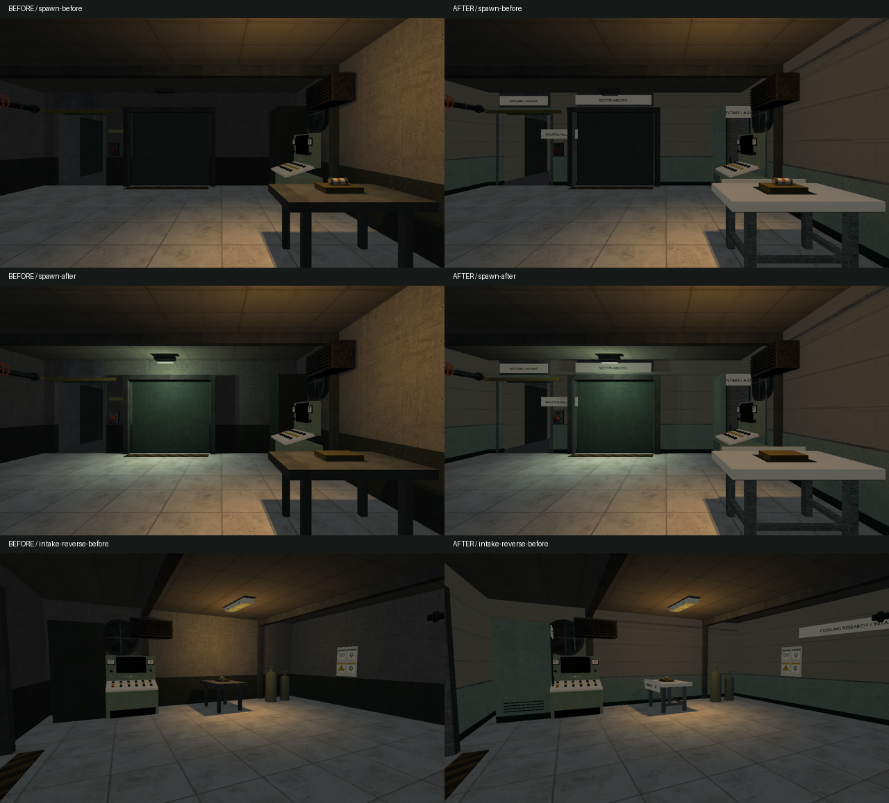
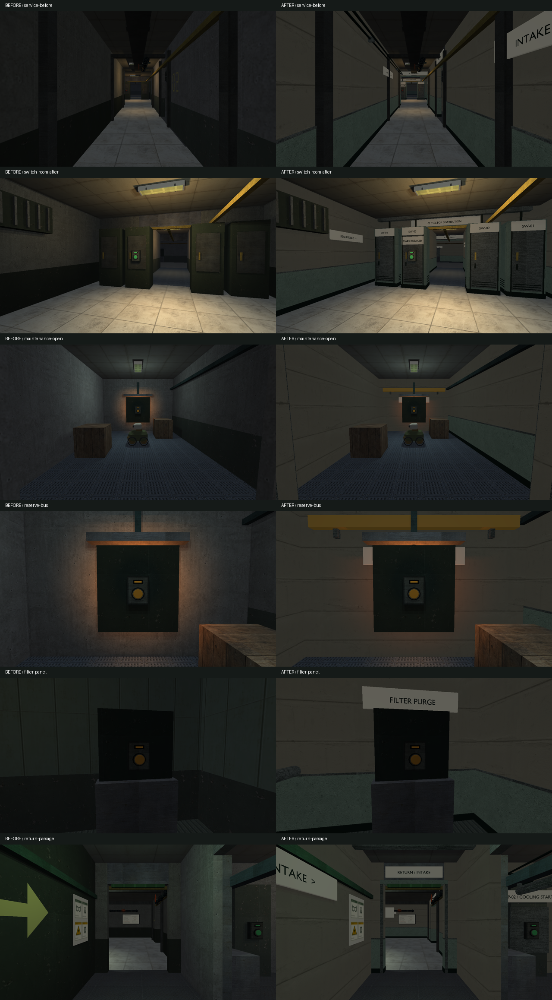
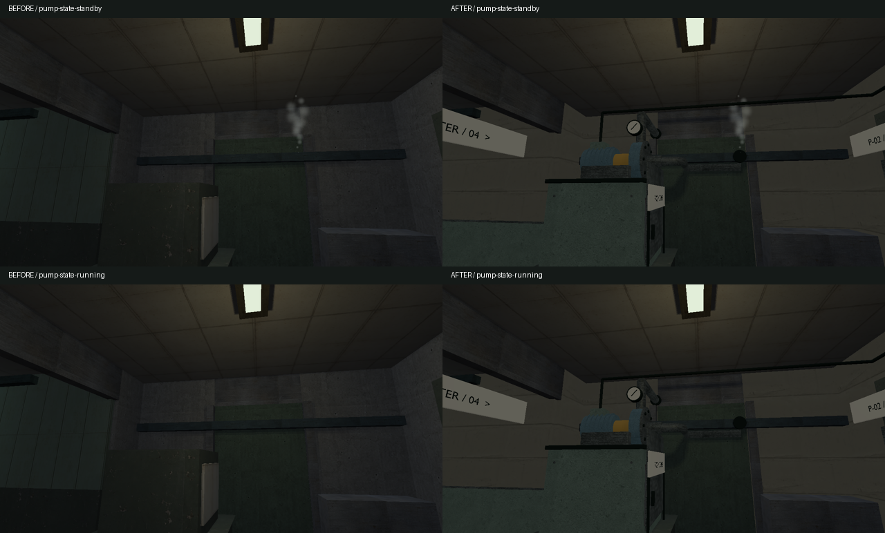
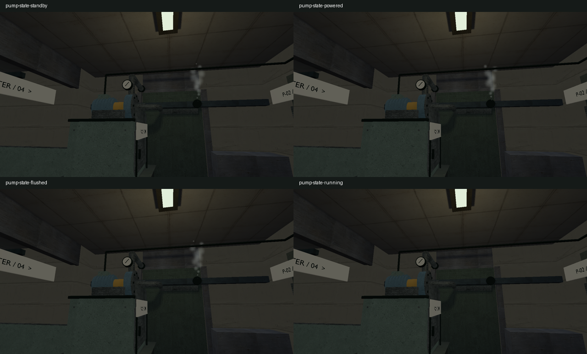

# VIS-05–07 — power restoration, 2026-10-08

Requested scope: finish the intake, service/switchgear/maintenance/reserve/filter
wings and pump room using the current native asset contract. Preserve authored
solids, interactables, doors, enemy positions, mission, low-clearance and routes.
The visual aim is a maintained but ageing research facility: quiet plaster,
sage enamel dado, ivory labels and galvanized service equipment. Floors keep
their existing zone differences. No renderer or gameplay capability is added.

## Contract and references

Six separate render families keep room bounds local for culling. The reproducible
source is `scripts/export-power-restoration-glb.py`; it reuses the established
geometry/UV/export functions in `export-pressure-transfer-glb.py`. The latter now
has a main guard so importing helpers cannot regenerate unrelated products.
Each `power_{intake,service,switchgear,maintenance,filtration,pump}` has editable
`.blend` and exported `.glb` under `content/models`, explicit metallic/roughness
opt-in, compiled products/receipts and a render-only placement at world origin.

Reference observations: the inspected [project board](occult-facility-style-board.png)
uses substantial concrete/plaster planes, dark lower wall protection, framed
portals, analog cabinets and restrained utility accents. Existing control console,
ventilation, utility pipes, notes and fluorescent fixtures remain the reusable kit.
The [Etanorm assembly reference](https://www.pumpa.eu/en/ksb-etanorm-horizontal-long-coupled-single-stage-volute-casing-pump/)
informs the motor/coupling/pump/base relationship; the installed machine is an
original schematic facility design, not a dimensional reconstruction. No vendor
texture or mesh is incorporated. Hidden pipe routing is inferred from the map.

Finish questions: is the fuse still the entry focal point; are the breaker and
reserve relay readable; does each wing have one useful destination; does the
pump show a drive, coupled motor, supported casing and connected pipes; do direct
and reverse views retain clear interactions? Intended distance is 1–12m, smooth
manufactured curves and sized bevels, no low-poly/blockout deliverable.

## Production and evidence

Stages: contract/reference and existing-block proportion review; fitted primary
shells; structural connections and service details; native-compatible materials;
fresh import; same-camera in-engine review and local repairs. The existing blocks
remain the dimensional constraints rather than an independently changed layout.

Working evidence is under `build/visual-revamp/power`: baseline map, fixed-camera
captures, export/build/test logs, fresh-import metrics and comparisons. The
graphics scenario captures standby, restored power, flushed filter and running
cooling from the same pump camera, plus direct/reverse views of the wings.

The in-engine review restored the existing panelled ceilings after an overly
plain first candidate, added side service panels/vents and captive screws to
the cabinets, moved the reserve-bus plate clear of the ventilation housing, and
added a pressure gauge. A second material review caught dark textured paint:
the shared writer stores sRGB PNG values, unlike linear constant material
factors. The new script now records that distinction and uses corrected sRGB
palettes. Existing transfer assets/materials were not regenerated by this fix.

## Reviewed comparisons

Identical cameras, 1280×720, shipped SDR/legacy configuration. The left column is
the starting working tree; the right column is the completed pass. Directional
and local lighting inputs, steam targets and timing remain authored as before.

The steam union is located at the original pump leak; cooling suppresses that
steam. Filter purge suppresses the separate filtration spill, so the pump leak
correctly remains through the first three pump states. The pump is static; no
new motor/needle animation is claimed. Existing fan, button and door behavior is
retained. Six neutral views of the isolated pump/drive from fresh GLB import are
in `build/visual-revamp/power/pump-multiview-final/contact_sheet.png`; the review
copy crops room architecture and long external feeds, not the source asset.

## Technical evidence

All 220 physical solids, original 77 entities, original entity groups, mission,
lights, effects, enemy parameters and interaction values compare equal to the
saved baseline after excluding the six new render-only placements. Check Map
reports valid with no warnings. The route, reserve door, both turret threats,
return alternatives, death/continue and powered snapshot regressions are covered
by the existing affected content cases.

All six authored `.blend` and six freshly imported GLB files pass inspection with
zero reported issues: finite geometry/transforms, UV-bearing meshes, assigned
materials, no degenerate faces, isolated vertices or zero-length edges. Authored
and fresh-import triangle counts agree:

| Family | Triangles |
| --- | ---: |
| Intake | 12,722 |
| Service / return | 10,267 |
| Switchgear | 17,384 |
| Maintenance / reserve | 9,789 |
| Filtration | 5,866 |
| Pump | 10,820 |
| Total authored addition | 66,848 |

These are asset totals, not all visible triangles in a frame or an FPS claim.
Debug and optimized native products have identical SHA256 values; both staged
maps match source. All 35 model receipts/products/staged paths pass
`scripts/check-model-assets.ps1` in both configurations. Exact six-product hashes
are retained in `build/visual-revamp/power/final-products.json`.

Reproduction commands and results:

- Blender 5.2.2 LTS: `--background --factory-startup --disable-autoexec --threads 2 --python scripts/export-power-restoration-glb.py`; `-- --model=power_pump` selects one family. Fresh inspection uses `.agents/skills/blender-asset-validation/scripts/inspect_asset.py` with each `.blend`/`.glb`.
- `cmake --build --preset demo-debug --target relaycore_demo relaycore_content_validation relaycore_level_check relaycore_power_restoration_graphics relaycore_vulkan_mesh_tests -j 1`: passed. The sequential retry resolved a collision between parallel post-build DLL copies. A repeat compile was required after dependency-header timestamps changed; no caches were deleted.
- `cmake --build --preset demo-relwithdebinfo --target relaycore_demo_assets -j 1`: passed; the existing optimized game receives the new runtime content.
- `ctest --preset test-debug -R '^validation\.(power restoration|all shipped maps)|^relaycore.tooling.model_assets$' --output-on-failure --no-tests=error`: 12/12 passed.
- `ctest --preset graphics-debug -R '^graphics.power_restoration_slice$' --output-on-failure --no-tests=error`: passed. All four reviewed power samples compare with zero coverage/color/RGB differences. The four previous samples were retained under `accepted-samples`; shader, fixture lighting and tolerances were unchanged.

The narrow mesh selection also checks static model loading, scene reinitialization,
visible/culled chunks and presentation. It excludes the previously known,
unrelated `pressure_transfer-0` baseline discrepancy; that broader gate is not
claimed green here. No other frozen samples were updated.

- `ctest --preset graphics-debug -R '^graphics.power_restoration$'` and `-R '^graphics.hdr_episode$'`, both with `--output-on-failure --no-tests=error`: 2/2 passed, no skips. JUnit reports contain zero failures/skips. These also exercised existing audio decode, menu/save/continue, editor/preview and finale checks.
- A last reverse-view review connected the filtration riser to the existing overhead line and seated the pump discharge in a wall sleeve. Only those two models were regenerated/staged and freshly inspected. On the final products, `relaycore_power_restoration_graphics.exe --power-views-only` and `--hdr --power-views-only` pass the complete power render/interaction/state checks; the four-sample CTest selection also passes again with zero differences. The full SDR scenario also passed after these local repairs. The new views-only switch stops after power checks, leaving default full-scenario behavior unchanged.
- `clang-format --dry-run --Werror tests/power_restoration_graphics.cpp tests/vulkan_mesh_tests.cpp`, Python AST/TOML inspection and `git diff --check`: passed.

The final native/source/staging and selected technical checks are complete.
The before/after images and direct/reverse views were opened and reviewed in SDR,
with affected HDR views inspected separately. Continuous human route/readability
and subjective visual acceptance remain open. No human playtest, other GPU,
measured performance improvement or broader graphics baseline completion is
claimed. Existing G-011/G-016/H-008/H-009 and VIS-04 acceptance states are retained.
