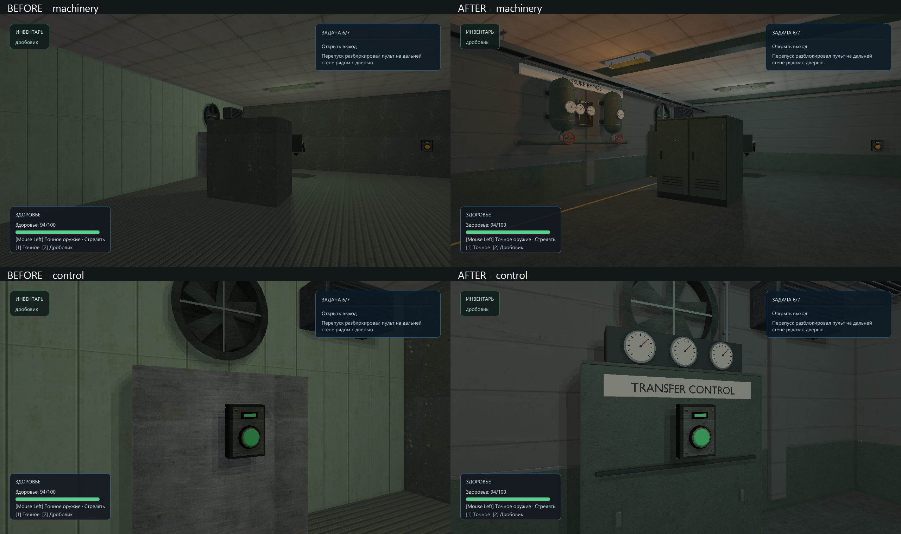

# Pressure transfer: first visual slice

2026-10-07. Owner-authorized visual revamp of the current working tree.
Scope: the mixed relay room (x=24–40, z=26–44), approximately one encounter and
the pressure-control/exit sequence. Existing combat cover, bench clearance,
interactions, target names, retry entry and mission order remain authoritative.

## Brief and construction contract

Function: pressure equalization and isolation for the technical sector.
Player purpose: defeat the mixed encounter, start transfer, unlock the exit.
Hierarchy: doorway/clear lanes, machinery and its control, then maintenance detail.
Landmark: paired pressure vessels on a wall-mounted bypass manifold, with one
brass differential instrument sharing the same supply/return system.
Materials: quiet concrete, desaturated green enamel, dark rubber, gray steel,
ivory instrument faces; brass confined to the differential instrument.
Asset families: shallow manifold, equipment-cover casing, room lining and
service runs. Reuse existing bench, fluorescent fixtures and safety notice.
Lighting: cool-white work light at entrance/bench; localized warm inspection
light at the manifold/control. No ambient scene-wide colored wash.
Story: a legible normal bypass has acquired a sealed differential measurement
loop; maintenance access stays clear. No lore paragraph or scattered symbols.
Occult: paired scales with incompatible readings connected to a deliberately
bonded brass loop. This is static environmental suggestion, not a new mechanic.
Reuse: manifold, casing and material palette; room lining remains map-specific.

Meter scale; Blender Z-up/front -Y → runtime Y-up/front +Z. Floor origins,
opaque triangles, UV0, normals and embedded base color maps, scalar
metallic/roughness opt-in. These assets have no normal maps and export no unused
tangents. No glass, emissive/ORM maps or runtime bypass.
Build in named stages: proportions → construction → UV/material → export →
fresh-import multiview → native/gameplay review. No cinematic polygon target;
measure exported density and runtime submissions rather than invent a budget.

## Baseline findings

- Architecture: correct routes, but large unarticulated boxes and uniform ceiling.
- Materials: repeated green panel/ribbed floor overwhelms the room's identity.
- Props: bench reads correctly; pressure transfer has no visible machinery.
- Lighting: weak differentiation between route, cover and objective.
- Composition: cover dominates entry; goal is a small distant panel.
- Story: no visible supply/return, isolation or measuring process.
- Noise: wall texture supplies detail where construction should supply it.
- Generic-content risk: adding arbitrary pipes would compound the problem.

Before: `build/visual-revamp/pressure-transfer/before/` contains the source-map
snapshot, original four route images and four fixed visual-slice images.
Capture tool: `relaycore_bench_relay_run --pressure-transfer --visual-slice`,
1280×720, hardware_srgb, HDR on, fixed saved gameplay cameras, powered state.
The normal `--pressure-transfer` run also exercises both combat routes.

## Authoring rules

1. Keep walking/rover/shot lanes and panel approach clear; detail gathers at walls.
2. Preserve large concrete masses; use a dark lower service band and explicit joints.
3. Pipes have visible supply/return ends, supports and isolation hardware.
4. Pressure-vessel heads are curved, flanges have thickness, and gauges have stems.
5. Pale gauge faces and red manual wheels provide scale and local contrast.
6. Green enamel is mostly intact; wear concentrates on handles and service seams.
7. Practical cool-white fixtures lead through the room; amber identifies inspection.
8. Brass belongs to one measurement loop. No free-floating occult decoration.
9. Signage names a function or route; do not copy reference branding or fake serials.

## Compact reference set

Owner boards were visually opened/attached. Web image search returned the photo
references below; manufacturer text/drawings were also consulted. Several full
photo hosts timed out, so inaccessible reverse construction remains an inference,
not a claimed photographic measurement. Reference photos are not game textures.

| Category | Reference | Information used |
| --- | --- | --- |
| Architecture | [Owner: environment variants](2026-10-07%2019-50-31.png) | Utility bays and reserved plain concrete masses |
| Composition | [Owner: facility/anomaly](relaycore-facility-anomaly-board.png) | Service route kept separate from machinery focal point |
| Equipment | [Owner: analog equipment](relaycore-industrial-occult-board.png) | Ivory dials in dark frames, physical knobs |
| Lighting | [Owner: dark research](relaycore-dark-research-board.png) | Cool practical route light, small warm maintenance pools |
| Occult | [Owner: design systems](relaycore-design-systems-board.png) | One instrumented anomaly inside ordinary infrastructure |
| Equipment | [WIKA gauge](https://www.wika.com/en-en/232_50_233_50.WIKA) | Round case, narrow bezel, lower radial stem; no modern QR graphics |
| Construction | [WIKA dimensions, pp. 7–10](https://www.wika.com/media/Data-sheets/Pressure/Pressure-gauges/ds_pm0202_en_co.pdf) | Case depth and stem/flange relationships; not a branded replica |
| Construction | [KSB installation](https://www.ksb.com/en-global/centrifugal-pump-lexicon/article/installation-1117016) | Shared foundations, supported pipe loads and maintenance access |
| Equipment | [Hydro-Vacuum installations](https://www.hydro-vacuum.com.pl/zestawy-hydroforowe-zha.php) | Paired vessels, common manifold and isolation valves |
| Equipment | [Alltype pump bases](https://www.alltypeengineering.com.au/projects/industrial/woodman-point-wastewater-treatment-plant-torque-tube-column-and-floc-skirts-2) | Motor/baseplate/coupling guard relationships; retained for later pump work |
| Architecture | [CERN cooling infrastructure](https://en-dep-cv.web.cern.ch/sps-home) | Real research facilities rely on ordinary cooling/compressed-air systems |
| Composition | [CERN heat exchanger](https://home.cern/heating-homes-worlds-largest-particle-accelerator/) | Readable paired equipment and connected service network; contemporary analogue |
| Signage | [Museum control desks](https://collection.sciencemuseumgroup.org.uk/search/objects/object_type/control-desk) | Process names and grouped controls rather than invented decorative numbers |
| Equipment | [Museum pressure station](https://collection.sciencemuseumgroup.org.uk/objects/co8823605/daily-herald-photograph-london-gas-shortage) | Distinct pressure measurement and chart-recording functions; older analogue |
| Materials / wear | [Poly Haven Concrete Wall 003](https://polyhaven.com/a/concrete_wall_003) | Downloaded and inspected; rejected because spalling would overwhelm this maintained room |
| Materials | [Poly Haven Concrete Wall 001](https://polyhaven.com/a/concrete_wall_001) | Downloaded, checksum verified and adopted: restrained formwork joints, 1.5 m tile |
| Materials | [ambientCG Concrete033](https://ambientcg.com/view?id=Concrete033) | Candidate only; full download did not complete, not incorporated |

No game textures, proprietary meshes, reference logos or generated moodboard
pixels are incorporated into runtime assets.

## Integration and evidence

Implemented on working tree over `c1118a1`. The pre-existing renderer, retry,
resource-preparation and roadmap changes were preserved. This document owns the
bounded art iteration; external human/other-GPU acceptance remains open.

Four reproducible `.blend` / `.glb` sources in `content/models/`, generated by
`scripts/export-pressure-transfer-glb.py` with Blender 5.2.2 LTS:

| Asset | GLB triangles | Parts/materials | Runtime role |
| --- | ---: | ---: | --- |
| `pressure_manifold` | 12,699 | 6 | Supported receivers, flanges, isolation wheels, differential loop |
| `transfer_cover_casing` | 5,087 | 4 | Two instances around existing cover, second instance scaled to its solid |
| `pressure_control_casing` | 4,476 | 6 | Three meters, cabinet and cable riser around the existing usable |
| `transfer_room_lining` | 3,197 | 8 | Floor, concrete/dado, pilasters, ribs, routed tray and exit sign |

The model declaration enables scalar metallic/roughness explicitly. CMake
compiles GLB → `build/msvc-debug/generated/model-assets/models/*.rcmodel`, writes
receipts, then stages to `build/msvc-debug/src/relaygame/assets/models/`.
`scripts/check-model-assets.ps1` verified source/importer/declaration/product and
staged hashes. No generated native product was put into source `assets/`.

Fresh `.blend` and `.glb` inspections: all four pass hard gates; no degenerate
faces, invalid vertices, isolated vertices, zero-length edges or missing material
faces. All GLB meshes have UV0. Exported split vertices explain GLB boundary-edge
counts; these render shells are not native collision meshes. Six neutral views
per GLB and metrics: `build/blender-review/pressure-transfer/final/`.

Downloaded source, license, author, checksum, actual map usage and adaptation:
`content/third_party/polyhaven/pressure_transfer/README.md`. Green enamel and
floor reuse existing project texture sources. The three derived PNGs are in
`content/graphics/pressure_transfer/` and are packed in the source/GLB files.

Post-integration correction: lifted floor/enamel values, separated the cool work
light from a warm manifold inspection light, reused the casing for the second
cover, completed the control riser/exit wall and removed an overlapping wall
panel from the doorway. Eight final gameplay views were inspected, including
bench/rover clearance and both directions through the room. The door opening,
interaction approach and original cover solids remain intact. One shallow
explicit manifold AABB occupies the wall service bay.

Before, first integration and corrected captures/logs:
`build/visual-revamp/pressure-transfer/{before,after-v1,after}/`.
The comparison above uses unchanged gameplay cameras, HUD, resolution and saved
state. No Blender render substitutes for the in-engine comparison.

Verification:

- Debug demo, benchmark, content-validation and unit-test targets built.
- Eight pressure-transfer validation cases, all shipped-map validation and model
  tooling: 10/10 passed (`tests-content.log`).
- Final targeted Vulkan checks: resource preparation, color baseline, playable
  pressure-transfer route and the changed room's two static views.
- The new `--pressure-transfer-slice` mode selects the existing world-view checks
  for this room; the normal full test retains all its original checks.
- Only `pressure_transfer-1{,-shotgun}.rcgb` were explicitly updated after image
  review. Their prior files and before captures remain in the review directory.
- The full `graphics.vulkan_mesh` test still fails at `mesh-reload-0`:
  mask difference 0, color difference 0.111389, mean RGB delta 3.32784. Running the
  same executable against the before-map snapshot produces **identical** values.
  This baseline mismatch predates this art patch; unrelated baselines were not
  rewritten. Logs: `tests-baselines.log`, `before-profile/baseline-before.log`.
- Legacy static regression views are substantially darker than the actual HDR
  gameplay views above; they verify placement/material output, not the art bar.

## Measured cost and remaining acceptance

RTX 4060 Ti, GPU API 1.4.329, 1280×720, VSync off, hardware sRGB, HDR/shadows on,
audio off. One executable per configuration, old/new map roots; no concurrent GPU
work. `--pressure-transfer --profile` runs two 2-second passes per saved state;
the table uses pass 1. OS/driver caches were not controlled. These are stationary
scripted states, not a continuous human traversal. CPU/wall frame boundaries
include update, render/UI and presentation; no separate GPU timing is claimed.

Debug with validation, powered state: 77 → 114 draws; 41,190 → 73,722 triangles;
256 → 133 measured samples; frame p50 7.776 → 15.034 ms, p95 8.167 → 15.407 ms.
Combat-state p50 changes from 10.66–10.76 to 19.05–19.18 ms. Logs:
`before-profile/profile.log`, `after/profile.log`. This is a measured Debug cost,
not a playable-build FPS claim. Optimized comparison is recorded below.

## Keep, avoid and next pass

Keep: plain concrete masses, a readable painted service band, supported machinery,
grouped analog controls and local practical-light contrast. Reuse the manifold,
casings, restrained enamel/concrete palette and maintenance-boundary pattern.
The room-sized lining and exact exit sign placement are scene-specific.

Avoid: the initial dark floor/enamel, broad gritty textures as a substitute for
construction, unreviewed CDN partial files, arbitrary symbols and decorative
pipe runs. The occult instrument is intentionally subtle; it does not establish
a new interactive system or containment-effect capability.

Next bounded steps, in actual episode order:

1. Measure reusable kit density/submission cost before spreading it to more rooms.
2. Give the entrance equipment bay the same clear functional material hierarchy.
3. Art-pass the long gallery's cabinet cover and turning landmark.
4. Carry the shared service treatment into the exit corridor, retaining route cues.
5. Review the connected episode with the owner/new player before another detail pass.
