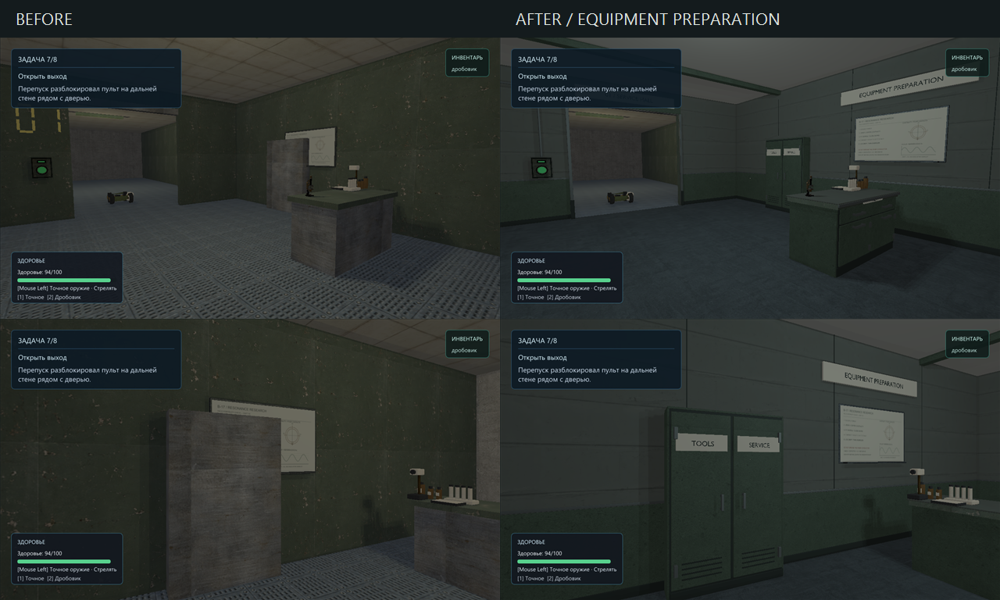
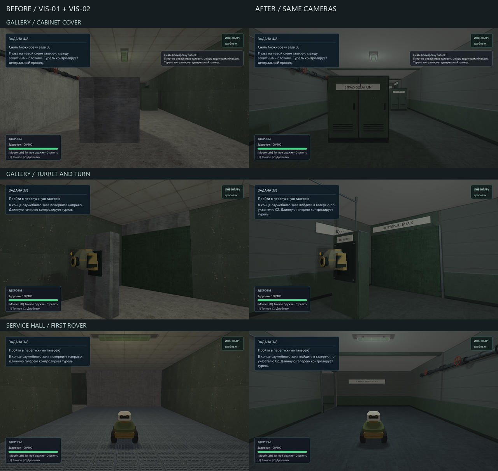
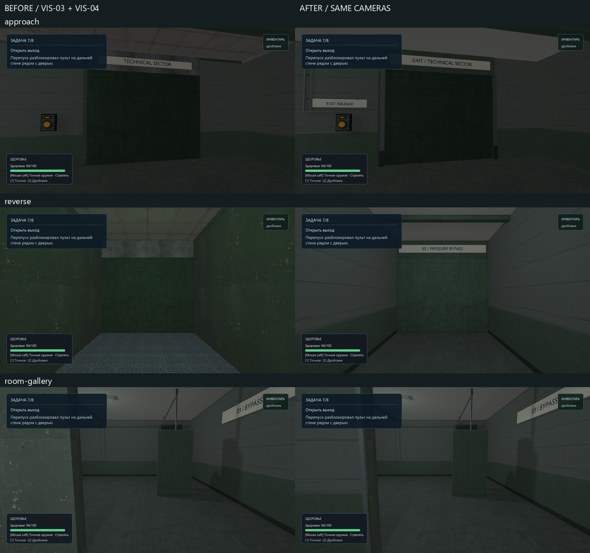

# Pressure transfer: first visual slice

2026-10-07. Owner-authorized visual revamp of the current working tree.
Scope: the mixed relay room (x=24–40, z=26–44), approximately one encounter and
the pressure-control/exit sequence. Existing combat cover, bench clearance,
interactions, target names, retry entry and mission order remain authoritative.

## Brief and construction contract

Function: pressure equalization and isolation for the technical sector.
Player purpose: defeat the mixed encounter, start transfer, unlock the exit.
Hierarchy: doorway/clear lanes, machinery and its control, then maintenance detail.
Landmark: paired pressure vessels on a wall-mounted bypass manifold, with one
brass differential instrument sharing the same supply/return system.
Materials: quiet concrete, desaturated green enamel, dark rubber, gray steel,
ivory instrument faces; brass confined to the differential instrument.
Asset families: shallow manifold, equipment-cover casing, room lining and
service runs. Reuse existing bench, fluorescent fixtures and safety notice.
Lighting: cool-white work light at entrance/bench; localized warm inspection
light at the manifold/control. No ambient scene-wide colored wash.
Story: a legible normal bypass has acquired a sealed differential measurement
loop; maintenance access stays clear. No lore paragraph or scattered symbols.
Occult: paired scales with incompatible readings connected to a deliberately
bonded brass loop. This is static environmental suggestion, not a new mechanic.
Reuse: manifold, casing and material palette; room lining remains map-specific.

Meter scale; Blender Z-up/front -Y → runtime Y-up/front +Z. Floor origins,
opaque triangles, UV0, normals and embedded base color maps, scalar
metallic/roughness opt-in. These assets have no normal maps and export no unused
tangents. No glass, emissive/ORM maps or runtime bypass.
Build in named stages: proportions → construction → UV/material → export →
fresh-import multiview → native/gameplay review. No cinematic polygon target;
measure exported density and runtime submissions rather than invent a budget.

## Baseline findings

- Architecture: correct routes, but large unarticulated boxes and uniform ceiling.
- Materials: repeated green panel/ribbed floor overwhelms the room's identity.
- Props: bench reads correctly; pressure transfer has no visible machinery.
- Lighting: weak differentiation between route, cover and objective.
- Composition: cover dominates entry; goal is a small distant panel.
- Story: no visible supply/return, isolation or measuring process.
- Noise: wall texture supplies detail where construction should supply it.
- Generic-content risk: adding arbitrary pipes would compound the problem.

Before: `build/visual-revamp/pressure-transfer/before/` contains the source-map
snapshot, original four route images and four fixed visual-slice images.
Capture tool: `relaycore_bench_relay_run --pressure-transfer --visual-slice`,
1280×720, hardware_srgb, HDR on, fixed saved gameplay cameras, powered state.
The normal `--pressure-transfer` run also exercises both combat routes.

## Authoring rules

1. Keep walking/rover/shot lanes and panel approach clear; detail gathers at walls.
2. Preserve large concrete masses; use a dark lower service band and explicit joints.
3. Pipes have visible supply/return ends, supports and isolation hardware.
4. Pressure-vessel heads are curved, flanges have thickness, and gauges have stems.
5. Pale gauge faces and red manual wheels provide scale and local contrast.
6. Green enamel is mostly intact; wear concentrates on handles and service seams.
7. Practical cool-white fixtures lead through the room; amber identifies inspection.
8. Brass belongs to one measurement loop. No free-floating occult decoration.
9. Signage names a function or route; do not copy reference branding or fake serials.

## Compact reference set

Owner boards were visually opened/attached. Web image search returned the photo
references below; manufacturer text/drawings were also consulted. Several full
photo hosts timed out, so inaccessible reverse construction remains an inference,
not a claimed photographic measurement. Reference photos are not game textures.

| Category | Reference | Information used |
| --- | --- | --- |
| Architecture | [Owner: environment variants](2026-10-07%2019-50-31.png) | Utility bays and reserved plain concrete masses |
| Composition | [Owner: facility/anomaly](relaycore-facility-anomaly-board.png) | Service route kept separate from machinery focal point |
| Equipment | [Owner: analog equipment](relaycore-industrial-occult-board.png) | Ivory dials in dark frames, physical knobs |
| Lighting | [Owner: dark research](relaycore-dark-research-board.png) | Cool practical route light, small warm maintenance pools |
| Occult | [Owner: design systems](relaycore-design-systems-board.png) | One instrumented anomaly inside ordinary infrastructure |
| Equipment | [WIKA gauge](https://www.wika.com/en-en/232_50_233_50.WIKA) | Round case, narrow bezel, lower radial stem; no modern QR graphics |
| Construction | [WIKA dimensions, pp. 7–10](https://www.wika.com/media/Data-sheets/Pressure/Pressure-gauges/ds_pm0202_en_co.pdf) | Case depth and stem/flange relationships; not a branded replica |
| Construction | [KSB installation](https://www.ksb.com/en-global/centrifugal-pump-lexicon/article/installation-1117016) | Shared foundations, supported pipe loads and maintenance access |
| Equipment | [Hydro-Vacuum installations](https://www.hydro-vacuum.com.pl/zestawy-hydroforowe-zha.php) | Paired vessels, common manifold and isolation valves |
| Equipment | [Alltype pump bases](https://www.alltypeengineering.com.au/projects/industrial/woodman-point-wastewater-treatment-plant-torque-tube-column-and-floc-skirts-2) | Motor/baseplate/coupling guard relationships; retained for later pump work |
| Architecture | [CERN cooling infrastructure](https://en-dep-cv.web.cern.ch/sps-home) | Real research facilities rely on ordinary cooling/compressed-air systems |
| Composition | [CERN heat exchanger](https://home.cern/heating-homes-worlds-largest-particle-accelerator/) | Readable paired equipment and connected service network; contemporary analogue |
| Signage | [Museum control desks](https://collection.sciencemuseumgroup.org.uk/search/objects/object_type/control-desk) | Process names and grouped controls rather than invented decorative numbers |
| Equipment | [Museum pressure station](https://collection.sciencemuseumgroup.org.uk/objects/co8823605/daily-herald-photograph-london-gas-shortage) | Distinct pressure measurement and chart-recording functions; older analogue |
| Materials / wear | [Poly Haven Concrete Wall 003](https://polyhaven.com/a/concrete_wall_003) | Downloaded and inspected; rejected because spalling would overwhelm this maintained room |
| Materials | [Poly Haven Concrete Wall 001](https://polyhaven.com/a/concrete_wall_001) | Downloaded, checksum verified and adopted: restrained formwork joints, 1.5 m tile |
| Materials | [ambientCG Concrete033](https://ambientcg.com/view?id=Concrete033) | Candidate only; full download did not complete, not incorporated |

No game textures, proprietary meshes, reference logos or generated moodboard
pixels are incorporated into runtime assets.

## Integration and evidence

Implemented on working tree over `c1118a1`. The pre-existing renderer, retry,
resource-preparation and roadmap changes were preserved. This document owns the
bounded art iteration; external human/other-GPU acceptance remains open.

Four reproducible `.blend` / `.glb` sources in `content/models/`, generated by
`scripts/export-pressure-transfer-glb.py` with Blender 5.2.2 LTS:

| Asset | GLB triangles | Parts/materials | Runtime role |
| --- | ---: | ---: | --- |
| `pressure_manifold` | 12,699 | 6 | Supported receivers, flanges, isolation wheels, differential loop |
| `transfer_cover_casing` | 5,087 | 4 | Two instances around existing cover, second instance scaled to its solid |
| `pressure_control_casing` | 4,476 | 6 | Three meters, cabinet and cable riser around the existing usable |
| `transfer_room_lining` | 3,197 | 8 | Floor, concrete/dado, pilasters, ribs, routed tray and exit sign |

The model declaration enables scalar metallic/roughness explicitly. CMake
compiles GLB → `build/msvc-debug/generated/model-assets/models/*.rcmodel`, writes
receipts, then stages to `build/msvc-debug/src/relaygame/assets/models/`.
`scripts/check-model-assets.ps1` verified source/importer/declaration/product and
staged hashes. No generated native product was put into source `assets/`.

Fresh `.blend` and `.glb` inspections: all four pass hard gates; no degenerate
faces, invalid vertices, isolated vertices, zero-length edges or missing material
faces. All GLB meshes have UV0. Exported split vertices explain GLB boundary-edge
counts; these render shells are not native collision meshes. Six neutral views
per GLB and metrics: `build/blender-review/pressure-transfer/final/`.

Downloaded source, license, author, checksum, actual map usage and adaptation:
`content/third_party/polyhaven/pressure_transfer/README.md`. Green enamel and
floor reuse existing project texture sources. The three derived PNGs are in
`content/graphics/pressure_transfer/` and are packed in the source/GLB files.

Post-integration correction: lifted floor/enamel values, separated the cool work
light from a warm manifold inspection light, reused the casing for the second
cover, completed the control riser/exit wall and removed an overlapping wall
panel from the doorway. Eight final gameplay views were inspected, including
bench/rover clearance and both directions through the room. The door opening,
interaction approach and original cover solids remain intact. One shallow
explicit manifold AABB occupies the wall service bay.

Before, first integration and corrected captures/logs:
`build/visual-revamp/pressure-transfer/{before,after-v1,after}/`.
The comparison above uses unchanged gameplay cameras, HUD, resolution and saved
state. No Blender render substitutes for the in-engine comparison.

Verification:

- Debug demo, benchmark, content-validation and unit-test targets built.
- Eight pressure-transfer validation cases, all shipped-map validation and model
  tooling: 10/10 passed (`tests-content.log`).
- Final targeted Vulkan checks: resource preparation, color baseline, playable
  pressure-transfer route and the changed room's two static views.
- The new `--pressure-transfer-slice` mode selects the existing world-view checks
  for this room; the normal full test retains all its original checks.
- Only `pressure_transfer-1{,-shotgun}.rcgb` were explicitly updated after image
  review. Their prior files and before captures remain in the review directory.
- The full `graphics.vulkan_mesh` test still fails at `mesh-reload-0`:
  mask difference 0, color difference 0.111389, mean RGB delta 3.32784. Running the
  same executable against the before-map snapshot produces **identical** values.
  This baseline mismatch predates this art patch; unrelated baselines were not
  rewritten. Logs: `tests-baselines.log`, `before-profile/baseline-before.log`.
- Legacy static regression views are substantially darker than the actual HDR
  gameplay views above; they verify placement/material output, not the art bar.

## Measured cost and remaining acceptance

RTX 4060 Ti, GPU API 1.4.329, 1280×720, VSync off, hardware sRGB, HDR/shadows on,
audio off. One executable per configuration, old/new map roots; no concurrent GPU
work. `--pressure-transfer --profile` runs two 2-second passes per saved state;
the table uses pass 1. OS/driver caches were not controlled. These are stationary
scripted states, not a continuous human traversal. CPU/wall frame boundaries
include update, render/UI and presentation; no separate GPU timing is claimed.

Debug with validation, powered state: 77 → 114 draws; 41,190 → 73,722 triangles;
256 → 133 measured samples; frame p50 7.776 → 15.034 ms, p95 8.167 → 15.407 ms.
Combat-state p50 changes from 10.66–10.76 to 19.05–19.18 ms. Logs:
`before-profile/profile.log`, `after/profile.log`. This is a measured Debug cost,
not a playable-build FPS claim. Optimized comparison is recorded below.

## Keep, avoid and next pass

Keep: plain concrete masses, a readable painted service band, supported machinery,
grouped analog controls and local practical-light contrast. Reuse the manifold,
casings, restrained enamel/concrete palette and maintenance-boundary pattern.
The room-sized lining and exact exit sign placement are scene-specific.

Avoid: the initial dark floor/enamel, broad gritty textures as a substitute for
construction, unreviewed CDN partial files, arbitrary symbols and decorative
pipe runs. The occult instrument is intentionally subtle; it does not establish
a new interactive system or containment-effect capability.

Next bounded steps, in actual episode order:

1. Measure reusable kit density/submission cost before spreading it to more rooms.
2. Give the entrance equipment bay the same clear functional material hierarchy.
3. Art-pass the long gallery's cabinet cover and turning landmark.
4. Carry the shared service treatment into the exit corridor, retaining route cues.
5. Review the connected episode with the owner/new player before another detail pass.

## Equipment bay continuation — 2026-10-08

Owner requested further visual revamp according to project files. Bounded scope:
entry equipment preparation bay x=0–8, z=0–10, following the next-pass order above.
Keep all original solids, pickup/panel/door identities and route logic. New native
render skins: quiet concrete, protective enamel dado, blue-gray coated floor,
folded doorway, closed preparation bench and shallow service-tools cupboard.
Reuse accepted concrete/enamel sources, fluorescent fixture and laboratory props.
Move the existing notes board out from behind the cupboard to above the bench.
No additional occult landmark: the downstream bonded differential loop remains
the episode focal point. No new physics, rendering features or packaging.

References opened: `occult-facility-style-board.png` and
`relaycore-industrial-occult-board.png`. Concrete above a dark service band,
compact closed steel storage, broad intact paint, physical handles and a clear
institutional doorway carry the observed construction/material relationships.
Hidden cabinet joinery is inferred, not a claim of manufacturer replication.
Finish target: manufactured edges and complete visible faces at 1–6 m; no new
polygon budget. Measure final native submissions instead. Stages: layout and
clearance → closed furniture construction → world-scale UV/materials → fresh
GLB inspection/multiview → same-camera gameplay comparison.

Baseline: `build/visual-revamp/equipment-bay/before/`, four 1280×720 HDR gameplay
views via `relaycore_bench_relay_run --pressure-transfer --equipment-bay`.
The existing chart is visibly obscured by the cupboard, all walls share a busy
steel tile, and the bench/cupboard retain unresolved block forms.
Verification and the final comparison follow below.

### Completed entry-bay pass

Two reproducible Blender 5.2.2 LTS sources, generated by the existing exporter:

| Asset in `content/models/` | GLB triangles | Materials/parts | Role |
| --- | ---: | ---: | --- |
| `equipment_bay_lining.blend` / `.glb` | 3,940 | 7 | Concrete/dado, coated floor, ceiling, gate frame, signs and supported reader conduit |
| `equipment_bay_furniture.blend` / `.glb` | 7,043 | 5 | Closed preparation bench and shallow two-door service cupboard |

`--model=equipment_bay_lining --model=equipment_bay_furniture` selects just these
families in `scripts/export-pressure-transfer-glb.py`. Two derived base-color
PNGs, `bay_bluegray_floor.png` and `bay_worktop_laminate.png`, live in
`content/graphics/pressure_transfer/`; they reuse original project source sheets.
Concrete and enamel reuse the accepted sources documented above. No new external
download, normal map, baked shadow or unsupported texture channel was introduced.
Metallic/roughness factors use the existing explicit CMake opt-in.

Construction review corrected the cupboard's hinge/handle arrangement and split
its identification plates so they do not bridge the door seam. The notes board
is above the bench, clear of the microscope and cupboard. The reused fluorescent
body now contains a correctly sized, less green light-strip insert. Functional
solids, door movement, mission, enemies, pickup and interaction positions are
unchanged. Render skins extend only a few centimetres beyond the existing solids.

Both authored and freshly imported assets pass inspection: matching triangle
counts, UV0 on every mesh, no invalid vertices, degenerate faces, isolated
vertices, zero-length edges or missing material faces. Render-shell boundaries
and glTF split vertices are expected; these are not collision products.
Six-view GLB evidence was rendered and opened: lining in
`build/blender-review/equipment-bay/v1/equipment_bay_lining/`, final furniture in
`build/blender-review/equipment-bay/final/equipment_bay_furniture/`. Interior finish
was reviewed through the four gameplay cameras, including the reverse view.

Native products are generated under `build/<configuration>/generated/model-assets/models/`
and staged under `build/<configuration>/src/relaygame/assets/models/`. Debug game
and capture targets were built; Debug and RelWithDebInfo asset targets were
staged. All 26 model receipts/products/staged hashes match in both configurations.
No generated native product was added to source `assets/`.

Checks actually run, logs under `build/visual-revamp/equipment-bay/`:

- `ctest --test-dir build/msvc-debug -R '^(validation\.(pressure transfer|all shipped)|relaycore\.tooling\.model_assets|graphics\.pressure_transfer$)' --output-on-failure --no-tests=error`: 14/14 passed, no skips.
- After the final cupboard correction, the same selection without the unchanged
  model-pipeline tooling fixture: 13/13 passed, no skips (`tests-final.log`).
- `relaycore_level_check.exe assets/levels/pressure_transfer.toml`: valid, no warnings.
- `scripts/check-model-assets.ps1`: final Debug and optimized receipts verified.
- Final `relaycore_bench_relay_run --pressure-transfer --equipment-bay`: passed;
  four 1280×720 hardware-sRGB/HDR captures in `after/pressure-equipment-captures/`.
- Expected Vulkan validation/shutdown diagnostics were absent; `git diff --check`
  passed. Existing unrelated working-tree changes and graphics baselines were preserved.

Same reverse camera and saved powered state: 104 → 118 draw calls,
72,166 → 83,777 triangles, including the reused fixture. This records added
submission/geometry cost; the four-frame capture is not a performance benchmark
or a claim about playable FPS. A continuous human pass and subjective acceptance
remain open. This completes next-pass step 2 above; the gallery is the next
bounded art target. The original mixed-room evidence remains historical.

## VIS-01 / VIS-02 — gallery and service hall, 2026-10-08

Owner requested these two items from `VISUAL_REVAMP_AUDIT.md`. Scope: gallery
x=8–32, z=18–26 and service hall x=0–8, z=10–24. The first rover should read
against quiet architecture; the gallery's isolation cabinets, turret mounting
and turn into room 03 should explain its function without narrowing combat lanes.
Original solids, doors, panels, threats and mission identities remain authoritative.

Reference inspected: `relaycore-industrial-occult-board.png`, especially its
concrete/service-band corridors, folded cabinet doors, supported utilities and
high-mounted directional signs. The accepted entry-bay comparison establishes
the local palette. Broad intact concrete above enamel, a plain ceiling and
contained overhead services connect the rooms; no new occult focal point.
Hidden joinery is inferred. Reuse the existing cover casing, utility pipes and
fluorescent fixtures; add only scene-specific lining and turret backing skins.

Contract: metre scale, complete visible/reverse faces, restrained bevels and
world-scale UVs; polished manufactured finish, no explicit low-poly request.
Keep render skins close to the unchanged physical envelopes. Inspect primary
layout and supports, then materials, fresh-import topology/multiview and native
gameplay views. No arbitrary triangle target or performance claim. Deliver
reproducible exporter, `.blend`/GLB sources, CMake declarations, map placements
and before/after evidence. Human acceptance remains separate.

Fixed cameras: `relaycore_bench_relay_run --pressure-transfer --gallery` and
`--service-hall`; add `--standby` for live threats before transfer activation.
Each mode retains the existing two-tactic complete-route assertions. Baseline
and subsequent captures/logs live in `build/visual-revamp/gallery-service/`.
Status: source/export, technical validation and visual review complete. Human
acceptance remains open; VIS-03/VIS-04 are outside this continuation.

Two new families generated by `scripts/export-pressure-transfer-glb.py`:

| Source/export in `content/models/` | GLB triangles | Materials/parts | Function |
| --- | ---: | ---: | --- |
| `service_hall_lining.blend` / `.glb` | 4,913 | 7 | Shared concrete/enamel/floor treatment, return gate, gallery portal, direction sign, pipe returns and conduit |
| `isolation_gallery_lining.blend` / `.glb` | 8,657 | 7 | Gallery lining, room 03 frame/landmark, reader feed, pipe terminations and turret mounting skins |

The two gallery covers reuse `transfer_cover_casing` rotated toward the long
approach. Scale preserves their original 2×2 and 2×1.6 m solid footprints and
2.2 m height. Three reused fluorescent housings contain resized light inserts;
three reused pipe modules occupy the service hall's west wall. Existing texture
sources/palette and scalar metallic/roughness opt-in are reused. No new external
download, texture family, collision product or renderer capability.

Gameplay review corrected the initially blank cabinet sides, a conduit crossing
the reader's label, the portal's unlined reverse face and the direction arrow.
The two old left/right mission hints contradicted the actual turns; they now
refer to the installed signs. All 39 non-light physical solids, gameplay entity
properties, mission conditions/order, retry/episode identities and interactions
match the before-map snapshot. Only three decorative light inserts were resized;
the local light palette now matches the entry bay. Render skins have no collision.

Both authored and freshly imported GLBs pass inspection: matching triangle
counts, UV0/material coverage on all meshes, no invalid/isolated vertices,
degenerate faces, zero-length edges or missing material faces. Six-view GLB
renders were opened in `build/blender-review/gallery-service/final/`. Render
shells and glTF split vertices explain the expected boundary-edge counts.

Sixteen final 1280×720 hardware-sRGB/HDR gameplay views were inspected: four
cameras per zone, standby/live threats and powered/completed threats. These
include both gallery directions, the turret/turn, reader, first rover, service
reverse, portal and its reverse corner. Comparison uses the original map
snapshot and identical cameras/settings; HUD wording changes are intentional.
`before/`, `after-v1/`, `after/` and `final-contact-sheet.png` under
`build/visual-revamp/gallery-service/` retain the evidence. The staged before-map
was restored to the current source immediately after baseline capture.

Checks actually run:

- Debug game, capture runner, content validation and Check Map targets built;
  final `relaycore_demo_assets` built/staged in Debug and RelWithDebInfo.
- `ctest --test-dir build/msvc-debug -R '^(validation\.(pressure transfer|all shipped)|relaycore\.tooling\.model_assets|graphics\.pressure_transfer$)' --output-on-failure --no-tests=error --output-junit vis-01-02.xml`:
  14/14 passed, zero failures/skips (`tests-debug.log`).
- After the final reverse-face correction, the same selection without unchanged
  model tooling: 13/13 passed, zero failures/skips (`tests-final.log`,
  `build/msvc-debug/vis-01-02-final.xml`). This includes both tactics, pistol-only
  completion, rover/door/cover queries, interactables, continue/retry and editor
  round trip. Four final camera runs also completed both scripted tactics.
- `relaycore_level_check.exe assets/levels/pressure_transfer.toml`: valid, no
  warnings (`check-map.log`). Final capture logs contain no Vulkan validation
  errors. Existing graphics baselines were not updated by this continuation.
- `scripts/check-model-assets.ps1`: all 28 source/importer/declaration/product/
  staged receipts match in both configurations; staged map SHA256 matches source.
- `git diff --check` passed. Sandbox compiler launch and temporary-save rename
  restrictions required using the existing VS environment outside the sandbox;
  no toolchain or dependency change was needed.

Same powered gallery-forward camera: 144 → 183 draws, 86,829 → 116,745 triangles.
Same powered service-forward camera: 139 → 177 draws, 84,767 → 114,673 triangles.
These record added submissions/geometry for the scene, not an FPS benchmark.
No new profiling cycle or packaging was performed. Continuous human traversal
and subjective acceptance remain open. Authored map edits change its save
fingerprint; older `pressure_transfer` progress requires a new episode under
the existing compatibility rule.

## VIS-03 / VIS-04 — exit and continuous-route junctions, 2026-10-08

Requested scope: finish the existing 4×8 m exit corridor and inspect the joins
between the completed pressure-transfer zones. Reuse the accepted concrete,
enamel, steel and floor palette, practical fluorescent housing and institutional
signage. The inspected industrial-occult board informs the thin metal reveals,
high destination plates and restrained service band; no new occult focal point.
Construction behind the lining is inferred from the existing physical solids.

Keep all gameplay solids, doors, readers, triggers, mission and retry identities.
Render skins follow the existing envelopes; doorway clearances and player routes
remain authoritative. Required views: exit approach, interior, reverse and reader;
bay/hall, hall/gallery and both sides of gallery/mixed-room joins, before and after
`transfer_running`. Fresh GLB inspection and multiview renders supplement runtime
review. Human continuous traversal remains a separate acceptance criterion.

Source: `scripts/export-pressure-transfer-glb.py --model=transfer_exit_lining`;
metre scale, native opaque material subset, world-scale UV0, editable Blender and
GLB deliverables. Baseline map/captures and subsequent evidence are retained in
`build/visual-revamp/exit-junctions/`; Blender review in
`build/blender-review/exit-junctions/`. Implementation and fixed-view runtime
review complete. Roadmap owns statuses: VIS-03 done; VIS-04 awaiting human pass.

| Source/export in `content/models/` | Triangles | Materials/parts | Result |
| --- | ---: | ---: | --- |
| `transfer_exit_lining.blend` / `.glb` | 5,268 | 7 | Concrete/enamel lining, coated floor, ceiling, two-sided gate sleeve, destination and reader signs, supported reader feed |
| `transfer_room_lining.blend` / `.glb` | 3,784 | 9 | Updated existing family: plain ceiling, consistent dado/coping, entry return walls, reveal, return sign and threshold |

The exit reuses `fluorescent_fixture.rcmodel`. Its local light retains
`required_target = "transfer_running"` with the shared cool-white palette;
the old unconditional LightStrip solid was removed so the existing dynamic lamp
emitter controls the visible state. The conditional emitter has no collision.
No external texture, collision product, dependency or renderer change was needed.

Baseline views confirmed the raw reverse doorway into room 03, missing finish
across its threshold, different dado height and tiled bypass ceiling. These were
repaired locally. Bay/hall and hall/gallery views did not justify additional
geometry edits. Both sides of the new exit frame are finished; the reader supply
routes beside its identification plate. Review caught and corrected a local/world
origin mix-up in the entry return and an initial conduit crossing the reader sign.
Intermediate evidence is retained in `after-v1/` and Blender `final/`; final accepted
sources correspond to Blender `reviewed/` and runtime `after/`.

Authored and fresh-import GLBs have matching triangle counts, UV0 on every mesh,
no invalid/isolated vertices, degenerate faces, zero-length edges or missing
material faces. Both six-view contact sheets and perspective images were opened.
Render-shell boundaries and glTF vertex splits are expected. Sixteen same-camera
before/after runtime views cover standby/powered states, plus four final open-door
views. The far reverse open-door camera also exercises the existing final trigger
and shows its completion presentation. All 39 non-light physical solids, gameplay
entities, mission/retry conditions and environment effects match the before-map.
Static review found no remaining visible join defect in these views; temporal
flicker and subjective route continuity still require continuous human traversal.

Checks actually run, logs under `build/visual-revamp/exit-junctions/`:

- Debug build: `cmake --build --preset demo-debug --target relaycore_demo relaycore_bench_relay_run relaycore_content_validation relaycore_level_check -j 2`; final assets restaged with `relaycore_demo_assets`.
- `ctest --test-dir build/msvc-debug -R '^(validation\.(pressure transfer|all shipped)|relaycore\.tooling\.model_assets|graphics\.pressure_transfer$)' --output-on-failure --no-tests=error --output-junit vis-03-04.xml`: 14/14 passed, zero skips (`tests-final.log`).
- After the final geometry/sign correction, same selection without unchanged model-tooling fixture: 13/13 passed, zero skips (`tests-reviewed.log`, `vis-03-04-reviewed.xml`).
- `relaycore_level_check.exe assets/levels/pressure_transfer.toml`: valid, no warnings (`check-map-reviewed.log`).
- `scripts/check-model-assets.ps1`: all 29 Debug source/importer/declaration/product/staged receipts match (`receipts-debug-reviewed.log`); staged map SHA256 matches source.
- Capture runner: `--pressure-transfer --exit-corridor`, `--junctions`, each with/without `--standby`; additional `--exit-corridor --exit-open`. All complete both scripted tactics; final logs contain no expected Vulkan validation/shutdown errors.
- `check-invariants.py`: gameplay/physical invariants and authored/fresh-import geometry checks passed. `git diff --check` passed.

Only Debug was rebuilt/verified for this continuation. The MSVC/Blender launches
required execution outside sandbox; existing toolchain and dependencies were used.
Human acceptance remains open; authored map changes use the existing save-fingerprint
compatibility rule. No package was produced.
