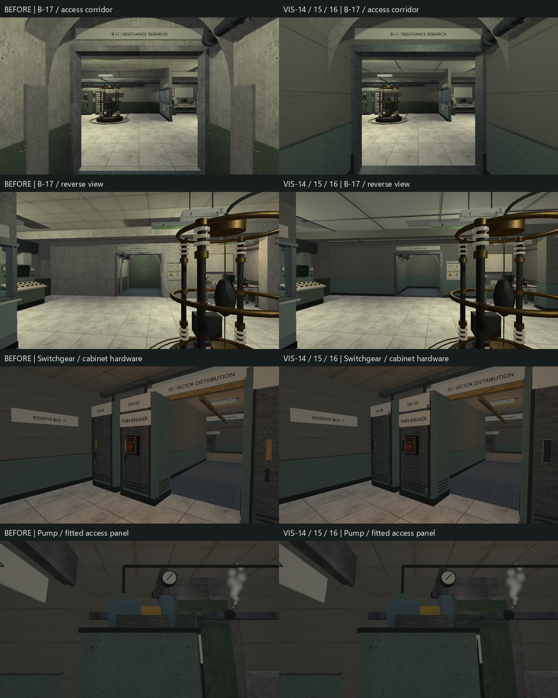

# VIS-14–16 — facility finish

Authorized 2026-10-08: extend the existing architectural finish to one next room,
repair infrastructure connections, and finish visible box equipment. Status and
acceptance remain owned by `PLAYABLE_SLICE_ROADMAP.md`.

Scope: B-17 laboratory and access corridor lining; existing pressure-transfer
pipe modules and B-17 ventilation/pipe terminations; existing power/bench cabinet
doors. Preserve original solids, collision, lights, mission, entries and props.
No renderer, dependency, gameplay, or collision contract changes.

Reference: `relaycore-design-systems-board.png`, inspected 2026-10-08. Its quiet
upper concrete, lower enamel, metal ceiling supports and folded cabinet doors
guide the finish. Existing accepted models determine dimensions and materials;
no new recognizable machine or external reference asset is needed. B-17 retains
the existing laboratory tile and corridor service floor, observation glass and
containment focus. Room-fitted assemblies remain room-fitted assemblies.

Model contract: reproducible Python/Blender sources, opaque native GLB, metres,
world origin. B-17 lining uses plaster, sage enamel, galvanized trim, dark plinth
and ivory ceiling; required parts are both wall faces at the entrance, column
wraps, dado/caps, ceiling fields/perimeters/tees and threshold. The passage and
window stay open. Target below 15,000 triangles for the lining; retain existing
smooth finish on pipes and manufactured cabinet edges. No low-poly request.
Cabinet hardware must attach to its door; elbows must meet pipe centres and wall
sleeves; ventilation backs must reach the wall. No arbitrary detail scattering.

Baseline: source maps and same-camera B-17, pressure gallery/hall and power
captures in `build/vis14-16/before`. Blender 5.2.2 LTS, build `d13f752e3b9c`.
The first sandboxed capture failed at canonical access to staged OBJ; the same
capture outside the sandbox passed. Blender likewise requires access to its
installed libraries outside the sandbox.

Completed modeling and optimized verification: the room's original tile/service
floors remain distinct, the apparatus stays dominant, and upper walls, column
wraps, entrance reveals, plinth and ceiling now match the facility finish.
The first runtime review prompted a complete beam jacket instead of a soffit
strip. Reviewed forward, reverse, observation, sample and instrument views,
including the existing isolator state change. The room-specific assembly is
not a freely rearrangeable modular kit; it reuses the existing palette,
manufactured-edge helpers and dimensional conventions.

VIS-15 adds five pressure pipe couplings, two bay wall elbows, a B-17 rear
coupling, two corridor elbows, swept rear wall returns and two mounted vent
throats. Existing pipe shafts already meet at 3 m module spacing; the couplings
explain the interval between their recessed flanges. Existing clamps, routed
reader/turret cables, light stems and supported equipment are retained. The six
new close views in `tests/power_restoration_graphics.cpp` cover these contacts.
Gallery/hall forward, reverse, corner and reader views were also opened.

VIS-16 refines the existing shared cabinet construction in power intake,
switchgear, pump drive and bench workshop: door gasket, hinge leaves/barrels,
raised pull with feet, captive screws and folded top lip. The access panel now
uses the cabinet height; its previous fixed centre put the short pump panel
above its housing. Existing side/rear access panels, louvers and plinth remain.
The pumps and heat exchanger from VIS-07/09/12 already provide the required
machine families; another machine family is unnecessary for these consumers.



Source chain: `scripts/export-b17-lining-glb.py` →
`content/models/b17_lining.blend` / `b17_lining.glb` →
`cmake/RelayCoreModelAssets.cmake` → generated/staged
`models/b17_lining.rcmodel`. Existing generator scripts own the other eight
revised models. The reused palette is packed in `.blend`/GLB; temporary PNGs
live under `build/blender-review/b17-lining/materials`, with no duplicate loose
source textures. A clean Blender rerun reproduced the lining GLB byte-for-byte.

| Retained model | Triangles |
| --- | ---: |
| `b17_lining` | 8,100 |
| `b17_services` | 27,817 |
| `equipment_bay_lining` | 5,136 |
| `service_hall_lining` | 5,161 |
| `isolation_gallery_lining` | 8,905 |
| `power_intake` | 13,774 |
| `power_switchgear` | 21,592 |
| `power_pump` | 11,872 |
| `bench_workshop` | 15,988 |

Authored and fresh-import inspection passed for all nine models: no invalid
vertices, degenerate faces, zero-length edges or missing-material faces. Six
neutral lining and cabinet-family views were opened. Interior finish and actual
contacts are established by the runtime views, since external neutral views
cannot see through a room shell. Metrics and sheets are in `build/vis14-16`.

Optimized checks passed: 12/12 content/tooling, 4/4 graphics with no skips.
The selection covers B-17 routes, pressure support/complete route/continue,
power fuse/snapshot/retry/service route, bench opening/tactics/retry, shipped
map references and native-model tooling. Graphics cover B-17 HDR/SDR, pressure
and bench. Separate power HDR/SDR capture runs both exited 0; HDR is saved in a
separate directory to preserve comparable before/after evidence. All four
affected Check Map reports are valid with no warnings. The preservation check
compares the saved TOML structures: all original B-17 data and the entire power
and pressure maps are unchanged; only `b17_fitted_lining` was added.

All 44 source/product/receipt/staged model hashes pass
`scripts/check-model-assets.ps1` in Debug and optimized. All 44 staged native
models, the four affected maps and B-17 probe match across configurations.
The optimized baker evaluated the current Debug native inputs, producing
18 B-17 probes with signature `16069326436357541102`; the subsequent Debug
build independently accepted and reused that product. No fingerprints or
receipts were edited. The current Debug capture target built and rendered
26 fixed views with `--art-review`: exit 0, `validation=true`, no Vulkan
validation warnings/errors or shutdown failures. This covers B-17, power,
bench and the pressure pipe close views. Its log and images are under
`build/vis14-16/debug-validation`.

```text
cmake --build --preset demo-relwithdebinfo --target relaycore_power_restoration_graphics relaycore_bench_relay_run relaycore_content_validation relaycore_level_check -j 2
ctest --test-dir build/msvc-relwithdebinfo -R '^(validation\.(B17.*|all shipped.*|pressure transfer (wall equipment.*|complete route.*|continue and retry.*)|power restoration (requires a fuse.*|repeated death.*|service route.*)|bench relay (native opening.*|distance and cover.*|tactical snapshots.*))|relaycore\.tooling\.model_assets)$' --output-on-failure --no-tests=error
ctest --test-dir build/msvc-relwithdebinfo -R '^graphics\.(b17(_sdr)?|bench_relay|pressure_transfer)$' --output-on-failure --no-tests=error
cmake --build --preset demo-debug --target relaycore_model_assets -j 2
cmake --build --preset demo-debug --target relaycore_demo_assets -j 2
cmake --build --preset demo-debug --target relaycore_power_restoration_graphics -j 2
# With RELAYCORE_ASSET_ROOT pointing to the corresponding complete staged root:
relaycore_power_restoration_graphics.exe --art-review
relaycore_power_restoration_graphics.exe --hdr --power-views-only
relaycore_power_restoration_graphics.exe --power-views-only
```

Logs, JUnit, map reports, preservation evidence and source/GLB metrics are in
`build/vis14-16`. Repeated power export encountered OpenImageIO refusing to
overwrite an existing PNG; switchgear succeeded on retry, while pump generation
used the same generator with a separate temporary PNG directory. The resulting
blue-gray texture is byte-identical to the accepted source. This is a local
export incident, not a changed importer/material contract.

The human continuous walkthrough, subjective author acceptance, other-GPU and
performance gates remain open. Python syntax, scoped clang-format and
`git diff --check` pass. Passing captures do not close the earlier SDR
highlight-handling observation. No renderer or lighting settings were changed.
