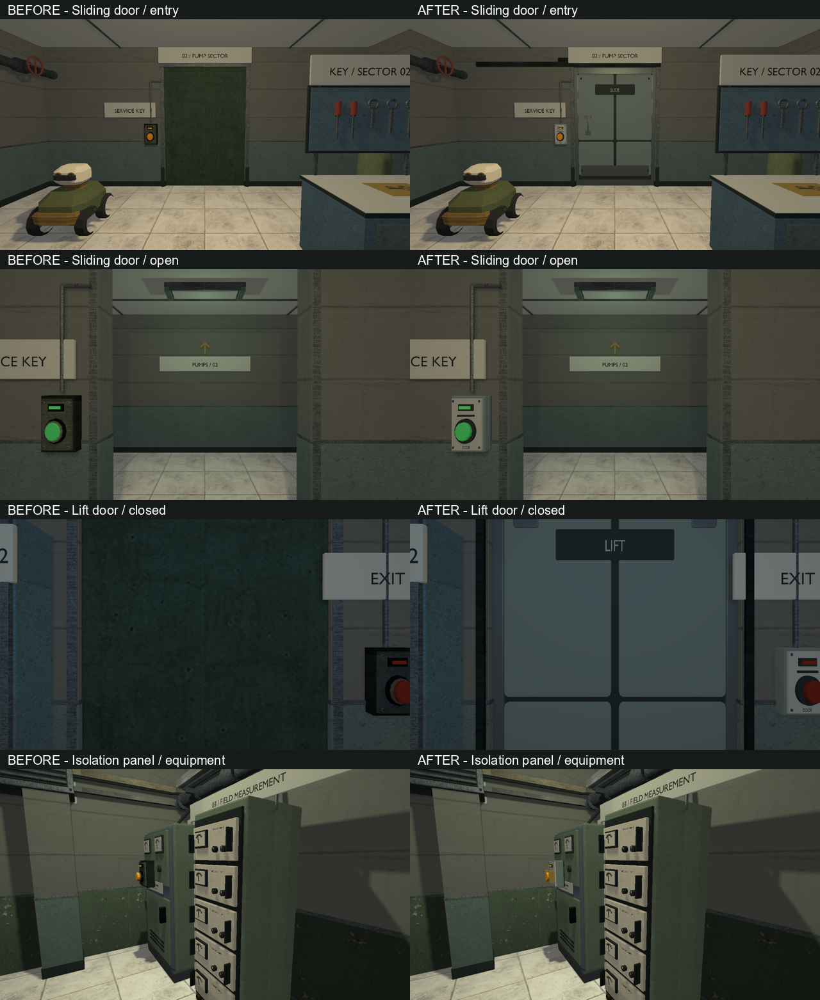
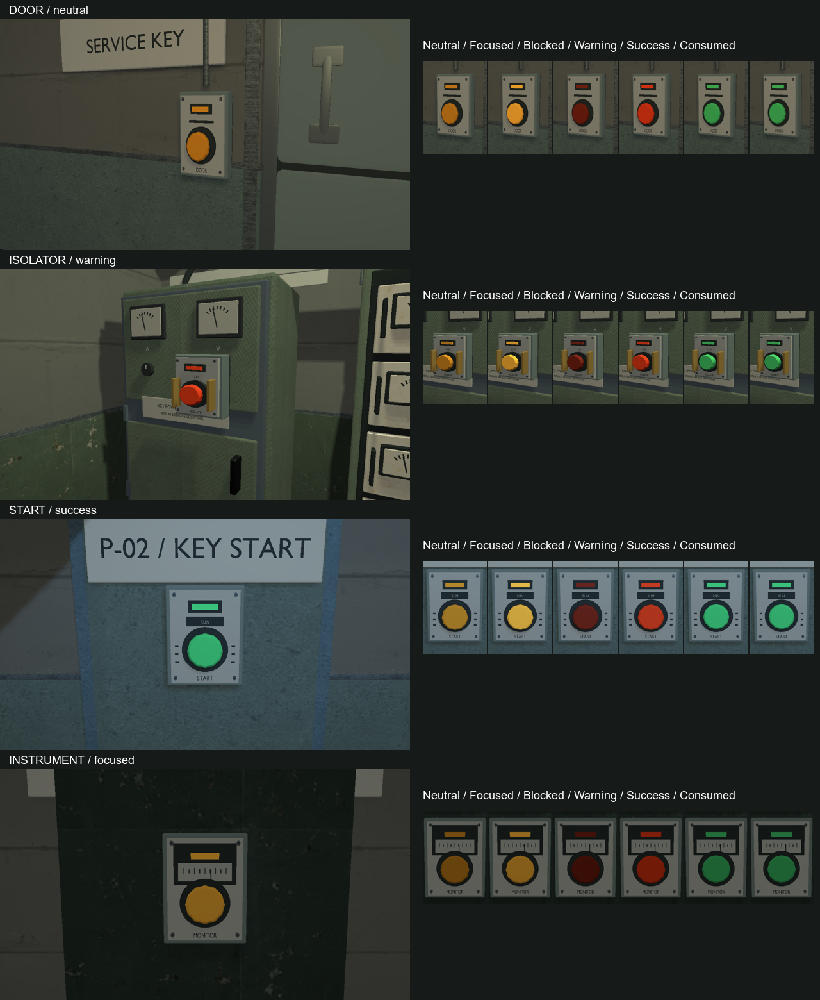

# VIS-17–19 — interactive hardware, 2026-10-08

## Scope and modeling contract

VIS-17: replace the shared box door with pressed-steel lift/sliding leaves,
rolled edges, recessed panels, kick plates and a readable drive identity.
Keep every leaf, including its pull handle, inside its original moving AABB.
Fixed guides sit outside the full swept depth; preserve movement, collision,
clearance and activation policy. Existing room portals remain useful context.

VIS-18: four recurring housings distinguish door access, isolation, startup
and measurement. Preserve the existing actuator position and all six neutral,
focused, blocked, warning, success and consumed presentations. Labels and guard
profiles must remain visible at interaction distance without covering the button.
The render-only `panel_style` property selects `door`, `isolator`, `start` or
`instrument`; invalid values fail with an entity index and accepted values.
Panel/button defaults to door, terminal/console defaults to instrument.

VIS-19: recheck the existing `service_key` native model and pickup/focus lifecycle.
The VIS-11 key has a pierced bow, shoulder, shaft and two teeth. The author already
accepted its silhouette, focus frame and disappearance after collection; reuse it.
Do not regenerate the fuse, shotgun or unrelated inventory.

Finish: smooth manufactured edges, restrained sage enamel, satin steel, ivory
legends and localized ochre guards. No low-poly/blockout delivery requested.
Six deterministic Blender/GLB assets, each below 8,000 triangles, reuse the
existing native pipeline and opaque scalar materials. Door coordinates normalize
to the unit AABB; panel XY normalizes to the existing interaction rectangle,
while depth stays in metres. Review at runtime proportions, from both sides,
through the full door travel and at gameplay distance. No user approval gate,
new dependency, packaging, collision product or gameplay rule is needed.

## Reference observations and assumptions

The inspected [project style board](occult-facility-style-board.png) supplies
the institutional palette, steel door panels and analog control enclosures.
The door reference has a perimeter frame, divided steel faces and a protected
lower edge; control panels use physical operators, removable front plates,
small indicators and clear material breaks. These relationships guide the
original geometry rather than reproducing named-game assets.

Construction analogues discovered in image search:
[UDF sliding fire doors](https://www.udf.net.au/doors/sliding-fire-doors) and
[Schneider XAL-E station](https://rexel.it/prodotto/pulsantiera-xal-e-1-pulsante-filoghiera-ad-impulso-verde-1-no-823207).
The image retrieval for the sliding door and Schneider's own rendition failed;
the Rexel image URL opened without usable image pixels in the tool output.
No claim of inspecting those photographs is made. The concealed lift drive,
guard geometry and two-sided guide construction are design assumptions constrained
by authored travel and clearance, not measured reproductions. No external media
is downloaded or included in game assets.

## Sources and evidence

`scripts/export-interactive-hardware-glb.py` owns the six `.blend`/`.glb` pairs
in `content/models`: `door_lift`, `door_slide`, `panel_door`, `panel_isolator`,
`panel_start`, `panel_instrument`. CMake compiles/stages their native products.
Renderer presentation is owned by `world_scene_renderer*`; existing feedback
actuator meshes and service-key source remain authoritative.

Working captures, source/fresh-import metrics, neutral views and logs live in
`build/vis17-19`.

## Production review

Installed Blender 5.2.2 LTS, hash `d13f752e3b9c`. Authored scenes and fresh GLB
imports agree in triangle counts and bounds, with no reported geometry issues:

| Model | Triangles | Role |
| --- | ---: | --- |
| `door_lift` | 3,396 | Lift clamps, rolled border, divided pressed faces, safety edge |
| `door_slide` | 4,760 | Recessed two-sided pull bridges, rolled border, kick plate |
| `panel_door` | 1,292 | Access slot, DOOR legend |
| `panel_isolator` | 1,409 | Ochre side guards, isolation legend |
| `panel_start` | 2,015 | RUN/START legends, side ventilation |
| `panel_instrument` | 1,495 | Analog scale and pointer, MONITOR legend |

Opened all six fresh-import contact sheets (perspective/front/back/left/right/top),
at runtime proportions: 3×3×0.22 m for door review, 0.38×0.50 m for panels with
unscaled metre depth. The final sliding-door handle uses a fixed transverse sweep
axis after runtime review exposed a frame flip in the general pipe sweep. The
instrument scale was lowered to leave the existing status lens unobstructed.
Both corrected assets were freshly inspected and their six views regenerated.

Door GLB bounds fit ±0.5 in normalized width/height/depth; maximum normalized
depth is ±0.4725 for lift and ±0.489 for slide. Renderer transforms these bounds
with the unchanged current door AABB, including doors facing X. Frame rails
remain at least 15 mm outside the full swept depth, drive covers at least 10 mm.
This is a construction/bounds argument for continuous clearance; runtime captures
sample closed, halfway and open positions plus reverse views. Existing adjacent
portal finishes and overhead services are retained.

Explicit style placements change only `panel_style`; the B-17 lining,
other model/export changes and earlier VIS-14–16 evidence were already present
in the working tree. Key geometry, other pickups, map solids, door descriptors,
mission actions and save identity are unchanged by this pass. Six map files
receive ten style properties; the default door style also affects intake.

## Verification and handoff

- Debug build: `cmake --build --preset demo-debug --target relaycore_demo relaycore_tests relaycore_content_validation relaycore_power_restoration_graphics relaycore_vulkan_mesh_tests relaycore_game_lifecycle -j 2`.
  Optimized: `cmake --build --preset demo-relwithdebinfo --target relaycore_demo -j 2`.
  Both built; final geometry was staged in both. The final save-only correction
  was rebuilt in both configurations and all affected Debug executables relinked.
- Final hardware selection: `ctest --test-dir build/msvc-debug -R '^relaycore\.(interactive panel|door reaches|activating open door|open-only door|closing door that|closing door overlapping)|^validation\.(two sectors|all shipped|power restoration requires|cooling loop gates|pressure transfer continue)|^relaycore.tooling.model_assets$|^graphics\.(interactive_hardware|resource_preparation$|game_lifecycle$|hdr_episode$)' --output-on-failure --no-tests=error --output-junit vis17-19-final.xml`.
  17/18 initially passed; the new panel-parser test lacked the logger fixture
  required by scene preparation. Added that fixture and reran the same case.
- Follow-up: `ctest --test-dir build/msvc-debug -R '^relaycore.interactive panel|^graphics\.(foundation_intake|foundation_pump$|b17$)' --output-on-failure --no-tests=error --output-junit vis17-19-followup.xml`:
  5/5 passed, including the repaired parser fixture and refreshed same-camera
  intake, pump and B-17 captures. The new hardware gates capture both door
  orientations, closed/half/open/reverse views, and all four panel roles in six
  states. They assert distinct neutral/focused/blocked/warning/success pixels
  and identical success/consumed presentation. Intake gates check focus and pickup.
- Save review found that the new render-only property would enter the existing
  level fingerprint. `save_game.cpp` now excludes only `panel_style`, so adding
  or changing this appearance does not invalidate pre-pass progress. Gameplay
  properties and geometry still enter the fingerprint; runtime registry identity
  is unchanged. `ctest --test-dir build/msvc-debug -R '^relaycore.save compatibility follows|^validation\.(two sectors|cooling loop gates|pressure transfer continue|power restoration requires|cooling loop editor|pressure transfer editor)' --output-on-failure --no-tests=error --output-junit vis17-19-save.xml`:
  7/7 passed after the correction. The native geometry and graphics inputs did
  not change in this final save-only patch.
- Across the selections, **25 distinct checks passed**, including **nine executed
  graphics cases with zero skips** and no validation warning/error failures.
  Initial fixture failure and the passing rerun remain in the separate JUnit logs.
- `scripts/check-model-assets.ps1 -ProjectRoot <repo> -BuildRoot build/<preset> -RuntimeAssets build/<preset>/src/relaygame/assets`:
  all 50 source/product/receipt/staged hashes verified in Debug and optimized.
  Seven Check Map runs (`foundation_intake`, `foundation_pump`, `power_restoration`,
  `pressure_transfer`, `bench_relay`, `cooling_loop`, `occult_lab_b17`) are valid,
  with zero warnings. Final `.blend`/GLB inspection and neutral six-view evidence
  cover all six new models; key source/product geometry was reused.
- Diff reviewed and `git diff --check` passed. Existing working-tree changes
  were preserved. Sandboxed captures could not canonicalize staged model paths,
  so working exports/builds/captures used the approved external execution path.
  One attempted test rebuild hit DLL copies locked by a running graphics check;
  retrying after that process exited passed. No archives, release, commit or push.

Technical delivery is complete. VIS-17/18 remain `awaiting_playtest` for the
author's subjective visual acceptance and continuous-route review. VIS-19 is
`done` using the prior explicit key acceptance plus current technical checks.
These results do not close independent gameplay playtests, another GPU, SDR
image-processing observations or performance gates; no speedup is claimed.
