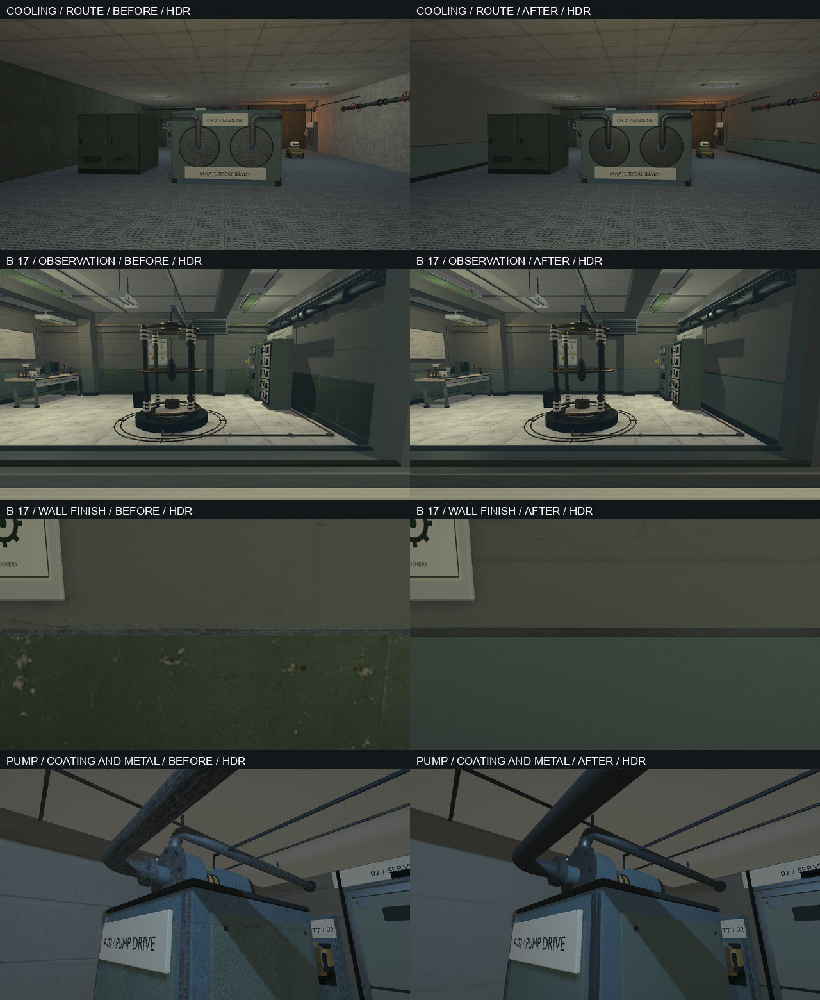

# VIS-20–22 — facility materials, 2026-10-08

Authorized scope: quieter large surfaces, metre-based UV/material consistency,
and a normal/scalar material pass on existing equipment. The inspected project
design-systems board supplies calm concrete/plaster, protective enamel and
distinct manufactured metals. Preserve gameplay, collision, light placement,
exposure, authored map data and the existing opaque native material contract.
No new dependency, renderer feature, external texture library or atlas rebuild.

## Changes

VIS-20: the existing power/foundation/bench/B-17 palette compresses concrete
variation to 35% and paint variation to 12% of its previous range. Existing
palette colours remain the source; wear no longer dominates the whole surface.
`cooling_service` adds upper plaster, a 1.10 m enamel dado, folded cap and
skirting just inside the original cooling room walls. The exchanger and two
aisles retain their geometry. B-17 review exposed an older VIS-14 problem: the
32 mm decorative dado was inside the original 80 mm `WallPanel`, leaving the
noisy original visible. The decorative dado/cap/plinth now cover those surfaces.
Physical solids and their collision were not changed.

VIS-21: the shared exporter reads explicit repeat lengths in metres: plaster
2.8 m, enamel 0.6 m and fine metal finish 0.4 m. The existing atlas remains
byte-identical, including all 32 wrapped 16 px gutters. Its laboratory floor
repeat is 1.6 m for a 2×2 tile image, so each tile is 0.8 m. Crate repeat remains
1.3 m; the separate object-mapped cotton/twill/leather/rubber repeats remain
0.20/0.24/0.16/0.12 m. Those independent wood/fabric consumers were retained,
not assigned the new equipment UV density. The earlier VIS-09 stretched casing
problem is already resolved by the fitted exchanger; current cooling shared
casings have no nonuniform scale. Graphics review covers close and route views,
forward/reverse directions, direct and weak light. This is a selected-consumer
pass, not a claim that every material in every map was reauthored.

VIS-22: deterministic periodic 256 px linear normal maps add restrained enamel,
steel, rubber and copper grain. Paint stays nonmetallic with roughness 0.63;
galvanized steel is metallic 0.80/roughness 0.48; B-17 bonded copper is
0.80/0.42, rubber 0/0.86 and ivory ceramic carriers 0/0.36. Existing opaque ABS
instruments are reused. The galvanized albedo formerly sampled cell 7
(blackened steel) of `prop_materials_source.png`; it now samples cell 2.
Colour textures retain sRGB semantics; normal images are `Non-Color`, +Y,
with positive Z, packed in the editable Blender source and GLB.

Blender 5.2.2 LTS (`d13f752e3b9c`) exports tangents for these models. Its
MikkTSpace output contained zero tangents at narrow bevel corners. The shared
exporter repairs only invalid exported vectors from geometry and UV derivatives
in double precision, retaining Blender's normal-image convention and handedness.
It rejects degenerate UV/surface data instead of inventing a basis. A damaged
real-product fixture verifies basis recovery, unchanged remaining payload,
handedness and idempotence. Native import validates all final tangent vectors
and triangle handedness. No importer tolerance or runtime contract was relaxed.

## Source and evidence

The existing generators own the output:

- `export-power-restoration-glb.py`: six `power_*` models.
- `export-bench-cooling-glb.py`: `bench_workshop`, `cooling_exchanger`,
  `cooling_service`.
- `export-foundation-intake-glb.py`: `foundation_intake`; the accepted service
  key was not regenerated.
- `export-foundation-pump-glb.py`: the pump machine and room.
- `export-b17-lining-glb.py` and `export-b17-services-glb.py`: B-17 finish/services.

`export-pressure-transfer-glb.py` owns the reused texture writer, normal writer,
metre projection and tangent repair. Existing pressure models were not
regenerated. These 14 `.blend`/GLB pairs compile through the existing model
declarations into generated/staged `models/*.rcmodel`; no loose runtime normal
files or hand-edited receipts are required.

All 13 existing model triangle counts are unchanged; `cooling_service` grows
from 9,220 to 10,948 triangles for its wall finish. B-17's existing lining keeps
8,100 triangles with corrected decorative thickness. All 14 authored/fresh
imports pass geometry gates. Neutral six-view pump/exchanger sheets and metre,
normal, atlas-gutter and product audits are retained in `build/vis20-22`.

`relaycore_power_restoration_graphics --material-views` and
`--material-views-sdr` provide twelve fixed material cameras. Before images use
a preserved complete staged root; after images use current Debug staging.
Both roots preserve the same maps, camera settings and lights. These include
cooling entry/reverse/wall, B-17 wall/gasket/services/earth/floor, pump detail and
shadow, intake detail and the bench route.

## Verification

- Debug capture target and optimized `demo_assets` build completed. All 50
  native model products, receipts and staged hashes pass in both configurations;
  the products match between configurations. The final B-17 probe was baked in
  optimized and accepted by the Debug baker's input fingerprint check.
- 18/18 selected content/tooling CTests passed, including native model/v2,
  normal/metallic fixtures, model asset validation and affected gameplay/map
  regressions. The final B-17 content test passed again after the lining fix.
- 10/10 graphics CTests passed without skips: bench, cooling, power, HDR episode,
  foundation intake/pump and B-17, including their SDR variants. All four manual
  before/after HDR/SDR capture runs passed: 48 fixed-camera images, with clean
  Vulkan validation. The three comparison sheets were visually inspected.
- Check Map passes for all six affected maps with no warnings. Their authored
  TOML bytes match the preserved baseline. All world-space triangle positions
  in the other 12 models match the baseline at 0.1 mm precision; only the
  intentional cooling wall finish and B-17 decorative thickness differ.
- All 14 authored and fresh-import geometry gates pass. The material audit
  verifies repeat lengths, normal colour space/positive Z, scalar material
  values, unchanged atlas bytes and all 32 wrapped gutters. Tangent recovery
  regression, Python syntax, harness formatting and `git diff --check` pass.

Reproduction uses the existing `demo-debug`/`demo-relwithdebinfo` build presets,
`demo_assets` and `relaycore_power_restoration_graphics` targets. Test selections,
JUnit results, commands and logs are retained in `build/vis20-22` and
`build/msvc-debug/vis20-22-*.xml`; source/product checks use the existing
`scripts/check-model-assets.ps1` against each build and staged runtime root.

Technical work for VIS-20–22 is complete. Continuous human walkthrough and
subjective author acceptance remain open. This pass does not close the earlier
B-17 SDR overexposure observation, other-GPU acceptance or performance work.
