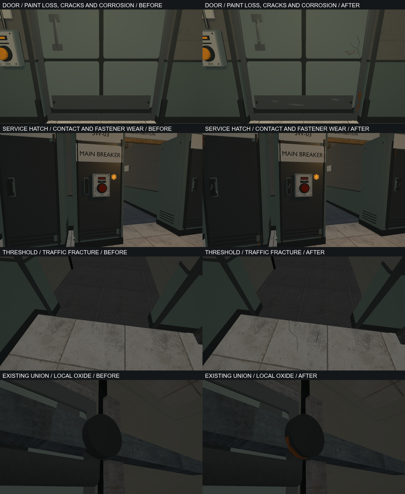

# VIS-23 — wear from use and moisture, 2026-10-08

The owner's first review rejected the initial pass: the cabinet, hatch and
threshold looked unchanged, with no readable rust, cracking or wear. The
preserved candidate and critique are in `build/vis23/candidate`. The revised
pass concentrates damage at contact points and vulnerable edges while keeping
large panels intact. This is a selected-consumer pass, not uniform aging of
every material in the facility.

## Changes and ownership

- Cabinet pulls and latch escutcheons have abrasion and chipped coating;
  removable hatch screws have local oxide and downward rust runs. Lower
  enclosure returns have breached primer, exposed steel and fractured paint.
- Both door leaves have flaking and cracks at a pressed-panel corner,
  corrosion on a lower rolled edge, shoe scratches on the replaceable kick
  plate, and a continuous worn contact strip following the slide-door grip.
- Portal floors have sparse heel pivots. The tiled intake threshold has one
  branching traffic fracture. The existing leaking pump union has oxide on
  its lower shell and broken dry mineral residue directly beneath it.
- Oxide reuses grain from the accepted material sheet, with opaque sRGB
  albedo, linear +Y normals and roughness 0.94. No lighting, highlights or AO
  were baked into the new albedo. Exposed weathered steel separates from the
  enamel in the current lighting; lights and exposure were preserved.

`export-power-restoration-glb.py` owns six `power_*` products. Its cabinet is
also used by `export-bench-cooling-glb.py`, so `bench_workshop` was regenerated.
`export-interactive-hardware-glb.py` owns `door_lift` and `door_slide`.
`export-pressure-transfer-glb.py` supplies fitted opaque marks and crack strips.
The nine editable `.blend` files pack their images; GLBs embed their textures.
The four new oxide PNG sources live under `content/graphics/power_restoration`
and `content/graphics/pressure_transfer`. Existing loose palette images were
preserved. CMake declarations, importer contracts and gameplay code are unchanged.

## Review and reproduction

`relaycore_power_restoration_graphics --wear-views` and `--wear-views-sdr`
capture cabinet, access hatch, threshold, union, residue and both sides of the
door kit, plus the workshop route. The
before root preserves the complete pre-VIS-23 staged assets; final pairs use
identical cameras, maps, lights and color settings. These are runtime captures,
not evidence of independent player acceptance.

Technical verification and the owner's pending visual acceptance are tracked
in the roadmap. Commands, logs, metrics, fixed neutral views and preservation
audits are retained in `build/vis23`.

## Verification

- Blender 5.2.2 LTS: all nine authored scenes and nine fresh GLB imports pass
  inspection without invalid/degenerate geometry or missing materials. Fixed
  neutral door views use runtime proportions; pump assembly views supplement
  the in-engine review. New normal images have positive Z and opaque alpha.
- Every original triangle is preserved at 0.1 mm, as are all original material
  factors and decoded texture pixels. Door bounds are unchanged. Some static
  lining bounds extend onto the adjacent floor to contain portal scuffs; the
  original map bytes, solids, collision, controls and light settings are intact.
- Debug and optimized staging pass all 50 model receipts; the nine changed
  native products match between configurations. The optimized baker produced
  the updated workshop's 30 probes; Debug accepted their input fingerprint
  `430134379680424983`. No receipt or fingerprint was hand-edited.
- 15 selected native/content CTests passed. The model-assets tooling fixture
  also passed. Seven distinct graphics cases passed without skips: intake and
  pump in HDR/SDR, interactive hardware in HDR/SDR, and the workshop. Hardware
  was rechecked after the visible damage revision; workshop was rechecked
  after staging its updated probes. Final HDR/SDR before/after runs contain
  nine matching views each, with no Vulkan validation warnings/errors.
- Python syntax and `git diff --check` pass. An initial broad
  `graphics.power_restoration` run was interrupted in an unrelated native-lab
  reload; no pass is claimed for that run. The focused gates above completed.

Builds use `demo-debug`/`demo-relwithdebinfo`, targets
`relaycore_demo_assets` and `relaycore_power_restoration_graphics`. The content
filter is `(power restoration|native model|native v[12])`; graphics filters
select `foundation_intake`, `foundation_pump`, `interactive_hardware` and
`bench_relay`, including the registered SDR variants. JUnit reports and exact
commands are retained in the build evidence. The comparison establishes a
visible technical revision; the owner's visual acceptance remains open.
