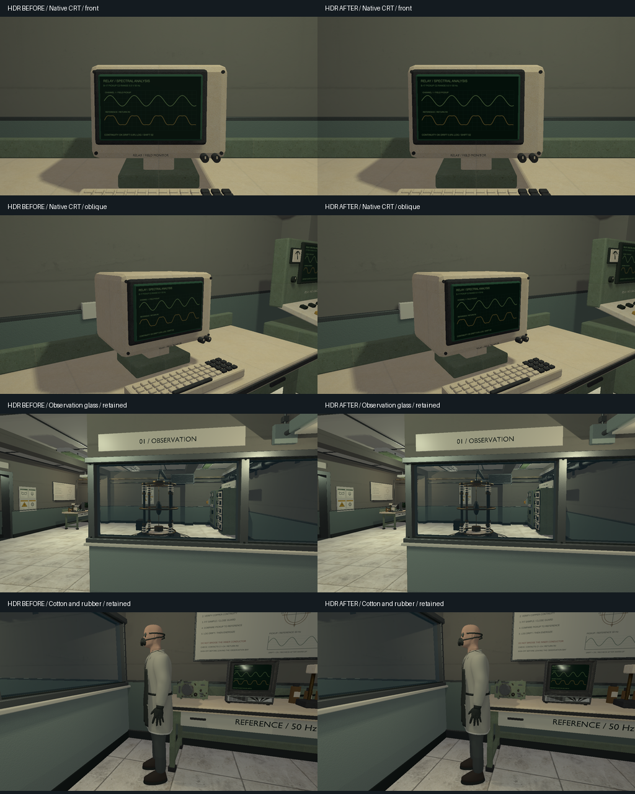

# VIS-24 — glass, CRT and fabric, 2026-10-08

This is a focused B-17 material review under the existing native contract.
The project design-systems board and the accepted B-17 scene are the visual
references: institutional observation glass, monochrome CRT instruments,
cotton workwear and protective rubber. Inspection precedes changes; a new
transparency, emissive or texture-channel pipeline is outside this ticket.

## Result and preserved consumers

The native `crt_terminal` had roughness 1.0 on both the green screen edge and
its measurement graphic. Both now use nonmetallic roughness 0.23 for a smooth
dielectric screen response alongside the ABS enclosure and rubber surround.
The existing waveform artwork is retained. The imported
`surveillance_monitor` already uses nonmetallic roughness 0.22 for its display;
its adapted opaque screen is reused.

The B-17 observation pane remains an authored `Glass` solid. Its transparent
runtime pass and view-dependent alpha keep the apparatus visible from the
observation side and preserve the inspection route. The surrounding seals and
frame are reused. Opaque GLB instruments are not used as a substitute for the
observation pane.

The existing `scientist_hazmat` cotton coat uses its fine cotton albedo and
roughness 0.88; the protective apron uses smooth rubber at 0.66. Front and side
views retain their distinct surface finishes and garment seams. These materials
and the scientist geometry are reused rather than regenerated.

## Sources and evidence

- `scripts/export-native-lab-glb.py` owns the two scalar changes and reproduces
  `content/models/crt_terminal.blend` and `.glb` with Blender 5.2.2 LTS.
- The GLB audit confirms that only those two roughness factors changed. The
  complete binary payload (geometry, UVs and embedded images), hierarchy and
  remaining metadata are identical. The CRT retains 3,925 triangles.
- `relaycore_power_restoration_graphics --surface-views` and
  `--surface-views-sdr` provide eight fixed cameras: observation window from
  both sides, scientist front/side, native CRT front/oblique, and imported
  monitor front/oblique. The existing B-17 review keeps its original cameras.
- Baseline HDR captures precede staging; SDR baseline captures use an isolated
  complete staged root with the saved original CRT compiled by the existing
  native importer. Working captures, logs, GLB comparison, metrics and the
  six-view neutral fresh-import render are retained in `build/vis24`.



The screen adjustment is subtle under these room lights: the largest channel
difference in the two CRT views is 7/255 in HDR and 13/255 in SDR. Changes are
confined to the screen. The window and scientist-side images are pixel-identical
to their respective baselines. This is a local finish correction, not a claim
of a large scene revamp or new reflection/emissive capability.

## Verification

The authored Blender source and independently imported final GLB pass the
asset inspector: no invalid vertices, degenerate faces or missing materials.
Six neutral views of the exported CRT were inspected. Debug and optimized
asset builds completed; the B-17 baker reused its 18 probes with the existing
input signature.

Five selected Debug CTests pass: the three native-model product/validation/cache
cases, B-17 native content and traversable inspection routes, and the native
asset tooling fixture. Exact commands and JUnit output are retained in
`build/vis24/content.log` and `build/msvc-debug/vis24-content.xml`.

The two focused graphics CTests pass without skips, capturing all eight views
in HDR and SDR on the RTX 4060 Ti with Vulkan validation enabled and no
validation warnings/errors. Both comparison sheets and full-resolution CRT
views were inspected. Source/receipt/product/staged hashes pass for the CRT in
Debug and optimized; both products are identical. All 14 authored maps,
glass authoring configuration, and monitor/scientist `.blend`/GLB bytes match
the preserved baseline. Formatting and `git diff --check` pass.

```text
cmake --build --preset demo-debug --target relaycore_power_restoration_graphics -j 2
cmake --build --preset demo-relwithdebinfo --target relaycore_demo_assets -j 2
cmake --build --preset demo-debug --target relaycore_tests relaycore_content_validation -j 2
ctest --test-dir build/msvc-debug -R '^validation\.B17|^relaycore\.native model|^relaycore\.tooling\.model_assets$' --output-on-failure --no-tests=error --output-junit vis24-content.xml
ctest --test-dir build/msvc-debug -R '^graphics\.special_materials(_sdr)?$' --output-on-failure --no-tests=error --output-junit vis24-graphics.xml
```

The material finish remains subject to author visual acceptance. The prior
B-17 SDR highlight-handling observation and external playtest gates are not
closed by this material review.
