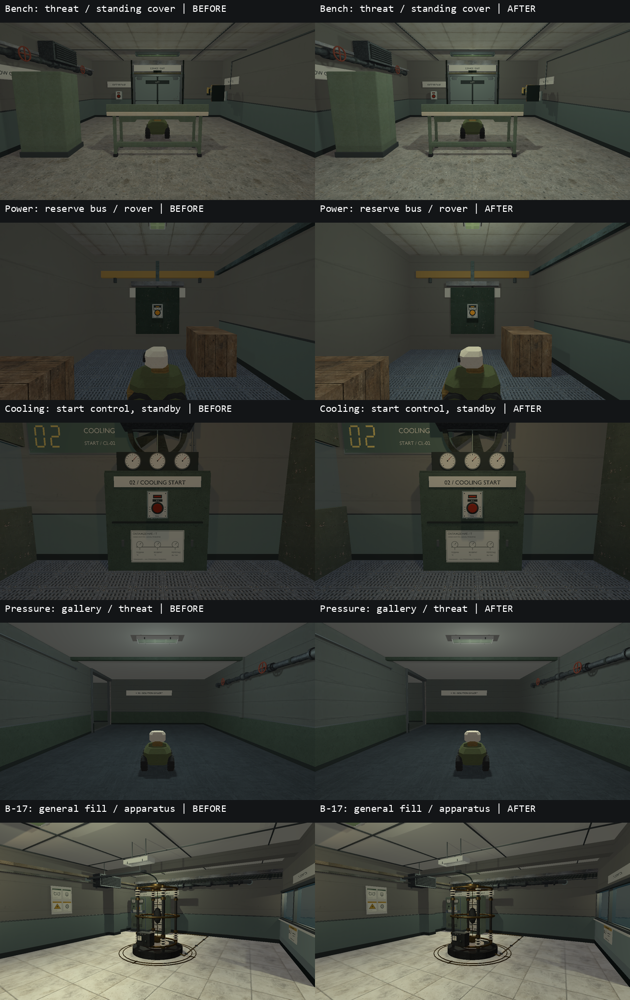
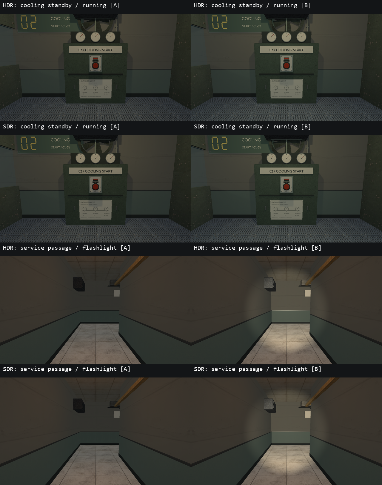

# VIS-29 — room lighting

2026-10-08. Technical pass completed at the owner's request;
status `awaiting_playtest` pending the owner's visual acceptance in motion.

Thirty authored light records adjust 33 existing practical lights across five maps
(the B-17 general-light record supplies four lamps). Changes are
limited to authored colour, intensity and radius. Light positions, fixture
geometry, power/startup/flicker conditions, solids, colliders, interactions,
mission data and global exposure/render settings are preserved.

| Map | Lighting decision |
| --- | --- |
| foundation_intake | Retained the warm workbench/key light and readable door/return view |
| foundation_pump | Retained the cool machinery light and switched exit light; pump control, rover and turret remain visible |
| bench_relay | Four lamps: clearer neutral work light at the bench, combat lane and gate; restrained green accent after relay startup |
| power_restoration | Eight lamps: reserve-bus control/rover and filtration receive stronger neutral work light; switchgear, powered corridor, intake and return lighting are balanced. Dark service/maintenance stretches and the damaged pump-room lamp remain deliberate flashlight areas |
| pressure_transfer | Eight lamps: brighter cool-white facility light along the bay/gallery/hall and around the transfer control/exit. Reduced amber emergency radius/intensity keeps the warning local |
| cooling_loop | Seven lamps: neutral work light on the exchanger lanes, warm standby light at the start control, restrained cool running/exit light; reduced amber spill at isolation |
| occult_lab_b17 | Three authored settings affect six lamps: four general lamps reduced from 1.8 to 1.25, sample-bench light from 1.35 to 1.0, scientist light from 1.45 to 1.1. The apparatus accent is retained |

The B-17 change reduces broad fill; it does not claim to resolve every previous
SDR image-processing observation. Fixture/emitter consistency and shadow-quality
tickets VIS-30/VIS-31 remain separate.





## Captures and verification

`tests/power_restoration_graphics.cpp` adds lighting-specific cameras and
`graphics.room_lighting` / `graphics.room_lighting_sdr`. Each mode captures
64 views: 34 base views, 26 paired powered views and four flashlight comparisons
on two service stretches. Doors remain closed in these pairs to isolate lighting;
powered targets are seeded explicitly, rather than claiming a completed route.
Lamp startup is settled with an activation update followed by two elapsed seconds.
The fixture rejects omitted views, unsettled switched lamps and flashlight views
without a measurable increase in image brightness; detail/readability is reviewed visually.

The primary comparison uses the same hardware-sRGB colour path: scene HDR at
exposure 0 and normal SDR. As documented in DEVELOPMENT.md, scene HDR still
presents through an SDR swapchain; these are not HDR10 display captures.

Executed on the local RTX 4060 Ti with Debug Vulkan validation:

- Baseline: both lighting checks passed, 60 views per mode before map edits.
- Final: **20/20 CTest checks passed, zero failures/skips**, including both lighting
  modes and 18 affected content/gameplay checks. All 128 final views were reviewed.
- Check Map: all seven maps valid, zero authoring warnings.
- Debug build: `relaycore_demo`, `relaycore_power_restoration_graphics` and
  `relaycore_content_validation` passed. Normal optimized Play build passed.
- Seven staged map hashes match their sources in Debug and optimized builds.
  Updated bench/B-17 probe products match between both builds and staged roots.
- Two supplementary power-state runs passed: scene HDR and legacy SDR
  compatibility, with no Vulkan validation warnings/errors or shutdown failures.
- `git diff --check` passed. Structured comparison against the session baseline
  confirms that only existing light colour/radius/intensity changed in map data.

Commands:

```powershell
cmake --build --preset demo-debug --target relaycore_demo relaycore_power_restoration_graphics relaycore_content_validation
cmake --build --preset demo-relwithdebinfo --parallel 2
ctest --test-dir build/msvc-debug -R '^(graphics\.room_lighting(_sdr)?|validation\.(all shipped|B17|bench relay|cooling loop|pressure transfer (wall|complete|stops)|power restoration (requires|can finish|filtration|service route)))' --output-on-failure --no-tests=error
```

Working evidence is retained under `build/vis29`: initial maps, before/after
captures, eight final contact sheets, scope/image/staging audits, build/bake logs,
Check Map reports and `final-results.xml`. Updated irradiance was generated with
the existing optimized baker; the Debug baker then accepted both exact input
signatures (bench 4697214867860190482, B-17 12874885785350560937).

The supplementary existing power-state scenario verifies the actual pump room
through standby, power, flush and cooling stages; its route-pump camera is separate
from the new corridor approach view. From `build/msvc-debug/tests`, with the staged
`RELAYCORE_ASSET_ROOT`, it runs as
`./relaycore_power_restoration_graphics.exe --hdr --power-views-only` and
`./relaycore_power_restoration_graphics.exe --power-views-only`. All eight pump-stage
captures were reviewed; the dark damaged work-light area was retained.
Human continuous play, subjective lighting
acceptance, another GPU and performance measurements remain unclaimed.
