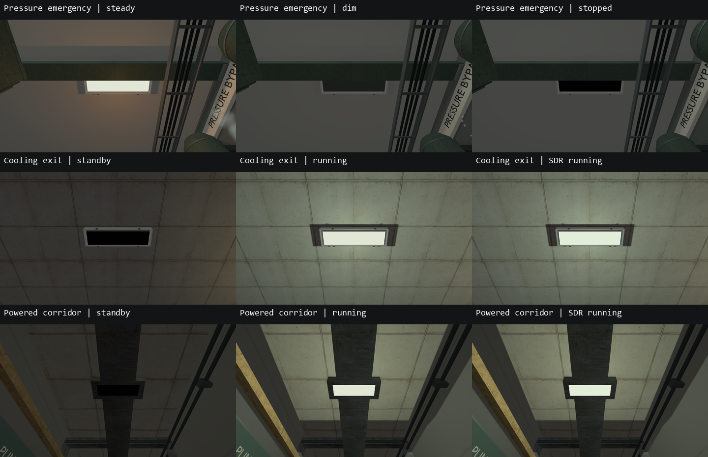
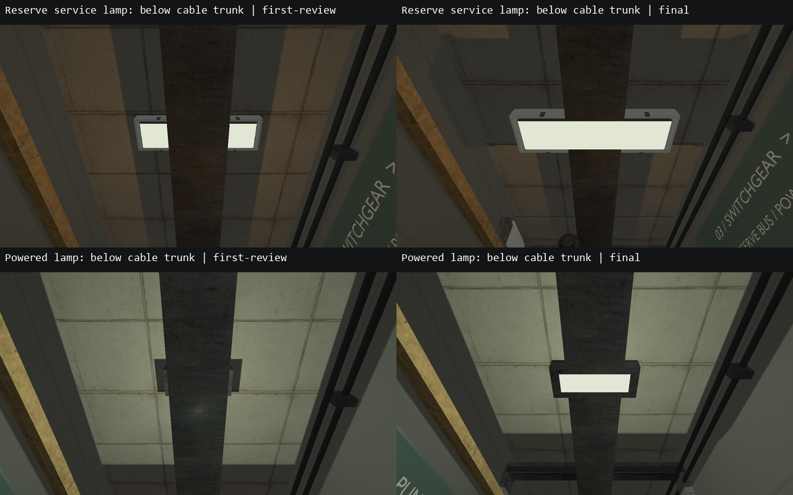

# VIS-30 — согласование светильников и источников

2026-10-08. Проверены 47 существующих источников на семи картах: 46 практических
светильников и локальный occult-свет аппаратуры B-17. Авторская приёмка в движении
остаётся открытой; статус хранится в PLAYABLE_SLICE_ROADMAP.md.

Светящиеся плоскости получили размеры по внутреннему проёму корпуса, высоту и
поворот вокруг +Y. Общая белая опаловая поверхность использует существующий
16-уровневый отклик лампы; нулевой уровень теперь непрозрачный и не emissive.
`required_target`, `stop_target`, задержка пуска и повреждённое мерцание управляют
плоскостью и освещением через одну `EnvironmentEffect::strength`.

| Карта | Исправление |
| --- | --- |
| foundation_intake / foundation_pump | Плоскости совпадают с нижней стороной существующих опаловых рассеивателей; выключенный выходной светильник тёмный |
| bench_relay | Три статических полосы заменены управляемыми плоскостями; выход получил существующую модель корпуса |
| power_restoration | Девять статических полос заменены; добавлен корпус возвратного прохода. Два корпуса в служебном коридоре перенесены на нижнюю сторону продольного кабельного короба; плоскости закреплены под ними |
| pressure_transfer | Удалены семь старых полос, включая две шириной 1,8 м в корпусах 1,3 м. Аварийный светильник гаснет после `transfer_running`; выход включается. Корпус bay переиспользован без переделки |
| cooling_loop | Добавлены корпуса существующих источников у изолятора и пускового поста; running/exit плоскости больше не висят выше внутреннего проёма |
| occult_lab_b17 | Пять статических полос заменены; длинные светильники согласованы по размерам и направлению. Свечение закреплено на task/observer светильниках. У аппаратуры сохранён локальный свет без потолочной плоскости |

Четыре новых размещения переиспользуют `fluorescent_fixture.rcmodel`; исходные GLB,
материалы и exporter scripts не менялись. Удалены 24 декоративных `LightStrip`
solid, перенесён один solid корпуса. Остальные solids, игровые entities, mission,
коллизии моделей, позиции/цвет/интенсивность/радиусы источников сохранены; это
проверено структурным сравнением с картами на начало задачи. Новый контракт
`fixture_width` / `fixture_depth` и нулевая ширина описаны в DEVELOPMENT.md;
необновлённые карты сохраняют прежний режим по умолчанию.

## Проверки и evidence

- Исходный HDR/SDR baseline: 2/2 passed до staging правок.
- Основной набор: **21/21 passed**, без failures/skips: environment/validation,
  shipped content, четыре HDR/SDR graphics cases. После переноса двух корпусов
  повторены только затронутые проверки: **7/7 passed**, включая оба fixture modes.
- Check Map семи карт: valid, 0 warnings. Debug и обычная optimized Play-сборка
  обновлены; семь staged-карт совпадают с исходниками.
- 66 native model receipts/products/staged hashes проверены в обоих деревьях;
  продукты совпадают между Debug/optimized. Три probe products также идентичны.
  Bench/B-17 fingerprints: `5673759613257394206` / `5041999000430289953`.
- `clang-format --dry-run --Werror` четырёх локально изменённых runtime/unit файлов
  и `git diff --check` прошли. Форматирование прежних art-review блоков сохранено.

Сборки: `cmake --build --preset demo-debug --target relaycore_demo relaycore_tests
relaycore_content_validation relaycore_power_restoration_graphics relaycore_level_check -j 2`
и `cmake --build --preset demo-relwithdebinfo -j 2`; финальная Debug-пересборка
ограничена `relaycore_demo relaycore_power_restoration_graphics`.
Финальный CTest filter:
`^(graphics.light_fixtures(_sdr)?$|validation.(all shipped|power restoration (requires|can finish|service route|return passage)))`,
с `--test-dir build/msvc-debug --output-on-failure --no-tests=error`.

Новые `graphics.light_fixtures` / `_sdr` снимают 87 видов на режим: каждый источник,
парные powered состояния и три ослабленных damaged состояния. Дополнительные
три синтетических кадра на режим проверяют пиксели плоскости off/on/off: свечение
появляется и исчезает без сохранённого emissive состояния. Камера входного
светильника power взята со стороны комнаты, чтобы дверная перемычка не закрывала
проверяемый корпус. 174 игровых крупных плана просмотрены в contact sheets;
перенос двух корпусов выполнен по обнаруженному перекрытию в первом ревью.

Рабочие карты до изменения, captures, scope/staging audits, логи сборок, Check Map
JSON и JUnit находятся в `build/vis30`. Первичный sandbox-запуск остановился на
отказе `canonical()` для staged OBJ; проверки выполнены вне sandbox на RTX 4060 Ti
с Vulkan validation. Debug bake двух изменённых probe volumes был остановлен в
пользу уже готового optimized результата; повторная сборка проверила signatures.
Scene HDR использует SDR swapchain, как описано в DEVELOPMENT.md; HDR10 display
capture, другой GPU, человеческое прохождение и performance measurements не
заявляются. VIS-31 и прежнее замечание к SDR обработке остаются отдельными задачами.
