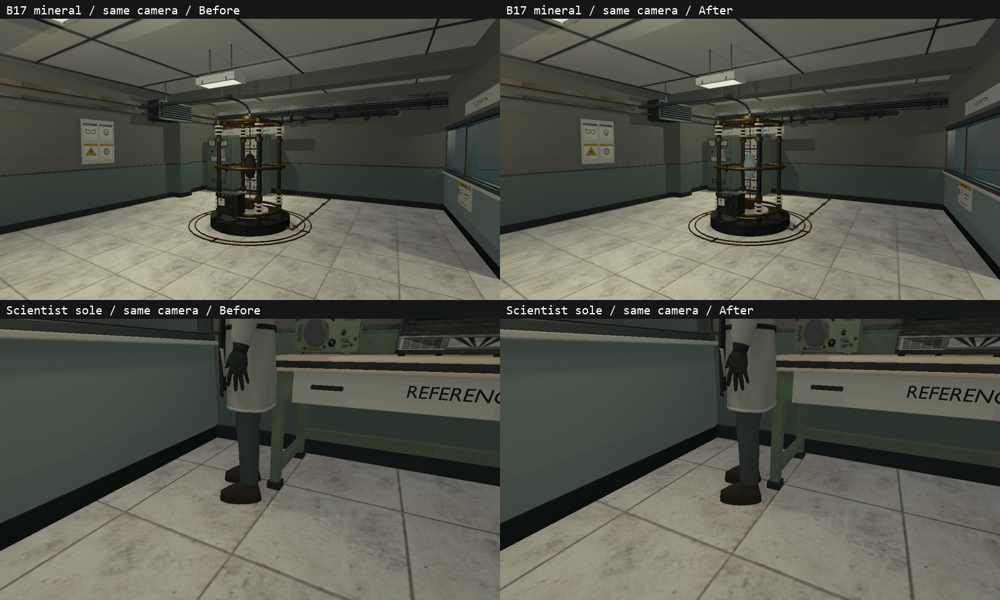
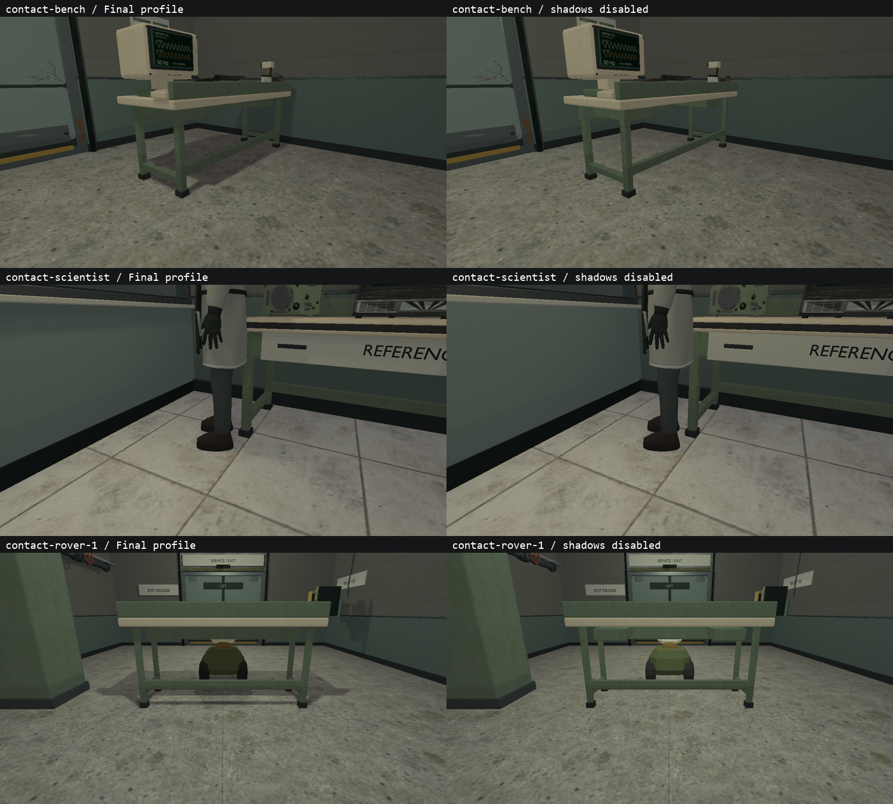
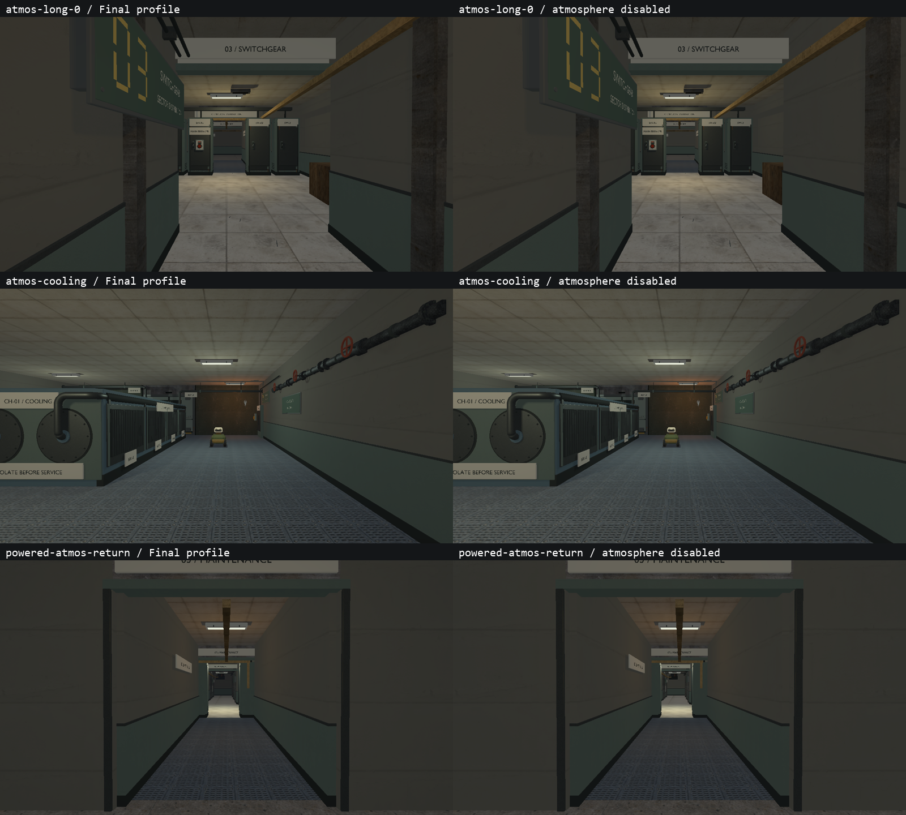
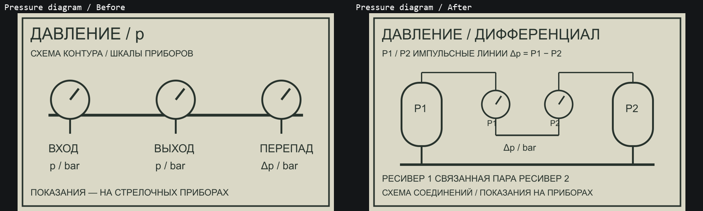
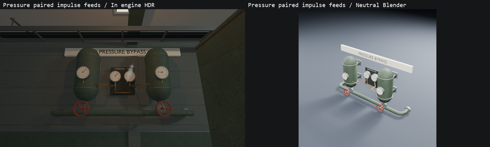

# VIS-31–33 — контакты, атмосфера и инженерный фокус

2026-10-08. Техническая часть выполнена; авторская оценка в движении остаётся
открытой (`awaiting_playtest` в PLAYABLE_SLICE_ROADMAP.md).

## VIS-31: контакт и тени

Проверены ножки bench, низ шкафов и аппаратуры, стеновые приборы/турель,
трубопроводы, дверь в закрытом, промежуточном и открытом положениях, учёный и
три положения rover. В исходном GLB учёного нижняя грань обуви находилась на
9 мм выше пола; исправлен только нижний контур подошвы (`.009` → `0`).
156374 треугольника сохранены; геометрия выше подошвы, поза, размещение и
коллизия не менялись. Исправление подтверждено fresh import и одинаковой камерой.

В просмотренных ракурсах других подтверждённых висящих объектов или мешающих
чтению shadow artifacts не обнаружено. Сравнение с отключёнными тенями показывает
вклад текущих shadow maps; параметры renderer, AO/IBL не менялись.





## VIS-32: fog/postfx

Профили `engine.toml`, `occult_lab_b17.toml` и `native_lab_hdr.toml` проверены;
настройки сохранены: fog 14–52 м, grain 0, scanline .004, vignette .06,
contrast 1.01, saturation 1, exposure EV 0. Изменение профилей не требовалось
по просмотренным видам: дальние двери/указатели и силуэты различимы, эффект
не заменяет рабочий свет. Карты и ранее настроенные светильники сохранены.

31 ракурс на режим охватывает семь карт, прямой/обратный маршрут, 13 powered/open
состояний и три последовательных положения камеры в длинном коридоре (шаг 1 м).
Для сравнения в HDR сняты те же виды без fog, vignette, scanline и contrast.
Это дискретные кадры, не запись непрерывного прохода.



В существующем `graphics.game_hud` добавлена регрессия: непрозрачный пиксель HUD
сохраняет RGBA при экстремальных fog/postfx. Проверка проходит на трёх размерах
окна в существующем SDR fixture; `graphics.hdr_pipeline` проверен отдельно.
Основные новые виды используют `hardware_srgb` и в HDR, и в поддерживаемом SDR.
HDR здесь — scene HDR с SDR swapchain, без утверждения о HDR10 display capture.

## VIS-33: аппаратура и измерительная цепь

У существующего образца resonance apparatus B-17 чёрный металлический материал
заменён на серо-зелёный минеральный. Он отделяется от тёмной опоры под прежним
рабочим светом; сохранены все 6989 треугольников, их мировые позиции и bounds.
Клетка, изоляторы, кабели, панели измерений и связь с инфраструктурой сохранены.

В pressure manifold добавлены две медные импульсные линии с муфтами от верхних
отборов ресиверов к центральной паре приборов. Шильдик уточнён до
`DIFFERENTIAL / P1-P2`; существующая U-образная связь и общая магистраль сохранены.
Модель выросла с 12699 до 13304 треугольников, bounds не изменились.

Печатная pressure-схема теперь соответствует этой цепи: P1/P2, два ресивера,
парные приборы, импульсные линии, U-связь и общая магистраль, формула
`Δp = P1 − P2`. Обновлены оба потребителя: control casing и notes board.
Остальные instrument masters/PNG совпадают с исходными по hash.





Исходники: `scripts/author-scientist.py`, `export-native-lab-glb.py`,
`export-pressure-transfer-glb.py`, `build-instrument-graphics.cjs`;
пять одноимённых Blender/GLB моделей и `content/graphics/instruments/pressure.*`.
Для четырёх приборных моделей сохранены authored/fresh-import metrics и шесть
neutral views; hard gates проходят без issues. Исправленная обувь отдельно
проверена fresh import, сравнением world triangles и игровым крупным планом.

## Проверки и воспроизведение

- Исходный baseline: 4/4 graphics, без skips. Основной набор: **14/14 passed**,
  включая B-17/pressure/shipped content, model/irradiance tooling, point-shadow
  receiver, HUD, HDR pipeline и четыре новых graphics cases.
- После исправления обуви повторены затронутые проверки: **6/6 passed**,
  B-17/shipped content и четыре graphics cases, без failures/skips.
- Оба ручных HDR сравнения завершились успешно: 15 видов без теней и 31 без
  атмосферы; Vulkan validation warnings/errors отсутствуют. В трёх сохранённых
  атмосферных парах средняя абсолютная разница RGB составляет 1.33–1.53 из 255;
  это величина воздействия профиля, не автоматическая оценка читаемости.
- Новые cases: `graphics.contact_quality` / `_sdr` (15 видов каждый),
  `graphics.route_atmosphere` / `_sdr` (31 каждый). Всего 92 финальных кадра.
  Fixture проверяет загрузку, захват, состояние ламп и различие кадров rover;
  качество теней/читаемость оценены просмотром, не pixel-perfect oracle.
  Положения rover заданы fixture с chasing/animation time 0/.25/.5 с,
  это не проверка AI-прохождения.
- Check Map B-17 и pressure: valid, 0 warnings. Debug/Play обновлены,
  все 66 model receipts каждого дерева проверены; пять продуктов и три probes
  идентичны между generated/staged Debug/Play. B-17 signature:
  `6601788837419745854`; bench: `5673759613257394206`.
- `git diff --check` и локальное форматирование новых C++ блоков проверены.

Финальная Debug-сборка: `cmake --build --preset demo-debug --target relaycore_demo
relaycore_power_restoration_graphics -j 2`. Play: `cmake --build --preset
demo-relwithdebinfo -j 2`. Для финальных шести проверок:

```powershell
ctest --preset graphics-debug -R '^(graphics\.(contact_quality|route_atmosphere)(_sdr)?$|validation\.(B17|all shipped))' --output-on-failure --no-tests=error
```

Ручные диагностические сравнения используют staged Debug root через
`RELAYCORE_ASSET_ROOT` и `relaycore_power_restoration_graphics.exe` с
`--contact-views --no-shadows` / `--atmosphere-views --no-atmosphere` в отдельном cwd.

Baseline, 92 финальных captures/contact sheets, сравнения, geometry/scope/staging
audits, Blender metrics, Check Map JSON, JUnit и логи находятся в `build/vis31-33`.
Медленный Debug bake первоначально остановлен; использован результат штатного
optimized baker с актуальными inputs, затем CMake проверил signature/staging.
Другой GPU, непрерывный человеческий проход и измерение производительности
не выполнялись. Внешние gates прежних задач этим не закрываются.
