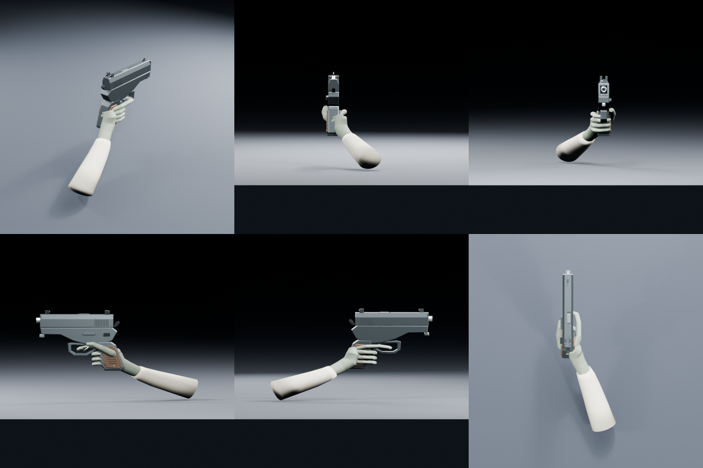
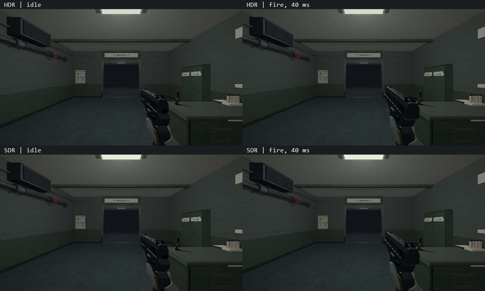

# VIS-34 — служебный пистолет, 2026-10-08

Стартовый `PlayerWeapon::Precise` получает оригинальный полноразмерный служебный
самозарядный пистолет; UI «Точное оружие»/«Точное» переименовывается в «Пистолет».
Роль, hitscan из глаза, урон, темп стрельбы, инвентарь и save schema сохраняются.
VIS-35 (хват/доводка дробовика) не входит в этот проход.

## Контракт и референсы

Длина затвора 219 мм, оружия без руки около 265 мм; тёмная стальная рамка и отдельный низкий затвор, наклонная
рукоять из коричневого фенопласта, открытая спусковая скоба, курок, мушка и целик.
Одна правая рука в серо-зелёной защитной перчатке охватывает рукоять; запястье
соединено с хлопковым рукавом халата. Отдельный rigid slide движется по local +Z,
рамка/ствол/рука откатываются вместе. Материалы — scalar native metallic/roughness.
Цель — законченный гладкий предмет для ближнего вида, ориентир до 20 000 triangles
на всю сборку; это бюджет, а не критерий визуального качества.

Рассмотрены профиль и верхний передний ракурс аналогичного служебного пистолета:

- [Профиль производителя](https://www.czfirearms.com/en-us/products/pistols/cz-75-series/cz-75-b),
  [изображение](https://www.czfirearms.com/storage-pim/assets/large_15z_CZ_75_B9mm_L_91102_01102_1_37a32c73ff.png):
  низкий затвор, длинная dust cover, наклонная рукоять, открытая скоба, отдельные
  курок/предохранитель; рукоять ниже оси ствола приблизительно на половину длины оружия.
- [Передний верхний ракурс аналога](https://www.prodej-zbrani.cz/pistole/standard/CZ75B9x19%2Cdecocking%2Bmanualsafety__s437x2393p.html),
  [изображение](https://www.prodej-zbrani.cz/data/MMA/836/f13495_2_0424-0765-ADRAABX-2.jpg):
  скосы верхней части затвора, узкий открытый канал целика, утопленный bore,
  объёмные накладки и rear serrations. Вариант Omega — только структурный аналог.
- [Проектная палитра и технология](occult-facility-style-board.png): сдержанные
  steel/sage/dirty-white материалы. Реальные маркировки и логотипы не копируются.

Изображения открыты в браузере для анализа; файлы и текстуры из них не заимствованы.
Скрытая механика и поза перчатки — авторские допущения; это визуальная модель.
Проверяются силуэт сбоку/сверху/сзади, контакт руки и рукава, открытая скоба,
idle/откат/возврат, направление к прицелу, несколько FOV/окон, HDR/SDR, переключение,
пауза/смерть/продолжение. Нейтральные виды дополняют in-engine кадры.

## Результат

Технически выполнено, `awaiting_playtest`. Пистолет показывается в Playing/Paused
при живом игроке, слот 1 называется «Пистолет». Успешный выстрел запускает
отдельный визуальный timer: затвор проходит 28 мм назад/вперёд, рамка с рукой
откатывается и восстанавливается. Возврат занимает не более 180 мс и сокращается
до authored refire interval, если он меньше. Ствол в покое направлен к eye ray
на расстоянии 12 м; hitscan по-прежнему исходит из глаза. При переключении со
стреляющего дробовика его общий cooldown не запускает ложный откат пистолета.
Continue/retry сбрасывают только transient animation; save schema не расширена.

Крупные формы проверены на graybox, затем скорректирован профиль dust cover и
высота рукояти/кисти. Перчатка объединена через voxel remesh, её плотность
уменьшена с сохранением просмотренного силуэта. Добавлены границы материалов,
скоба, ствол с открытым bore, курок, органы управления, serrations, три точки
прицела, крепёж накладок, рёбра фенопласта, cuff folds и шов рукава. Миниатюрные
bevel slivers ниже native area threshold устранены в генераторе. Материал-группы
сводят 68 authored объектов к 11 runtime parts.

Исходники:

- `scripts/export-service-pistol-glb.py`, `content/models/service_pistol.blend`;
- `content/models/pistol_frame.glb` и `pistol_slide.glb` →
  `build/<preset>/generated/model-assets/models/pistol_{frame,slide}.rcmodel` →
  `build/<preset>/src/relaygame/assets/models/`;
- декларация и metallic/roughness opt-in в `cmake/RelayCoreModelAssets.cmake`;
- загрузка/resource preparation/shutdown и очередь viewmodel в
  `src/relaygame/world_scene_renderer.{h,cpp}` и
  `world_scene_renderer_interactives.cpp`; вызов в `demo_game.cpp`;
- transient timer в `game_world_runtime.{h,cpp}` / `game_world_runtime_feedback.cpp`,
  название в `game_world_runtime_diagnostics.cpp`;
- regressions в `tests/pressure_transfer_tests.cpp`, `game_lifecycle_tests.cpp`,
  `vulkan_mesh_tests.cpp`; регистрация `graphics.pistol_viewmodel` в `tests/CMakeLists.txt`.

## Проверки и кадры

Blender 5.2.2 LTS, clean factory startup, disabled autoexec, два CPU threads.
Исходник выполнен с graybox checkpoint и повторно для финального экспорта.
Оба GLB импортированы новым процессом Blender и рассмотрены совместно.
Authored/fresh-import имеют одинаковые **13 514 triangles**; invalid vertices,
degenerate faces, zero-length edges, isolated vertices и missing material faces — 0.
UV0 присутствует у всех meshes. У экспортированных rigid parts нет skins/actions.
Метрики: `build/blender-review/vis34/{authored-metrics,fresh-metrics}.json`.
Просмотрены perspective и six-view contact sheet из fresh import; отдельный
hero открыт в полном размере. [Финальные нейтральные виды](vis34-pistol-multiview.png).



Исполнены:

```powershell
cmake --preset msvc-debug
cmake --build --preset demo-debug --target relaycore_demo relaycore_tests relaycore_vulkan_mesh_tests relaycore_game_lifecycle
cmake --build --preset validation-debug
cmake --build --preset demo-relwithdebinfo
ctest --preset test-debug -R 'shotgun|player fire respects' --output-on-failure --no-tests=error --output-junit vis34-unit.xml
ctest --preset validation-debug -R 'pistol viewmodel|sandbox shotgun|pressure transfer (continue|close)' --output-on-failure --no-tests=error --output-junit vis34-validation.xml
ctest --preset graphics-debug -R '^(graphics.pistol_viewmodel|graphics.game_lifecycle|graphics.resource_preparation)$' --output-on-failure --no-tests=error --output-junit vis34-graphics.xml
```

Финальные Debug targets повторно собраны после локального форматирования и
уточнения refire duration. Unit selection — 8/8 (6 unit и два повторных content
cases), актуальный content binary — 4/4, graphics — 3/3 **без skips**, итого
13 различных checks. SDL input действительно запускает timer; blocking shots,
переключение во время cooldown, death/save/retry и обе роли оружия проходят.
Graphics проверяет 60 видов: HDR/SDR × FOV 50/70/90° × 640×360/800×600 ×
idle/40/90/180/240 мс; видимость, возврат, свободную центральную область 17×17 px,
направление bore с точностью 2 мм на 12 м и отсутствие отложенного GPU upload
при переключении. Кадры сохранены в
`build/msvc-debug/tests/vulkan-mesh-captures/pistol-*.bmp`; финальный JUnit —
`build/msvc-debug/vis34-graphics.xml`. В выбранных проверках нет Vulkan validation
warnings/errors. [Idle/fire в обоих режимах](vis34-pistol-states.png).



`scripts/check-model-assets.ps1 -ProjectRoot . -BuildRoot build/msvc-debug
-RuntimeAssets build/msvc-debug/src/relaygame/assets` и тот же вызов для
`msvc-relwithdebinfo` проверили все 68 receipts/products/staged hashes каждого
дерева. Новые два native products побайтно совпадают между Debug и Play.
`git diff --check` проходит. Архив не создавался.

Авторская оценка размера, хвата, материалов и движения остаётся открытой;
проверки кадров и scripted lifecycle не заменяют человеческую приёмку.
