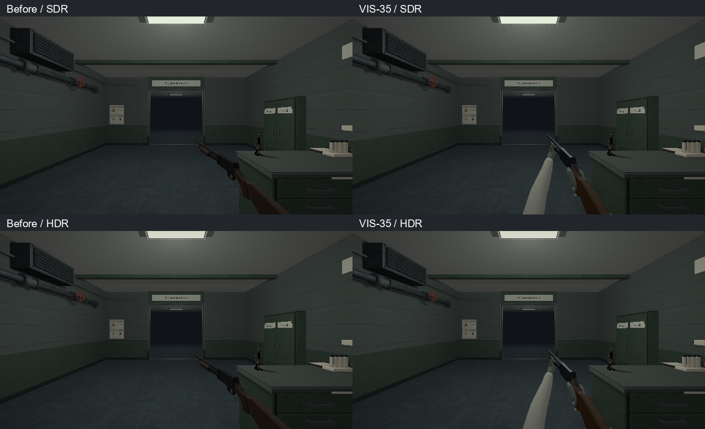
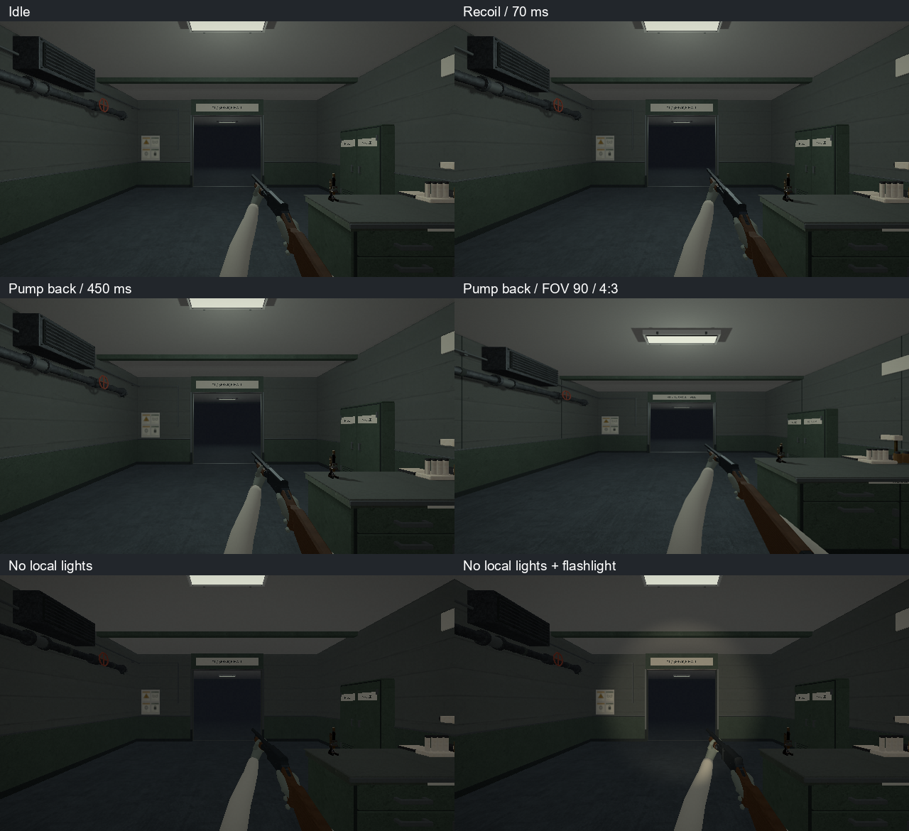
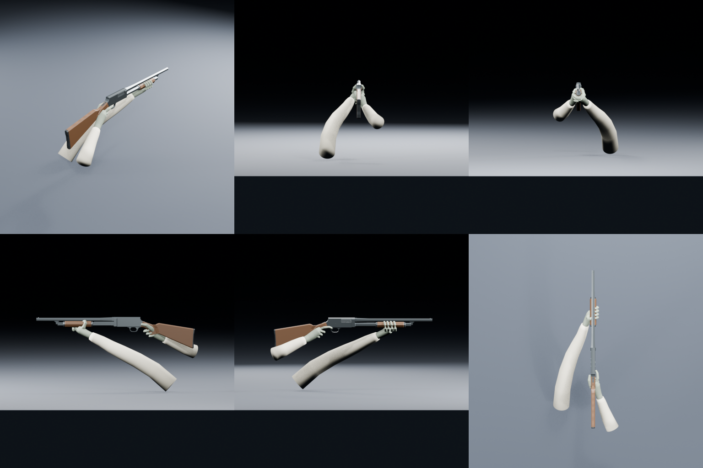

# VIS-35 — хват и подача дробовика, 2026-10-09

## Контракт

Сохранить supplied Stevens 520: исходные `assets/models/shotgun_{body,pump}.obj`
и rigid pump travel 70 мм. Для ближнего вида добавить правую перчатку на шейке
ложи и левую вокруг цевья, хлопковые рукава в палитре VIS-34. Левая рука и её
рукав следуют цевью; правая — корпусу. Native opaque materials отделяют тёмную
сталь, дерево, защитную перчатку и ткань. Не добавлять skeletal animation,
новое поведение оружия, collision или save fields. Pickup остаётся отдельным
потребителем прежнего OBJ; его согласование принадлежит VIS-36.

Просмотренные проектные ориентиры: `occult-facility-style-board.png`, текущий
in-engine shotgun и исходная модель. Корпус 1,02 м, узкая шейка за скобой,
цевьё ниже ствола; пальцы должны охватывать эти поверхности, а не лежать
отдельными шарами. Материалы рук соответствуют служебному пистолету VIS-34.
Web search нашёл [аналог хвата](https://www.luckygunner.com/lounge/how-to-use-a-pump-action-shotgun/),
но прямое открытие фото провайдером не удалось; оно не считается просмотренным
референсом. Анатомия и скрытые контакты — авторские допущения.

Готовность: законченные гладкие перчатки/рукава, сохранённый исходный силуэт
оружия; ориентир до 20 000 triangles на сборку, без требования low-poly для рук.
Проверки: neutral perspective/front/back/left/right/top после fresh GLB import;
idle/recoil/pump-back/return в HDR/SDR, FOV 50/70/90°, 640×360 и 800×600;
свободный прицел, контакт рук, видимость в слабом свете, prepared switching.
Стадии: исходная форма → контакт кистей → topology/materials → native/export
и игровые кадры. Авторская визуальная приёмка остаётся отдельной.

## Результат и исходники

Технически выполнено, `awaiting_playtest`. Исходные 1,02-м body/pump сохранены;
видимая сборка имеет правую перчатку на шейке и левую на цевье. Перчатки —
связные remeshed surfaces, рукава соединены с манжетами; левый рукав продолжается
за край кадра даже при FOV 90°. Первый игровой просмотр выявил видимый срез
рукава: исправление проверено повторно теми же камерами. Плотность перчаток
уменьшена с просмотром силуэта, flat shading после remesh исправлен.

Дерево имеет собственный слабоконтрастный продольный albedo grain без baked
света; сталь использует scalar metallic/roughness. Оружие расположено ближе
к центру и чуть выше прежнего, bore сходится с eye ray на 12 м. Hitscan остаётся
из глаза. Recoil/recovery занимает прежние 140 мс, с большей видимой амплитудой;
помпа начинает цикл после 180 мс, проходит 70 мм назад и возвращается к 720 мс.
Сохранён refire 850 мс. Правый хват остаётся с корпусом, левый — с помпой.
Центральные 17×17 px свободны во всех проверенных позах.

- Генератор: `scripts/export-shotgun-view-glb.py`; checkpoint через `-- --graybox`.
- Editable source: `content/models/shotgun_view.blend`;
  albedo: `content/graphics/weapons/shotgun_walnut.png`.
- Export: `content/models/shotgun_view_{body,pump}.glb` →
  `build/<preset>/generated/model-assets/models/shotgun_view_{body,pump}.rcmodel` →
  `build/<preset>/src/relaygame/assets/models/`; декларация и scalar opt-in в
  `cmake/RelayCoreModelAssets.cmake`.
- Runtime: `src/relaygame/world_scene_renderer.{h,cpp}` и
  `world_scene_renderer_interactives.cpp`: загрузка, подготовка ресурсов,
  очередь viewmodel и shutdown. World pickup продолжает использовать прежний OBJ.
- Regressions: `tests/vulkan_mesh_tests.cpp`, `tests/CMakeLists.txt`,
  `tests/pressure_transfer_tests.cpp`.





## Проверки и границы

Blender 5.2.2 LTS, factory startup, disabled autoexec, два CPU threads.
Graybox contact views просмотрены до финальных материалов. Authored source и
fresh GLB import: **16 594 triangles**, 10 UV-bearing meshes, 0 actions/armatures,
0 invalid vertices/degenerate faces/zero-length edges/isolated vertices/missing
material faces. Split normals/UVs создают отдельные vertices и открытые edges
при GLB import; watertightness не является контрактом этих render meshes.
Метрики: `build/blender-review/vis35/{authored-metrics,fresh-metrics}.json`.
Fresh import и perspective/front/back/left/right/top просмотрены, hero открыт
отдельно. Rigid parts импортируются в новом процессе Blender.



Исполненные команды (MSVC targets — в x64 Developer PowerShell):

```powershell
cmake --build --preset graphics-baseline-debug
cmake --build --preset demo-debug --target relaycore_demo relaycore_vulkan_mesh_tests relaycore_game_lifecycle relaycore_content_validation relaycore_tests
cmake --build --preset demo-relwithdebinfo
ctest --preset graphics-debug -R '^graphics.(shotgun_viewmodel|pistol_viewmodel|resource_preparation|game_lifecycle)$' --output-on-failure --no-tests=error --output-junit vis35-graphics.xml
ctest --preset validation-debug -R '^validation.(sandbox shotgun|pistol viewmodel|pressure transfer (continue|close))' --output-on-failure --no-tests=error --output-junit vis35-validation.xml
ctest --preset test-debug -R '^relaycore.(shotgun|player fire respects|tooling.model_assets)' --output-on-failure --no-tests=error --output-junit vis35-unit.xml
ctest --preset graphics-debug -R '^graphics.power_restoration_slice$' --output-on-failure --no-tests=error --output-junit vis35-power-initial.xml
```

Основной выбор — **15/15 passed**: 7 unit/tooling, 4 content, 4 graphics,
без skips и Vulkan validation warnings/errors. Отдельный weapon check проверяет
72 вида: HDR/SDR × FOV 50/70/90° × 640×360/800×600 ×
0/70/180/450/720/850 мс. Ещё четыре кадра показывают отсутствие local lights и
фонарь в HDR/SDR; ambient/directional lighting при этом сохранено.
Проверены bore с допуском 2 мм на 12 м, возврат, движение помпы по local +Z,
независимый корпус и отсутствие GPU allocations при переключении. SDL/lifecycle,
cooldown, blocking shots, pickup/save/retry и роли двух оружий проходят.
Кадры: `build/msvc-debug/tests/vulkan-mesh-captures/shotgun-*.bmp`;
72 before frames сохранены в `build/blender-review/vis35/before`.

**Дополнительный power regression не прошёл:** `graphics.power_restoration_slice`
останавливается на `power_restoration-0` **до отрисовки viewmodel**:
mask diff 0,00361111, color diff 0,368056, mean RGB delta 4,05567.
Это несовпадение scene-only кадра с замороженным эталоном; новые руки ещё не
участвуют в сравнении. Эталон, допуски и renderer не изменены. Остальные historical
world/shotgun baselines этим проходом не пересматривались; полный graphics suite
не заявлен зелёным. JUnit: `build/msvc-debug/vis35-power-initial.xml`.

`scripts/check-model-assets.ps1 -ProjectRoot . -BuildRoot build/msvc-debug
-RuntimeAssets build/msvc-debug/src/relaygame/assets` и аналогичный вызов для
`msvc-relwithdebinfo` проверили по **70 receipts/products/staged hashes**.
Оба новых native products побайтно совпадают между конфигурациями. Debug и
optimized demo собраны; optimized graphics execution отдельно не заявляется.
Python AST и `git diff --check` проходят. Архив не создавался.

Авторская оценка хвата, размера, материала и движения остаётся открытой;
scripted кадры не заменяют игру человеком. VIS-36 и другие VIS tickets не закрыты.
