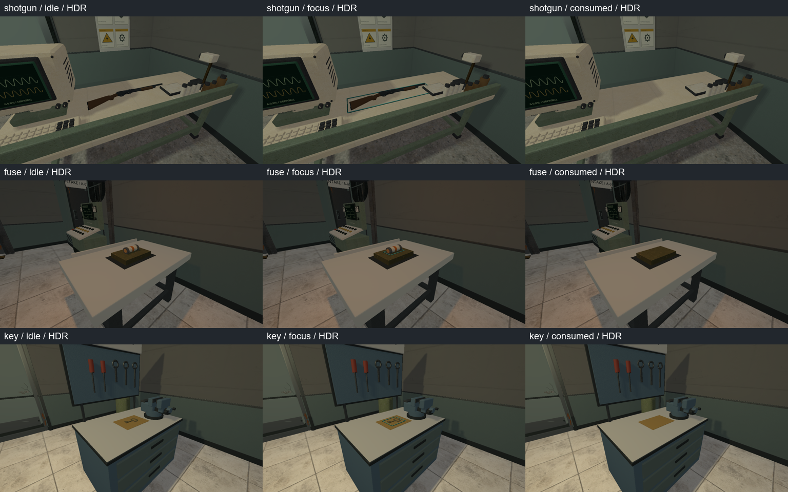
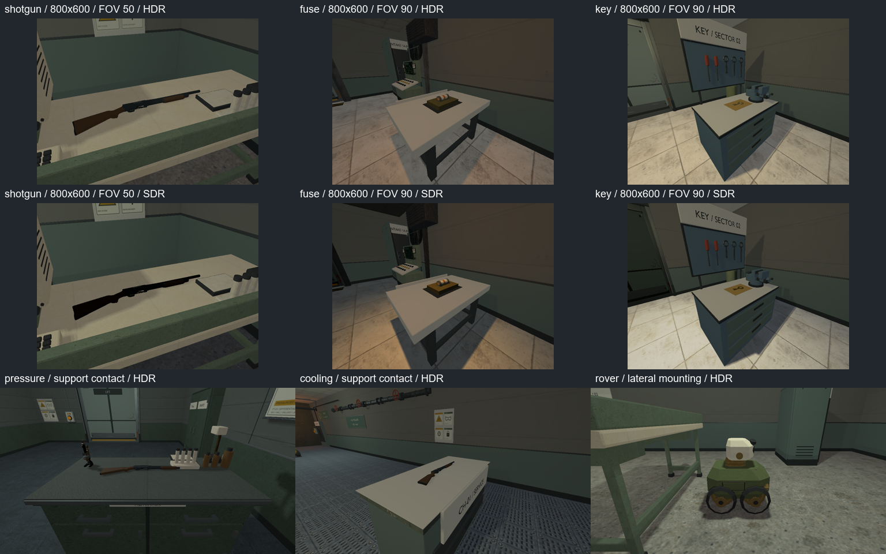
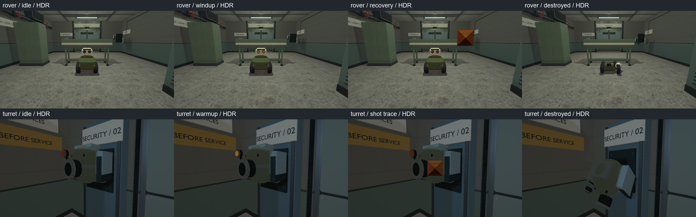
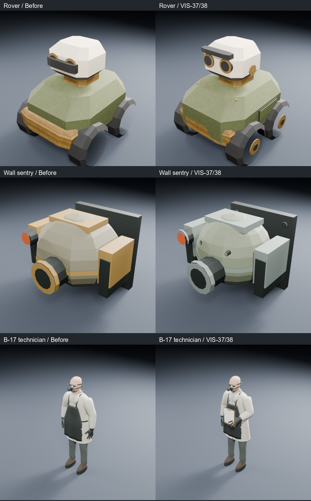
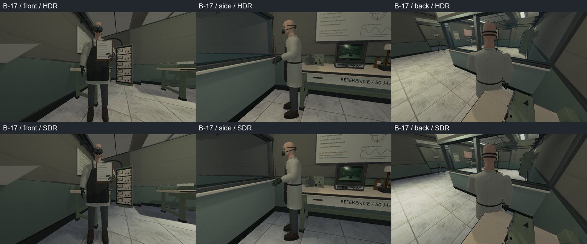

# VIS-36–38 — pickups, охрана и сотрудник B-17

Техническая реализация по поручению автора завершена 2026-10-09;
статус трёх tickets — `awaiting_playtest`. Основание: `ART_DIRECTION.md`,
facility style board и текущие модели. Сохранены gameplay, interaction volumes,
коллизия, урон, таймеры, inventory и совместимость save. Человеческая визуальная
приёмка, непрерывный проход и performance measurements этим отчётом не заявляются.

VIS-36: bare world Stevens 520 экспортируется из тех же исходных body/pump,
что и viewmodel, без рук. Сохранены 1,02 м, 1 586 triangles и четыре материала;
native check сравнивает base-color pixels/dimensions и metallic/roughness с
viewmodel. Дробовик лежит на боку; world и held materials используют sRGB.
Fuse опирается нижней границей модели на подставку. Общая тонкая cyan focus
рамка применяется к shotgun/fuse/key; consumed предмет и рамка исчезают.
Существующий native service key переиспользован; held fuse/key в игре отсутствуют
и здесь не добавлялись.

`pickup_surface_y` — необязательная конечная высота опоры в игровых метрах,
подготовленная renderer из authored entity. Без поля используется нижняя граница
interaction volume. Поле не меняет reach/focus/physics и исключено из save
fingerprint. Четыре карты отличаются от состояния перед задачей только этим
полем: bench shotgun 0,92; cooling shotgun 1,036; pressure shotgun 1,039;
power fuse 1,065 (верх существующей подставки). Нижняя поверхность предмета
на 2 мм выше опоры. Некорректная высота отклоняется с именем поля и номером entity.





VIS-37: у live rover открыты оси/ступицы, оформлены сервисные крышки, крепёж,
толщина оптики и боковые опоры головы. Brow больше не перекрывает линзы.
Бампер/колёсная база укладываются в прежний локальный hit AABB ±0,42 м по X/Z
и 0–0,95 м по Y; windup не поднимает колёса наклоном всего корпуса.
Amber пульсирует при windup, red показывает recovery после melee; destroyed
использует прежнюю разобранную конструкцию без живой оптики. Rover не стреляет.
У wall sentry уточнены mounting fasteners, кольцо оптики, боковые подшипники и
скруглённая sage/steel оболочка. Wreck сохраняет повреждённый силуэт/монтаж;
прежние warmup, shot trace и damaged effects сохранены. OBJ/BMP single-texture
контракт не заменялся PBR-пайплайном.



VIS-38: сохранены анатомическая голова/кисти, goggles, respirator, перчатки и
защитная обувь. Уточнены объём рукава, задний шов/края разреза халата, застёжки
и окантовка фартука. Асимметричная рука поддерживает планшет с листом измерений;
голова слегка повёрнута и наклонена к работе. Фигура остаётся статическим prop,
без NPC/rig/animation. Исходная плотность анатомии сохранена: 156 374 → 157 096
triangles, добавлена только конструктивная детализация и планшет.





Neutral front/back/left/right/top/perspective и fresh import просмотрены в Blender
5.2.2 LTS. [Учёный](vis38-scientist-multiview.png),
[bare shotgun](vis36-world-shotgun-multiview.png). Fresh scientist: 11 materials,
157 096 triangles; shotgun: четыре материала, 1 586 triangles. Invalid/isolated
vertices, degenerate faces, zero-length edges и missing material faces отсутствуют.
Границы на импортированных mesh соответствуют material/UV splits и отдельным
деталям; замкнутая manifold collision из render mesh не заявляется. Live rover
1 660 triangles, wreck 3 858; live/dead turret по 892. Автоматической общей
subdivision ради количества полигонов не было.

Исходники: `scripts/export-shotgun-view-glb.py`, `content/models/shotgun_view.blend`
и `shotgun_world.glb`; `scripts/build-security-{rover,turret}.py` и соответствующие
`assets/models/security_*`; `scripts/author-scientist.py` через существующий
`scripts/export-native-lab-glb.py`, `content/models/scientist_hazmat.blend/.glb`.
Renderer changes находятся в `world_scene_renderer.{h,cpp}`,
`world_scene_renderer_interactives.cpp` и `world_scene_renderer_props.cpp`; native declaration —
`cmake/RelayCoreModelAssets.cmake`. Новые regressions находятся в
`render_authoring_config_tests.cpp`, `save_game_tests.cpp`, `native_lab_tests.cpp`
и `power_restoration_graphics.cpp`.

Проверки выполнялись в MSVC x64 Developer PowerShell. Основные команды:

```powershell
cmake --build --preset demo-debug --target relaycore_demo relaycore_power_restoration_graphics relaycore_vulkan_mesh_tests relaycore_content_validation relaycore_tests relaycore_level_check
cmake --build --preset demo-relwithdebinfo
ctest --preset test-debug -R '^relaycore.(pickup support|save compatibility|shotgun|player fire|tooling.model_assets)' --output-on-failure --no-tests=error --output-junit vis36-38-unit.xml
ctest --preset validation-debug -R '^validation.(world shotgun|B17 laboratory|sandbox shotgun|pressure transfer continue|power restoration requires|cooling loop gates)' --output-on-failure --no-tests=error --output-junit vis36-38-content.xml
ctest --preset graphics-debug -R '^graphics.(character_pickups|resource_preparation|shotgun_viewmodel|game_lifecycle)' --output-on-failure --no-tests=error --output-junit vis36-38-graphics.xml
ctest --preset graphics-debug -R '^graphics.character_pickups' --output-on-failure --no-tests=error --output-junit vis36-38-final-graphics.xml
```

Итог — **20 различных проверок проходят**: 9 unit/tooling, 6 content и 5 graphics.
Три resource/viewmodel/lifecycle graphics прошли в первом прогоне; два новых
character cases — в финальном повторе. Первые captures обнаружили неверную
опору fuse внутри подставки: исправлена высота 1,065. Test camera турели
перенесена из-за стены в известный pump-room ракурс; rear camera учёного
поставлена над существующим calibration bench: видны спина и пояс халата,
нижняя часть фигуры перекрыта столом; полный задний силуэт проверен в neutral
multiview. Эталоны/допуски не ослаблялись.
Финальные HDR/SDR — 58 кадров, без skips и Vulkan validation warnings/errors
(RTX 4060 Ti). Pickups проверены при FOV 50/70/90°, 1280×720 и 800×600;
state pixels различаются, consumed снижает число usable draw calls.
Эти checks не заменяют полный historical graphics suite и не снимают отдельное
старое расхождение power scene baseline, записанное в VIS-35.

Debug и обычный optimized Play обновлены. По 71 model receipt/product/staged hash
проверено `scripts/check-model-assets.ps1` в каждом дереве; новые native products
совпадают между конфигурациями. B-17 probe пересчитан оптимизированным baker:
18 probes / 293 235 triangles / 8 lights, signature `8427271552463004708`;
оба дерева повторно проверили signature и переиспользовали product.
Bench/native_lab probes переиспользованы при неизменных inputs.
Check Map шести карт (bench, cooling, pressure, power, B-17, intake) успешен,
`warnings=[]`. Python source/map/bounds invariants и `git diff --check` проходят.

Логи/JUnit: `build/vis36-38/{unit,content,graphics,final-graphics}.log`,
`build/msvc-debug/vis36-38-*.xml`; source/fresh metrics и нейтральные кадры —
`build/vis36-38/{before,after}` и `*-metrics.json`; runtime originals —
`build/msvc-debug/tests/power-captures/{hdr,legacy}/shadows/vis3*.bmp`.
Прежние пользовательские изменения сохранены; commit и архив не создавались.
