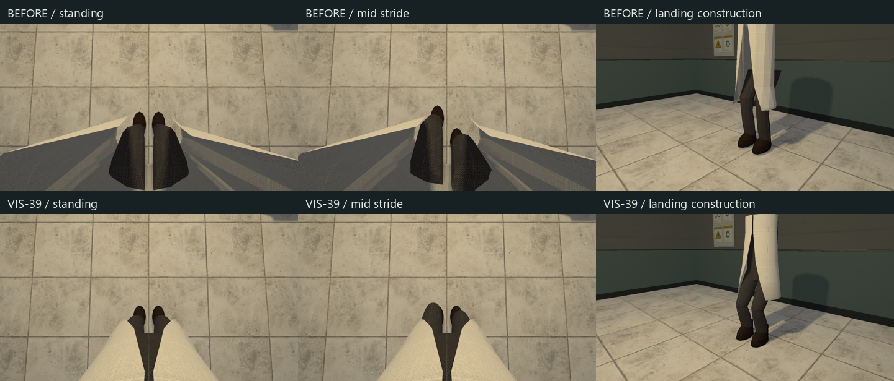
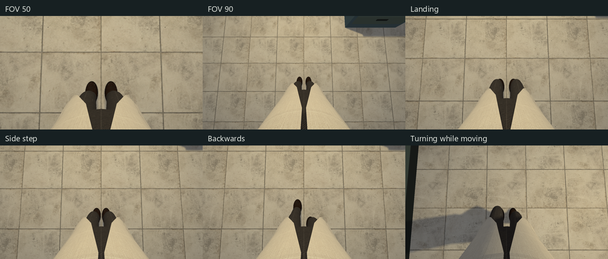

# VIS-39 — процедурное тело игрока

2026-10-09. Прямое поручение автора: VIS-39; продолжение «доделывай».
Статус: `awaiting_playtest` — реализация и техническая проверка завершены,
авторская оценка в непрерывном движении остаётся открытой.

Тело первого лица сохранено процедурным. Статический `scientist_hazmat`
из B-17, native models, карты, collision, оружие и save schema не изменены.
Визуальный ориентир — существующая лабораторная одежда и
[ART_DIRECTION.md](../ART_DIRECTION.md).

## Результат



- Халат получил внутреннюю поверхность с толщиной 3 мм, закрытые передние
  кромки и подол, более плавный профиль и сглаженные нормали. Внутренняя одежда
  закрывает прежние видимые торцы бёдер. Положение тела относительно глаз
  исправлено по кадрам: верх одежды не перекрывает колени и ботинки.
- Бёдра и голени получили округлённые профили и перекрытие на колене;
  низ брюк перекрывает верх ботинка. У ботинок уточнены носок, голенище,
  подошва и посадка четырёх рядов шнуровки.
- Отдельный расчёт двух звеньев сохраняет длины бедра/голени 0,40/0,38 м.
  Подъём чередуется между стопами; хотя бы одна подошва остаётся на высоте
  корня игрока. При приземлении корпус опускается на 55 мм, колени сгибаются,
  опорная подошва не проваливается в плоскость пола.
- Визуальная походка использует горизонтальное направление фактического
  перемещения: назад и вбок больше не изображаются движением только вперёд.
  Боковой шаг ограничен формой походки, чтобы ботинки не пересекались.
  Поворот следует yaw камеры; её pitch не наклоняет тело.
- Cotton/Twill/Leather/Rubber и существующие object-space material coordinates
  переиспользованы; shader не менялся. Геометрия создаётся при инициализации,
  а во время движения меняются матрицы семи прежних draw items.



## Исходники

- [world_scene_renderer_props.cpp](../../src/relaygame/world_scene_renderer_props.cpp):
  loft surfaces, подол, одежда, ботинки и подача матриц в render queue.
- [scientist_pose.cpp](../../src/relaygame/scientist_pose.cpp) и
  [scientist_pose.h](../../src/relaygame/scientist_pose.h): детерминированные
  transforms тела, двухзвенная поза ног и положение относительно камеры.
- [player_feedback.cpp](../../src/relaygame/player_feedback.cpp), его header и
  [game_world_runtime.cpp](../../src/relaygame/game_world_runtime.cpp): направление
  перемещения для отображения тела. Footstep cadence, camera motion,
  controller и gameplay timing сохранены.
- [scientist_pose_tests.cpp](../../tests/scientist_pose_tests.cpp),
  [player_experience_tests.cpp](../../tests/player_experience_tests.cpp) и
  [power_restoration_graphics.cpp](../../tests/power_restoration_graphics.cpp):
  проверки и воспроизводимые кадры; новые файлы зарегистрированы в CMake.

## Проверки

MSVC developer environment из существующего `CMakeUserPresets.json`,
`VCPKG_ROOT=E:/Code/vcpkg`; существующие build trees переиспользованы.
Сборка/GPU-проверки выполнены вне sandbox: sandboxed MSVC build зависал
и выдавал C1902 при доступе к program database manager.

```powershell
cmake --build --preset demo-debug --target relaycore_power_restoration_graphics relaycore_tests relaycore_demo -j 4
cmake --build --preset demo-relwithdebinfo -j 4
ctest --preset test-debug -R 'relaycore\.(player body|body travel|footsteps|footstep material)' --output-on-failure --no-tests=error --output-junit vis39-unit.xml
ctest --preset graphics-debug -R '^graphics\.player_body' --output-on-failure --no-tests=error --output-junit vis39-body.xml
git diff --check
```

**7/7 выбранных checks проходят:** 5 unit/locomotion и 2 graphics, без skips;
NVIDIA GeForce RTX 4060 Ti, `validation=true`, без validation warnings/errors.
Debug и optimized Play собраны. Optimized graphics execution отдельно
не заявляется; полный исторический graphics suite не запускался.

Unit sweep проверяет 1 152 комбинации направления, stride, phase и landing:
стык бедро/голень и голень/ботинок с допуском 0,01 мм, отсутствие провала
подошвы ниже корня, опорную подошву и разделение ботинок. Отдельно проверены
yaw/pitch и сохранение travel direction при остановке/сбросе.

Сохранены 60 исходных HDR/SDR кадров в `build/vis39/before`.
Финальный fixture создаёт **100 кадров** в
`build/msvc-debug/tests/power-captures/body-{hdr,sdr}`: idle/hidden,
FOV 50/70/90°, восемь фаз шага с видами вниз и сбоку, четыре направления
перемещения, два уровня приземления и четыре поворота стоя/в движении.
Просмотрены контактные листы обоих color modes и отдельные крупные кадры;
в проверенных видах заметных отверстий и пересечений не осталось.
JUnit — `build/msvc-debug/vis39-{unit,body}.xml`, build logs и промежуточный
visual review — `build/vis39`. Это локальные игнорируемые evidence files.

Непрерывная авторская оценка походки/поворота и одежды остаётся открытой.
Техническая опора здесь означает высоту корня на ровном полу: terrain foot IK,
world-space фиксация стопы, лестницы, скелетная анимация и NPC не добавлялись.
Архивы не создавались; другие VIS tickets этим проходом не закрываются.
