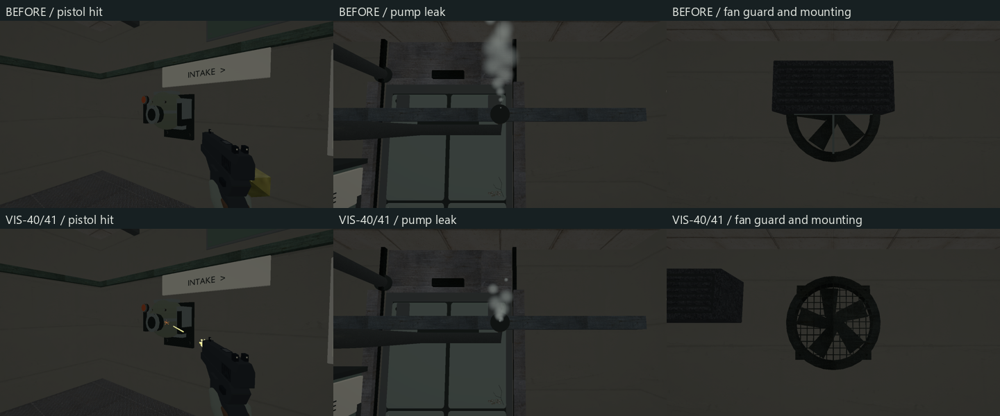
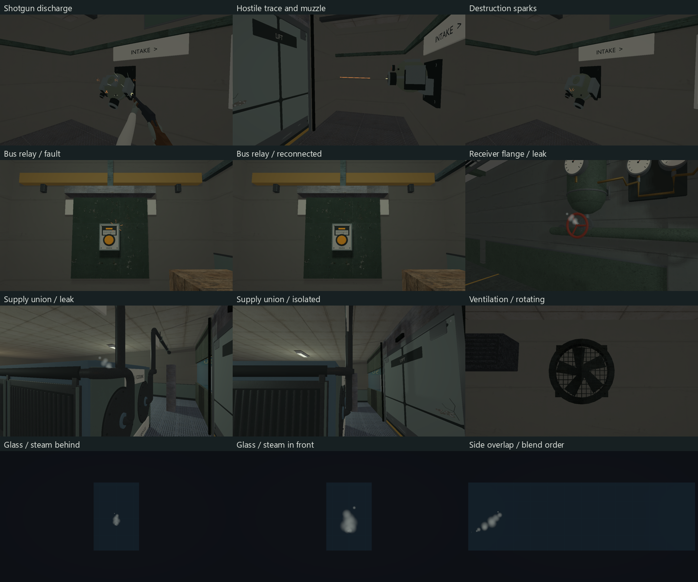

# VIS-40–41 — combat and equipment effects

2026-10-09, direct request for VIS-40 and VIS-41. Both tickets are technically
implemented and remain `awaiting_playtest` for the owner's assessment in combat
and continuous movement. This pass uses the existing meshes, render passes,
query surfaces and environment targets.



## VIS-40

- The pistol's 45 mm travelling block becomes a fading 9 mm streak, capped at
  45 cm and visible for 65 ms. Hostile streaks are 11 mm / 55 cm / 80 ms;
  pellets are 4 mm / 16 cm / 55 ms. These are visual limits; hitscan, ranges,
  damage, cadence and the existing transient timers are unchanged.
- Pistol and shotgun flashes use the same recoil transforms and actual bore
  coordinates as their native viewmodels, for 45/55 ms. The turret receives a
  short barrel flash. Effects use the existing emissive material path and depth
  testing, with no new dynamic-light or particle system.
- Traces retain an optional current-query hit. Metal contacts produce small
  orange sparks; hard surfaces produce shorter pale flecks along the hit normal.
  Turret and rover contacts use their existing hit bounds. A range miss has no
  impact, and a subsequent miss clears the preceding shot's impact. The surface
  classification is shared with existing impact audio.
- Turret hit and destruction timers drive compact ballistic bursts; destruction
  no longer submits three full hostile shot traces. Transient impact data is not
  added to disk saves.

## VIS-41

- Ten soft puffs begin 12 mm from the source, move along its authored direction,
  rise and spread within a smaller plume. Their original exponential shutdown
  remains intact. Steam stays in the existing sorted transparent pass.
- Pressure steam now begins at a receiver isolation flange; cooling steam begins
  at the exchanger's supply union. Power's pump union and spill outlet remain the
  existing sources. Stop targets are preserved.
- Electrical bursts use small three-dimensional streaks instead of flat strips,
  preserving the 3.2 s rhythm. Two power sources move out of their panel housings;
  restoration/reconnection still stop them immediately. The sandbox source remains
  the existing blockout equipment fixture.
- All six existing fans receive a fixed open wire guard, mounting tabs and
  fasteners in front of the rotor. Three overlapping ventilation cassettes move
  beside their fans: two in cooling and one in foundation pump. Fan startup,
  rotation and coast-down retain their existing timing and power targets.



Only decorative effect origin/orientation and three noncolliding vent prop
positions change in maps. The four changed TOMLs retain their solids, gameplay
entities, entity order, mission/retry/save data, targets, lights and collision
products. No models, textures, shaders, dependencies or authored format change.
This does not add particle collision simulation; opaque depth testing and compact
placements handle the inspected surface contacts.

## Verification

The existing MSVC developer environment and `VCPKG_ROOT` were used. Debug has
Vulkan validation enabled. Final builds:

```powershell
cmake --build --preset graphics-debug --target relaycore_power_restoration_graphics relaycore_vulkan_mesh_tests relaycore_tests relaycore_demo relaycore_content_validation -j 2
cmake --build --preset demo-debug --target relaycore_demo relaycore_power_restoration_graphics -j 2
cmake --build --preset demo-relwithdebinfo -j 2
```

32 distinct selected checks pass: 20 unit regressions, eight affected-map content
checks and four graphics gates. The unit/content selection checks blocking doors,
nearest contacts, a hit followed by a miss, pellet behavior, enemy cadence,
persistence, environment timing, routes, repairs and snapshots:

```powershell
ctest --preset test-debug --output-on-failure --no-tests=error -R '^relaycore\.(combat |player fire |a missed shot|shotgun |weapon impacts |environment |lamp fixtures |rover |nonlethal hits)|^validation\.(cooling loop (service|gates|isolation)|pressure transfer (wall equipment|complete route|stops)|power restoration (requires|can finish))'
ctest --preset graphics-debug --output-on-failure --no-tests=error -R '^graphics\.(world_effects(_sdr)?|pistol_viewmodel|shotgun_viewmodel)$'
ctest --preset graphics-debug --output-on-failure --no-tests=error -R '^graphics\.world_effects(_sdr)?$'
```

The last two environment gates were rerun after the final placement/camera fixes.
Graphics JUnit reports have zero failures and skips, and the validation warning/error
failure expression is clean. Pistol/shotgun gates cover HDR/SDR, FOV 50/70/90°,
640×360 and 800×600, reticle clearance, recoil recovery and prepared weapon switching.

Each final effects mode records 141 frames at 1280×720: 13 sources with off,
four phase samples, side, coast and stopped states; 34 combat/contact/miss states;
three glass/steam overlap views. The existing pixel comparison verifies that
side-view steam/glass blend in the expected order. Source visibility and stopping
also have executable assertions. Fixed cameras and source/side contact sheets were
reviewed in HDR and SDR; screenshots do not establish moving-player readability.

Check Map reports `valid=true`, zero warnings for power, pressure, cooling and foundation pump.
The four changed maps' Debug and Play staged hashes match source. A semantic TOML
comparison against the starting Git versions permits only the decorative spatial
changes described above. `git diff --check` passes.

Local logs, JUnit, baseline images and review scripts are in
`build/vis40-41`; final raw captures are in
`build/msvc-debug/tests/power-captures/effects-hdr` and `effects-sdr`.
The initial baseline capture helper quit SDL before renderer destruction and
reported a teardown warning; that helper was fixed before the final gates.
Baseline images are visual evidence, not a passed validation gate.

## Changed owners and remaining acceptance

`combat_runtime.{h,cpp}` retain query contacts; `enemy_runtime.cpp` supplies robot
contacts; `player_feedback.{h,cpp}` owns the shared material classification.
`world_scene_renderer{,_interactives,_environment}.{h,cpp}` owns the visuals.
The four map TOMLs own placement. Existing combat, enemy and weapon tests plus
`power_restoration_graphics.cpp` / `tests/CMakeLists.txt` own regressions/captures.

The owner still needs to judge threat direction, hits versus misses, effect strength
and duration at combat distance, and leak/repair readability while moving. External
playtest/GPU acceptance and measured performance are not claimed. VIS-42 and broader
equipment state presentation remain outside this request.
