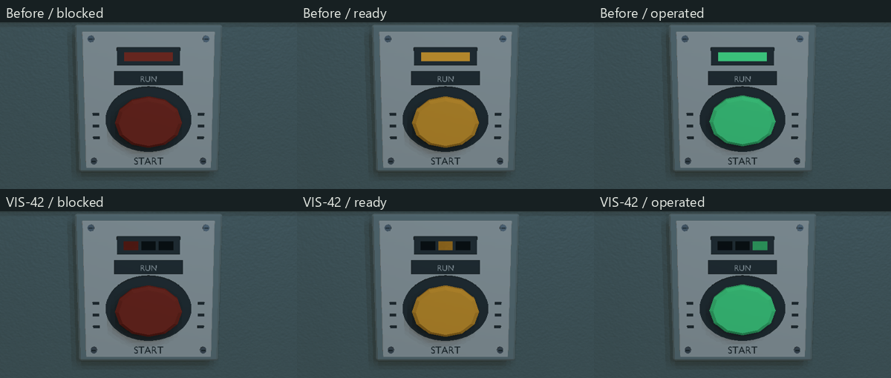
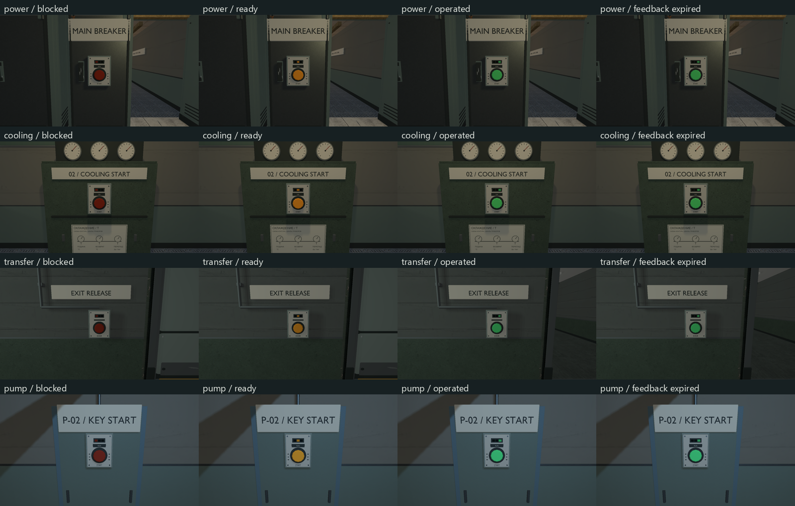

# VIS-42 — equipment state presentation

Scope authorized by the owner on 2026-10-09: review visible equipment states
outside the HUD, and improve only the feedback needed to read existing operations.

## Result

The four existing native panel housings retain their actuator and labels. Their
single colored indicator is now three separated lenses in the same recessed
window: left red for blocked/denied, centre amber for ready, right green for
operated. Only the active lens uses the existing light-strip material; the other
two remain dark. Focus brightens the ready actuator. Success retains the existing
pressed actuator, including after a consumed single-use control's feedback expires.
Position supplements color without adding screens, particles or another state system.



The state selection still consumes the existing `locked`, `requirement_met`,
`consumed` and transient feedback fields. A red panel means its interaction is
blocked; it does not claim that every blocked control represents an electrical
power failure. A green isolator means its operation completed, while a green
start control means its authored activation completed. Their existing labels and
the connected world equipment distinguish those meanings.

Existing VIS-40/41 feedback supplies the remaining state pairs: lamps and fans
respond to power/start targets, leaks and electrical sparks stop on repair or
isolation, fans coast after shutdown, and the turret switches to its wreck model
on destruction. These consumers were reviewed again without changing their logic.

## Fixed-camera evidence

The existing hardware graphics gates now also execute actual interaction chains:

| Map / control | Blocked → ready | Ready → operated |
| --- | --- | --- |
| `power_restoration` / power breaker | Collect fuse, isolate line, reconnect bus | Restore sector power |
| `cooling_loop` / start control | Operate cooling isolator | Start cooling |
| `pressure_transfer` / exit reader | Start pressure transfer | Open exit |
| `foundation_pump` / pump control | Supply the carried service key | Start pumps |

Each sequence captures blocked, ready, operated and expired-feedback states from
the same camera. Assertions check prerequisites, applied interactions, consumed
controls and activated targets; blocked/ready/operated frames must differ, and
the operated/expired frames must match. The service key represents inventory
carried from the preceding foundation chapter, not a newly placed pickup.



The existing hardware views additionally cover all four panel roles in ready,
focused, blocked, warning, success and consumed states, plus three door families
closed, travelling, open and from the reverse side. The world-effects gates cover
13 sources with stopped/running/coasting phases, repair/isolation and turret
live/destruction captures, including transparent overlap.

## Verification and remaining acceptance

Debug runtime, unit tests and the affected graphics target were rebuilt using
the existing MSVC developer environment and `VCPKG_ROOT`:

```powershell
cmake --build --preset graphics-debug --target relaycore_power_restoration_graphics -j 2
cmake --build --preset graphics-debug --target relaycore_power_restoration_graphics relaycore_tests relaycore_demo -j 2
ctest --preset test-debug --output-on-failure --no-tests=error -R '^relaycore\.(usable interaction returns denial|single-use usable returns activation|apply usable interaction records activated|environment reacts)|^validation\.(cooling loop (service|gates|isolation)|power restoration (requires|can finish))' --output-junit vis42-unit-content.xml
ctest --preset graphics-debug --output-on-failure --no-tests=error -R '^graphics\.(interactive_hardware|world_effects)(_sdr)?$' --output-junit vis42-graphics.xml
git diff --check
```

All nine selected unit/content checks and four graphics checks pass. Graphics
JUnit records zero failures and skips, with no validation warning/error matched
by the gates. Reviewed comparison sheets cover panel roles and the four actual
operations in both modes, plus representative fault/isolation, fan and turret
states. Final captures total 104 hardware frames and 282 world-effects frames.
The existing hardware SDR gate uses the non-HDR legacy-gamma pipeline; the
world-effects SDR gate uses non-HDR hardware-sRGB. HDR gates use hardware-sRGB.
`git diff --check` passes.

Local baseline images, logs and review sheets are in `build/vis42`; final raw
captures are in `build/msvc-debug/tests/power-captures`. The baseline hardware
check passed before this change. Sandboxed execution initially failed on asset
path canonicalization with `Access is denied`; the checks use approved execution
outside that sandbox. JUnit files are under `build/msvc-debug`.

Changed owners are `world_scene_renderer_props.cpp` for panel geometry and
`power_restoration_graphics.cpp` for actual-operation captures and assertions.
Maps, models, gameplay/save data and authored formats are unchanged by VIS-42.
Earlier in-progress VIS work remains in the working tree.

Technical fixed-camera review does not establish readability during continuous
play. Owner acceptance of the indicator positions, interaction distance and
world-state cues remains open (`awaiting_playtest`). No new optimized build,
external-GPU acceptance or performance measurement is claimed.
