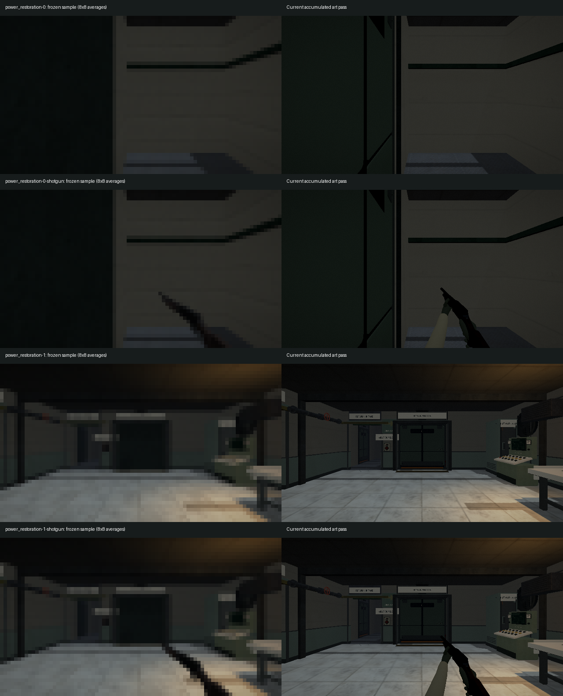
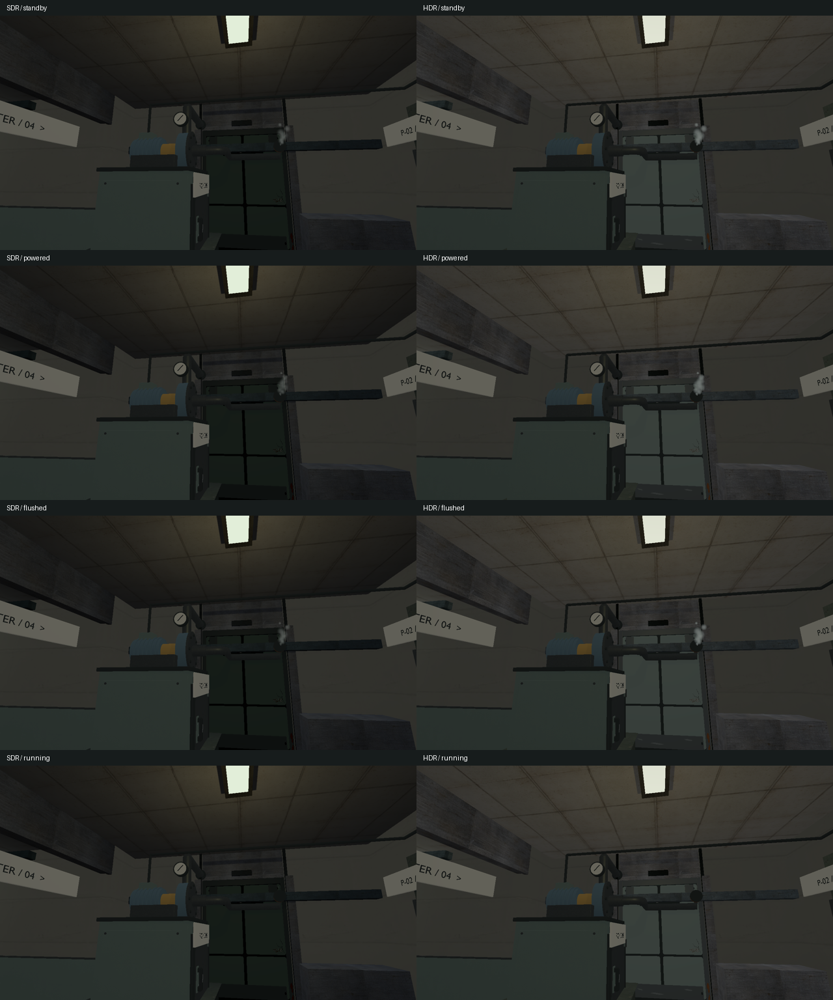

# VIS-48–49 — measured cost and accumulated-art review

2026-10-09. Owner request: VIS-48 and VIS-49. VIS-48's local cost assessment is
complete. VIS-49's graphics investigation and review preparation are complete;
continuous movement/combat and subjective acceptance remain `awaiting_playtest`.

## VIS-49: cause and reference update

Rebuilt `relaycore_vulkan_mesh_tests` and reproduced the recorded failure exactly:
`power_restoration-0`, mask diff **0.00361111**, color diff **0.368056**, mean RGB
delta **4.05567**, before any viewmodel is drawn. The sandbox attempt instead
failed at `filesystem::canonical(service_cylinder.obj)` with access denied;
the actual reproduction and final graphics checks ran outside the sandbox.

The frozen RCG1 reference is authoritative. The older full-resolution BMPs in
`build/visual-revamp/power/accepted-samples` do **not** encode to the current
reference: the later color audit updated its tile sums. They must not be presented
as the current accepted baseline. The figure reconstructs the frozen reference's
8×8 averages on the left and shows the current full-resolution frame on the right.



The scene-only mismatch is concentrated on the **VIS-17 door**, not the wall
material or weapon: all **13** differing coverage tiles and **1,325** color tiles
over the existing threshold lie at x < 280 (35 tile columns). The remaining
2,025 wall-side tiles have zero coverage/color failures and mean RGB delta 0.451.
The old `render_doors` in `9366e8e` submits a single box; current code submits the
native leaf and stationary guides. The reviewed frame shows those panel edges,
rails and recesses precisely where the failed tiles lie. This comparator's
coverage metric tests nonzero RGB; it is not a direct collision/silhouette metric.

Preserved-input controls used the current executable, pre-material-pass assets,
pre-door map and reconstructed old intake/service GLBs. They retained the native
door submission in current C++, so they could not reproduce the old complete
scene. Their first-scene deltas (0.00361111 / 0.3675 / 3.8014) support the minor
material contribution but are **not** a passing historical-renderer control.
The legacy import-mode experiment also failed and was discarded. These isolated
controls did not modify shipped assets, source code, shaders or receipts.

The two shotgun views also intentionally contain VIS-35's hands and changed
viewmodel silhouette/materials. The second scene camera shows the later door,
panel, pipe and sign detail. Every current frame was inspected before replacing
its individual sample. Recorded pre-update deltas:

| Sample | Mask diff | Color diff | Mean RGB delta |
| --- | ---: | ---: | ---: |
| power_restoration-0 | 0.00361111 | 0.368056 | 4.05567 |
| power_restoration-0-shotgun | 0.00722222 | 0.411111 | 5.00607 |
| power_restoration-1 | 0 | 0.0222222 | 0.617733 |
| power_restoration-1-shotgun | 0.00333333 | 0.0722222 | 4.76748 |

Only these four `.rcgb` files were updated. Original samples, current BMPs,
region analysis and individual comparison figures remain in `build/vis48-49`.
Normal comparison thresholds and culling/reload/presentation assertions remain.

Final CTest: **3/3 passed, zero skips/failures**, covering the power slice and both
weapon viewmodels. All four power comparisons have zero mask/color/RGB delta.
Additional existing `--power-views-only` runs passed in SDR and scene HDR;
standby → powered → flushed → running captures were reviewed from the same camera.
No Vulkan validation warning/error was found in these executed checks. Scene HDR
still presents through SDR; this is not physical HDR10-display evidence.



## VIS-48: one current measurement

Reused the H-008 workload, not a new profiling cycle: optimized
`relaycore_bench_relay_run --pressure-transfer --profile`, two passes of
entry/distance/cover/powered, two seconds per state. It exercises real
update/render/UI/present using isolated temporary saves after its CPU route checks;
it does not measure a continuously moving player. Loading and first-use are separate.

Windows, RTX 4060 Ti 8188 MiB, GPU API 1.4.329, driver 596.49;
`msvc-relwithdebinfo`, Tracy 0.14.1, 1280×720, VSync off, hardware sRGB,
scene HDR/exposure 0, shadows on, audio off, validation=false. Revision `c8acf15`
plus the existing VIS-39–46 working tree. No build or other GPU workload ran during
capture. OS/driver caches were not cleared. This is not a cold-cache measurement.

All times below are milliseconds. Warm excludes the first frame of each state;
GPU statistics include all intervals inside that state. Draws/triangles are the
runner's final world diagnostics, not the total scene+UI GPU draw count.

| Pass / state | Frames | Loading | First frame | Warm p50 / p95 / p99 | GPU Scene p99 | Scene fences p99 | Draws / triangles |
| --- | ---: | ---: | ---: | --- | ---: | ---: | --- |
| 0 / entry | 704 | 702.542 | 14.439 | 2.611 / 5.205 / 5.950 | 3.553 | 4.260 | 238 / 157235 |
| 0 / distance | 866 | 79.105 | 3.555 | 2.204 / 2.922 / 3.579 | 1.687 | 2.220 | 238 / 157235 |
| 0 / cover | 934 | 69.409 | 3.029 | 2.055 / 2.584 / 2.931 | 1.485 | 1.649 | 236 / 158328 |
| 0 / powered | 1106 | 64.463 | 3.319 | 1.669 / 2.462 / 3.318 | 1.195 | 1.661 | 218 / 157222 |
| 1 / entry | 637 | 78.880 | 3.847 | 2.710 / 5.836 / 6.756 | 4.063 | 4.947 | 238 / 157235 |
| 1 / distance | 642 | 86.456 | 5.599 | 2.637 / 5.905 / 6.321 | 4.076 | 4.701 | 238 / 157235 |
| 1 / cover | 768 | 87.594 | 3.833 | 2.447 / 3.360 / 5.876 | 3.518 | 4.169 | 236 / 158328 |
| 1 / powered | 803 | 78.803 | 2.751 | 2.086 / 5.134 / 5.725 | 3.329 | 4.122 | 218 / 157222 |

6,460 frames. No gameplay-frame mesh uploads. Eight gameplay-frame texture uploads
are all nested inside `RmlUi atlas upload`: six in the first entry frame (0.774 ms
upload + 1.248 ms waits), two in the first powered frame (0.199 + 0.229 ms).
Every warm frame has zero mesh/texture uploads and upload waits. Geometry/font
preparation costs and allocations are different questions; allocations were not
instrumented. First loading contains 682 mesh and 160 texture uploads; upload/wait
intervals are nested in resource preparation and must not be added to loading.

World passes p99 spans 0.784–3.170 ms; viewmodel 0.041–3.021 ms; shadows
0.206–0.389 ms; RmlUi GPU 0.008–0.012 ms. These nested/overlapping p99 values
cannot be summed with Scene or CPU fence intervals. The spread between passes is
material; no particular kit family or clock/scheduling cause was isolated.

[H-008](../profiling/H-008-2026-10-08.md) recorded 116–136 world draws and warm p99
1.570–2.112 ms for its older scene/UI. Current world draws are 75–88% higher in
the corresponding states. That is an observed scene-complexity increase, not a
controlled FPS regression attributable to one family: content, weapons/body,
effects and UI changed. The historical bay 104→118 draws / 72,166→83,777 triangles
remains only a one-camera geometry comparison.

Decision: retain the existing kit at its current authored use. Do not extrapolate
this result into permission for unlimited repetition or a lower-end hardware budget.
Before expanding room density, measure that specific changed scene at matching
settings. No speculative optimization or renderer/pipeline change was made.
Continuous sound-on performance, agreed target FPS and weaker hardware remain H-008
acceptance, not completed by this local VIS-48 assessment.

## Short owner review route

Use the normal current build. In the main menu choose **«Перепуск давления»** and
start its route. New-game confirmation has the existing save-replacement behavior;
use a disposable save/profile if retaining progress is necessary.

1. At the entry table, look at the shotgun and its support/focus, collect with E,
   and verify disappearance. Switch 1/2; fire once with each and watch recoil/recovery.
2. In the safe bay, look down, walk W/S/A/D, turn, and jump/land with Space.
   Judge VIS-39's body/camera contact in continuous motion. Its procedural transforms
   have no world-space foot lock, terrain IK or skinning.
3. Open the service gate, approach/reverse around the rover and cover, then use
   the gallery control. Watch weapon/hit/hurt feedback during the encounter.
4. In the mixed hall, compare the low bench and tall cabinet sightlines, the turret
   and controls under work/emergency light. Observe the transfer control before use,
   focused, after use and after transient feedback expires.
5. Start transfer, revisit the same control/equipment view, then inspect the exit
   reader and door from both sides. Check stopped/running effects and label agreement.
6. Repeat the relevant view through Settings → SDR/HDR. Record map/location, state,
   image mode and the visible problem; send movement/combat issues to their owning
   VIS ticket. No continuous human observations have yet been supplied.

For power equipment, the new paired figure supplies the narrowly rerun states.
Reuse [VIS-39 body evidence](vis39-player-body.md),
[VIS-40–41 combat/environment states](vis40-41-combat-environment-effects.md) and
[VIS-42 real control chains](vis42-equipment-states.md) for other already captured
questions. B-17 remains a static prop consumer (VIS-38), VIS-39 remains the limited
first-person body. A full animated character requires its own scoped rig/animation
ticket; this review does not extend the temporary gait or remodel the scientist.

## Reproduction and retained evidence

Builds used the existing VS developer environment and configured vcpkg root.
The first optimized build hit sandbox MSVC C1902; the completed build ran outside it.

```powershell
cmake --build --preset graphics-baseline-debug -j 2
cmake --build --preset demo-relwithdebinfo --target relaycore_bench_relay_run -j 2
cmake --build --preset demo-debug --target relaycore_demo relaycore_power_restoration_graphics -j 2
ctest --preset graphics-debug -R '^graphics\.(power_restoration_slice|pistol_viewmodel|shotgun_viewmodel)$' --output-on-failure --no-tests=error --output-junit vis48-49-final.xml
# From build/vis48-49, then its sdr/ subdirectory for separate retained SDR images:
$env:RELAYCORE_ASSET_ROOT = 'E:/Code/C++/RelayCore/build/msvc-debug/src/relaygame/assets'
E:/Code/C++/RelayCore/build/msvc-debug/tests/relaycore_power_restoration_graphics.exe --hdr --power-views-only
E:/Code/C++/RelayCore/build/msvc-debug/tests/relaycore_power_restoration_graphics.exe --power-views-only
# Separate Tracy capture process; runner cwd build/msvc-relwithdebinfo/tests:
build/profiling/tracy-0.14.1/tracy-capture.exe -o build/vis48-49/current.tracy -s 25
$env:RELAYCORE_ASSET_ROOT = 'E:/Code/C++/RelayCore/build/msvc-relwithdebinfo/src/relaygame/assets'
./relaycore_bench_relay_run.exe --pressure-transfer --profile
git diff --check
```

Working evidence: `build/vis48-49/{build-*,power-before-outside,power-review-*,
graphics-final,power-sdr,power-sdr-retained,power-hdr,profile,capture}.log`,
`profile-exit.txt` (workload=0, capture=0), `current.tracy`, CPU/GPU CSV exports,
`current-analysis.json`, `atlas_check.py`, `compare_regions.py`, `review_sample.py`;
JUnit `build/msvc-debug/vis48-49-final.xml`.

| Input / artifact | SHA-256 |
| --- | --- |
| Optimized runner | `F74A9487C350470FDC91C055F7B7CD80EB59C245B65FBCA13291B58A7F67D0B3` |
| Source and staged pressure map | `06D1D63D91A3609774FF3DD176595C94AD463B5EA729C328FA18FA3C5EE31698` |
| engine.toml | `7983447D21516006CDC2CEA6DDD30502290E1D4A07DF4A16631DF6EBF726BC1B` |
| render_authoring.toml | `47F541C9B467F1226CA1E541DD8163EAC5D1CCDF2C4AD540F7D696E85373B4DE` |
| Tracy capture | `82922E41064270BE93A88F128D8A54118D38B6A289D0667D574179A0F47123C6` |

No full graphics-suite pass, author playtest, other-PC result, archive or release is claimed.
